# Lab 05 – Implement Intersite Connectivity


## 📌 Lab Overview

This lab focuses on implementing **connectivity between Azure virtual networks**. It demonstrates how separate virtual networks can be connected using **Virtual Network Peering**, how connectivity can be diagnosed using **Azure Network Watcher**, how Azure PowerShell can be used to verify private connectivity, and how **User Defined Routes (UDRs)** can be configured to control traffic flow.

The lab uses two separate network environments:

* **CoreServicesVnet** – `10.0.0.0/16`
* **ManufacturingVnet** – `172.16.0.0/16`

Two Windows Server virtual machines are deployed:

* **CoreServicesVM**
* **ManufacturingVM**

Initially, these virtual machines are located in separate virtual networks and cannot communicate with each other. VNet peering is then configured to establish private connectivity between the networks.

The final part of the lab introduces a **perimeter subnet, route table, and custom route** that can be used to direct traffic through a future Network Virtual Appliance (NVA).

---

# 🎯 Learning Objectives

By completing this lab, I learned how to:

* Create Azure virtual machines with virtual networks.
* Configure VNet address spaces and subnets.
* Create separate virtual network environments.
* Diagnose network connectivity using Azure Network Watcher.
* Understand connectivity limitations between unpeered VNets.
* Configure bidirectional VNet peering.
* Verify VNet peering status.
* Test private IP connectivity using PowerShell.
* Configure a perimeter/DMZ-style subnet.
* Create an Azure Route Table.
* Configure a User Defined Route.
* Configure a virtual appliance as a next hop.
* Associate a route table with a subnet.
* Understand how custom routes can control Azure network traffic.

---

# 🏗️ Architecture

The lab consists of two separate virtual networks.

```text
                         Azure Subscription
                              az104-rg5
                                   |
                ┌──────────────────┴──────────────────┐
                │                                     │
        CoreServicesVnet                       ManufacturingVnet
          10.0.0.0/16                            172.16.0.0/16
                │                                     │
          Core Subnet                         Manufacturing Subnet
          10.0.0.0/24                            172.16.0.0/24
                │                                     │
        CoreServicesVM                       ManufacturingVM
                │                                     │
                └──────────── VNet Peering ────────────┘
                                   │
                         Private Connectivity
```

### Architecture Diagram

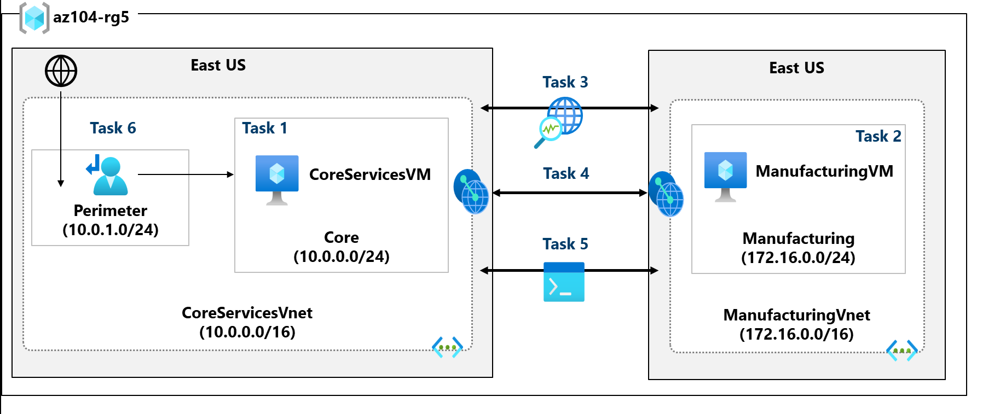

---

# 🧪 Task 1 – Create a Core Services Virtual Machine and Virtual Network

## Objective

Create a core services virtual network and deploy a virtual machine into the network.

### Configuration

| Setting              | Value                                     |
| -------------------- | ----------------------------------------- |
| Resource Group       | `az104-rg5`                               |
| VM Name              | `CoreServicesVM`                          |
| Region               | East US                                   |
| Image                | Windows Server 2025 Datacenter – x64 Gen2 |
| VM Size              | `Standard_D2s_v5`                         |
| Security Type        | Standard                                  |
| VNet                 | `CoreServicesVnet`                        |
| VNet Address Space   | `10.0.0.0/16`                             |
| Subnet               | `Core`                                    |
| Subnet Address Space | `10.0.0.0/24`                             |
| Public Inbound Ports | None                                      |
| Boot Diagnostics     | Disabled                                  |

The lab creates the virtual network while creating the virtual machine. The source lab also notes that the VNet could alternatively be created first and the VM added afterwards.

### 💡 Note – Creating a VNet During VM Deployment

The Azure portal allows a virtual network to be created directly from the VM creation workflow.

**What this means:**

Instead of creating:

```text
VNet → Subnet → VM
```

separately, Azure can create the required networking components while deploying the VM.

For larger environments, however, networking is often designed and managed separately so that multiple workloads can use the same network infrastructure.

### CoreServicesVM Deployment

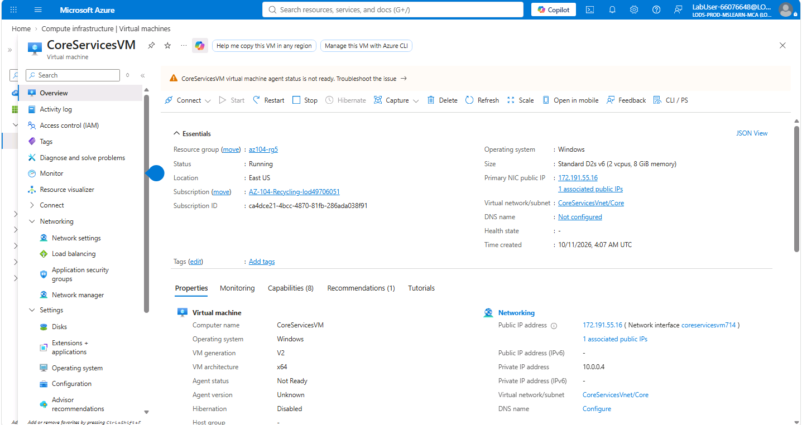

### CoreServicesVnet Configuration

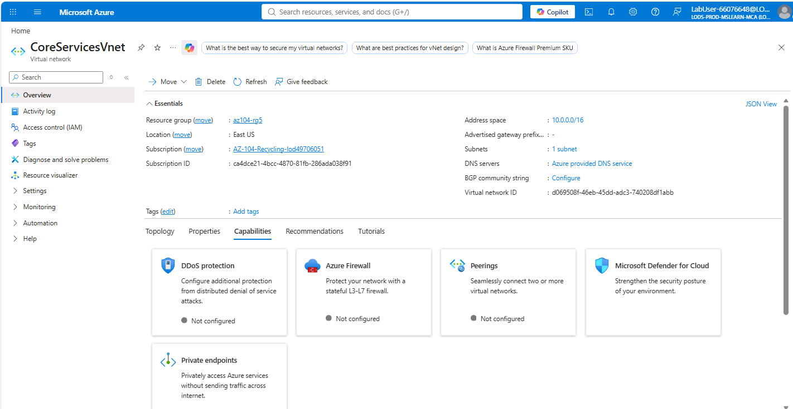

### CoreServicesVM Overview

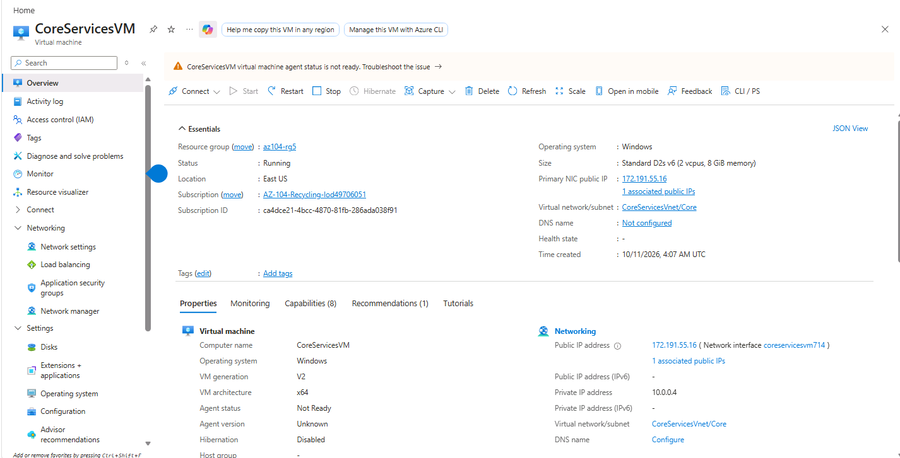

---

# 🧪 Task 2 – Create a Virtual Machine in a Different Virtual Network

## Objective

Create a manufacturing environment in a separate virtual network.

### Configuration

| Setting              | Value                                     |
| -------------------- | ----------------------------------------- |
| Resource Group       | `az104-rg5`                               |
| VM Name              | `ManufacturingVM`                         |
| Region               | East US                                   |
| Image                | Windows Server 2025 Datacenter – x64 Gen2 |
| VM Size              | `Standard_D2s_v5`                         |
| Security Type        | Standard                                  |
| VNet                 | `ManufacturingVnet`                       |
| VNet Address Space   | `172.16.0.0/16`                           |
| Subnet               | `Manufacturing`                           |
| Subnet Address Space | `172.16.0.0/24`                           |
| Public Inbound Ports | None                                      |
| Boot Diagnostics     | Disabled                                  |

### 💡 Note – Separate Virtual Networks

The Core Services and Manufacturing environments are intentionally placed in different VNets.

**What this means:**

Separate VNets provide network segmentation.

```text
CoreServicesVnet
10.0.0.0/16
       │
       │ Isolated
       │
ManufacturingVnet
172.16.0.0/16
```

This type of separation can be useful when different business areas, environments, subsidiaries, or security zones need to be isolated.

### ManufacturingVM Deployment

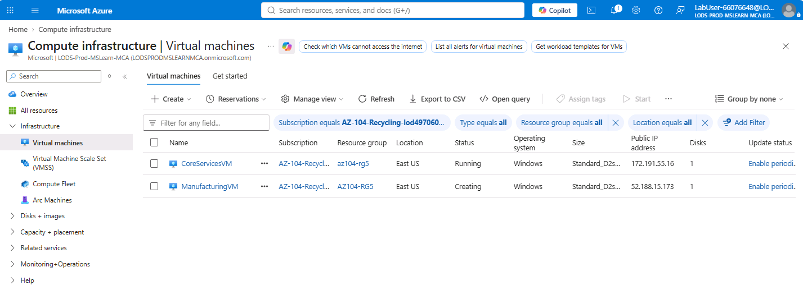

### ManufacturingVnet Configuration

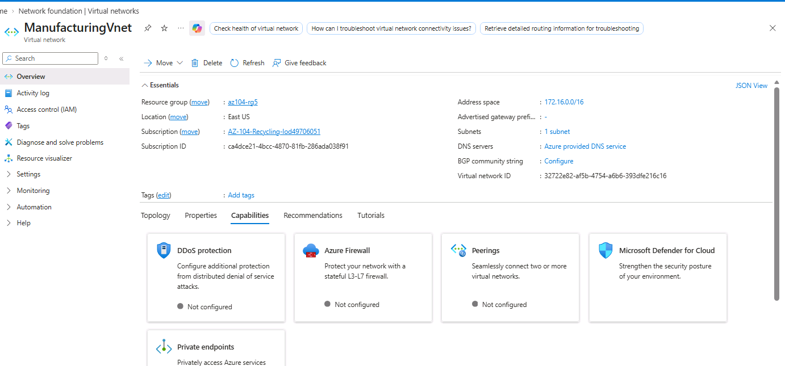

### ManufacturingVM Overview

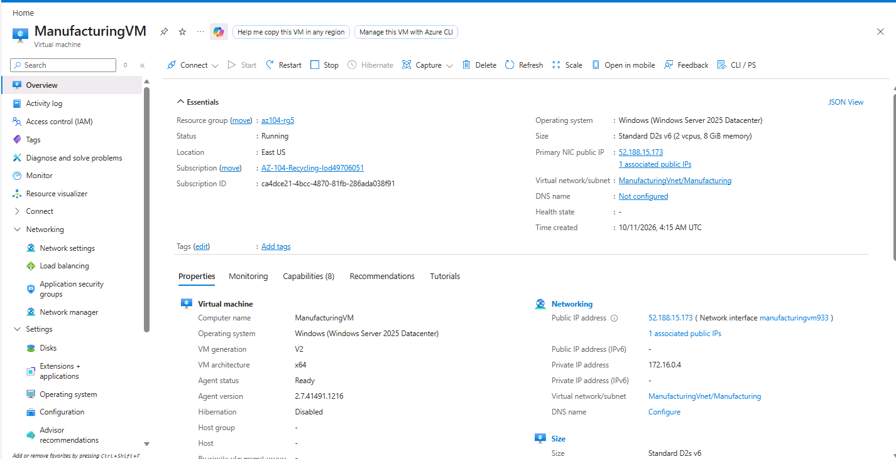

---

# 🧪 Task 3 – Test Connectivity Using Network Watcher

## Objective

Use **Azure Network Watcher – Connection Troubleshoot** to test communication between the two virtual machines before configuring VNet peering.

### Connection Test Configuration

| Setting          | Value             |
| ---------------- | ----------------- |
| Source Type      | Virtual Machine   |
| Source VM        | `CoreServicesVM`  |
| Destination Type | Virtual Machine   |
| Destination VM   | `ManufacturingVM` |
| IP Version       | Both              |
| Protocol         | TCP               |
| Destination Port | `3389`            |

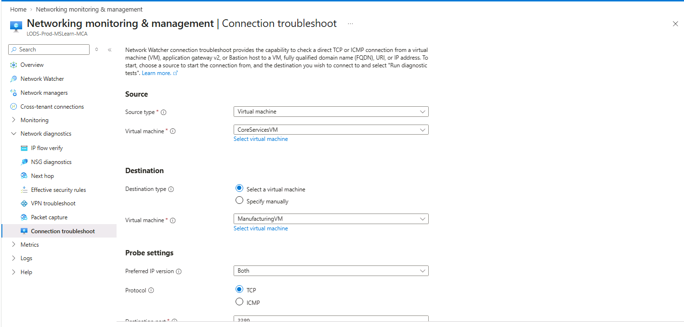

### Initial Connectivity Result

The connection test reports the destination as **Unreachable**.

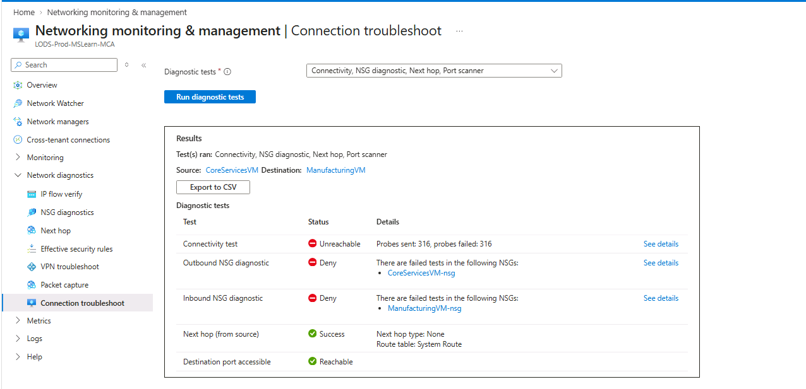

### 💡 Note – Why Is the Connection Unreachable?

The source lab explains that the virtual machines are located in different virtual networks and that connectivity has not yet been configured between those networks.

**What this means:**

Creating two VNets does not automatically create connectivity between them.

Before peering:

```text
CoreServicesVnet
       │
       │ ❌ No VNet connectivity
       │
       X
       │
       │
ManufacturingVnet
```

Therefore, the Network Watcher test correctly reports:

```text
Connectivity: Unreachable
```

This provides a useful baseline before implementing VNet peering.

---

# 🧪 Task 4 – Configure Virtual Network Peering

## Objective

Configure communication between `CoreServicesVnet` and `ManufacturingVnet` using Azure Virtual Network Peering.

### CoreServicesVnet → ManufacturingVnet

| Setting                 | Value                                   |
| ----------------------- | --------------------------------------- |
| Peering Name            | `CoreServicesVnet-to-ManufacturingVnet` |
| Remote VNet             | `ManufacturingVnet`                     |
| Allow VNet Access       | Enabled                                 |
| Allow Forwarded Traffic | Enabled                                 |

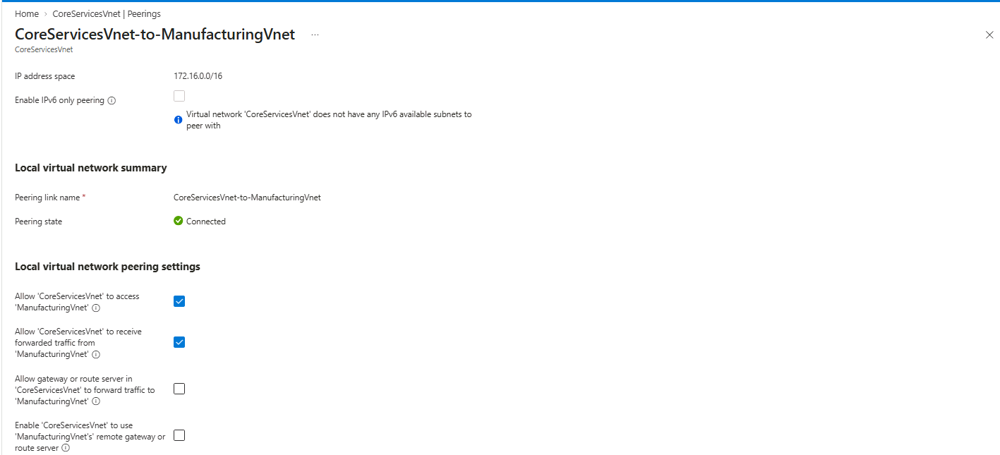

### ManufacturingVnet → CoreServicesVnet

| Setting                 | Value                                   |
| ----------------------- | --------------------------------------- |
| Peering Name            | `ManufacturingVnet-to-CoreServicesVnet` |
| Remote VNet             | `CoreServicesVnet`                      |
| Allow VNet Access       | Enabled                                 |
| Allow Forwarded Traffic | Enabled                                 |

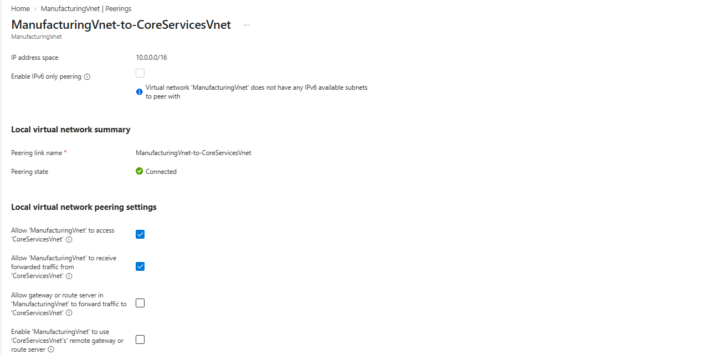

### Peering Verification

Both peerings were verified and the peering status changed to:

**Connected**

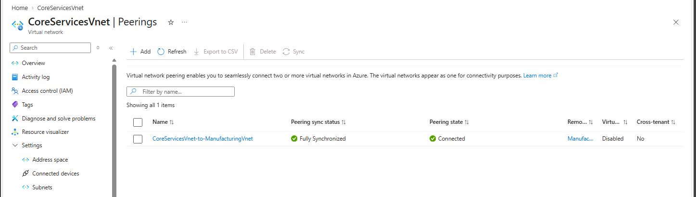

### 💡 Note – What Does VNet Peering Do?

VNet peering establishes private connectivity between Azure virtual networks.

After peering:

```text
CoreServicesVnet
       │
       │
       │ VNet Peering
       │
       ▼
ManufacturingVnet
```

The two VNets can communicate using private IP addresses.

The source lab highlights that peered VNets appear as one for connectivity purposes and that traffic between VMs in peered VNets uses Microsoft's backbone infrastructure.

### Result

The previously isolated environments can now communicate through private network connectivity.

---

# 🧪 Task 5 – Test Connectivity Using Azure PowerShell

## Objective

Retest the connection between the virtual machines after VNet peering has been configured.

## Step 1 – Identify CoreServicesVM Private IP

The private IP address of `CoreServicesVM` was obtained from the VM networking information.

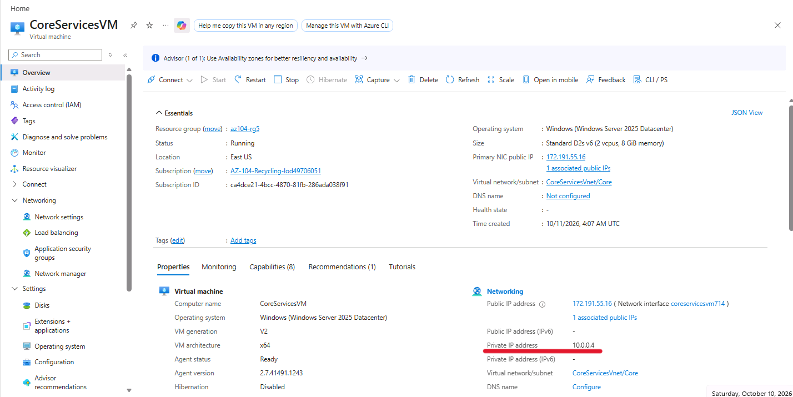

---

## Step 2 – Enable Remote Desktop Firewall Rule

The Windows Firewall rule allowing Remote Desktop traffic was enabled using Azure VM Run Command.

```powershell
Enable-NetFirewallRule -DisplayGroup "Remote Desktop"
```

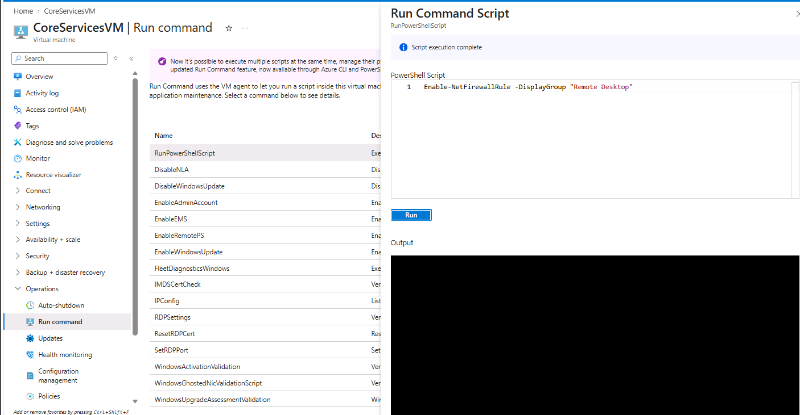

---

## Step 3 – Test Connectivity

From `ManufacturingVM`, the following PowerShell command was executed:

```powershell
Test-NetConnection <CoreServicesVM-private-IP> -Port 3389
```

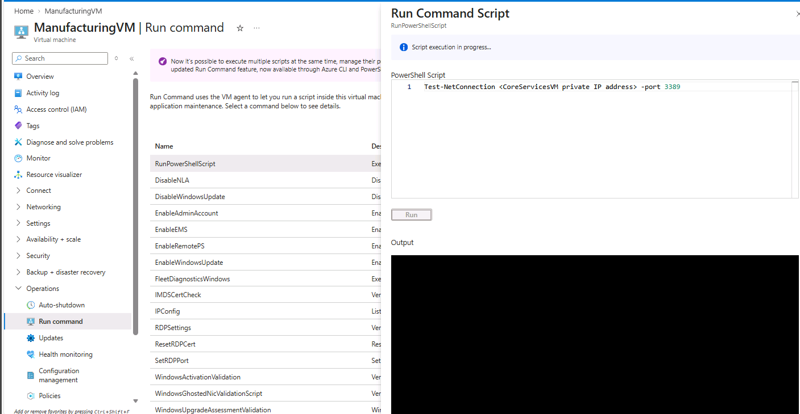

### Successful Connectivity Test

The connection test successfully reached `CoreServicesVM` on TCP port `3389`.

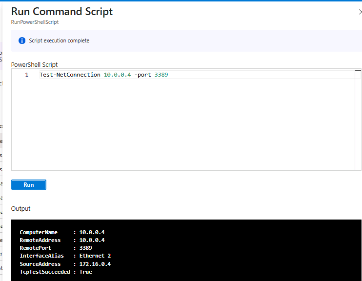

### 💡 Note – Why Did the Test Succeed Now?

After VNet peering was configured, a private network path became available between the two VNets.

```text
ManufacturingVM
172.16.0.x
      │
      │ Private connectivity
      ▼
VNet Peering
      │
      ▼
CoreServicesVM
10.0.0.x
```

The successful `Test-NetConnection` demonstrates that the two virtual machines can now communicate over the peered virtual networks.

The source lab specifically expects the test to succeed because peering has been configured.

---

# 🧪 Task 6 – Create a Custom Route

## Objective

Create a perimeter subnet and configure a custom route that directs traffic toward a future **Network Virtual Appliance (NVA)**.

---

## Step 1 – Create Perimeter Subnet

A new subnet was added to `CoreServicesVnet`.

| Setting       | Value         |
| ------------- | ------------- |
| Subnet Name   | `perimeter`   |
| Address Range | `10.0.1.0/24` |

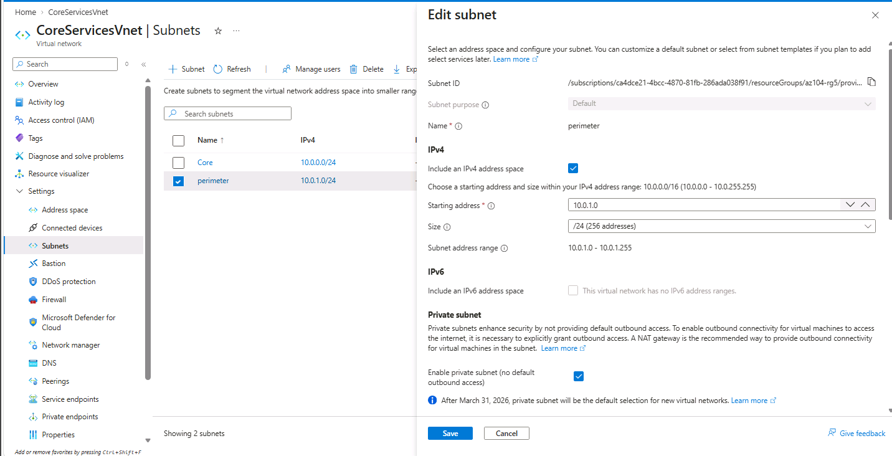

### 💡 Note – What Is the Perimeter/DMZ Subnet?

The perimeter subnet represents a network area intended for resources that sit between external/perimeter traffic and internal services.

In this lab, the subnet is:

```text
perimeter
10.0.1.0/24
```

The lab scenario is preparing this subnet for a future network appliance that will control or inspect traffic before it reaches the internal Core Services network.

---

## Step 2 – Create Route Table

A route table named `rt-CoreServices` was created.

| Setting               | Value             |
| --------------------- | ----------------- |
| Resource Group        | `az104-rg5`       |
| Region                | East US           |
| Route Table           | `rt-CoreServices` |
| Enable Peering Routes | Yes               |

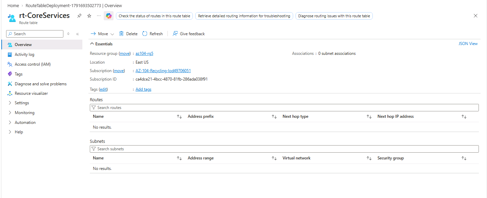

---

## Step 3 – Create Custom Route

A custom route named `PerimetertoCore` was configured.

| Setting          | Value             |
| ---------------- | ----------------- |
| Route Name       | `PerimetertoCore` |
| Destination Type | IP Addresses      |
| Destination      | `10.0.0.0/16`     |
| Next Hop Type    | Virtual Appliance |
| Next Hop Address | `10.0.1.7`        |

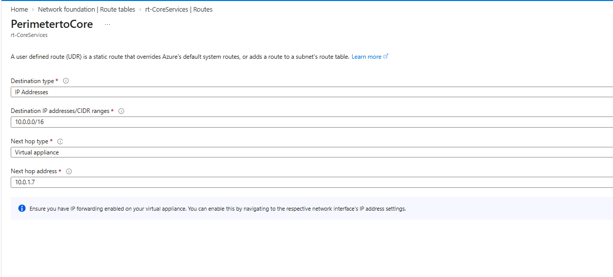

---

## 💡 Important Note – User Defined Route from DMZ to NVA

> **Note:** You have created a user defined route to direct traffic from the DMZ to the new NVA.

### What does this mean?

This is one of the most important concepts in this task.

The lab creates a **User Defined Route (UDR)** called:

```text
PerimetertoCore
```

Its purpose is to control how traffic destined for the Core Services network should be forwarded.

The configuration is:

```text
Destination:
10.0.0.0/16

Next Hop Type:
Virtual Appliance

Next Hop:
10.0.1.7
```

Therefore, conceptually:

```text
                CoreServicesVnet
                  10.0.0.0/16
                       ▲
                       │
                       │
                 Virtual Appliance
                    10.0.1.7
                       ▲
                       │
                       │ UDR
                       │
                Perimeter / DMZ
                  10.0.1.0/24
```

In a real-world architecture, the **NVA** could perform functions such as traffic inspection, filtering, firewalling, or other network security controls.

The important point is that the route tells Azure:

> Traffic destined for `10.0.0.0/16` should use the virtual appliance at `10.0.1.7` as the next hop.

The source lab describes this as directing traffic from the perimeter subnet toward a future NVA.

### Important clarification

The lab does **not** deploy an actual NVA at `10.0.1.7`.

The address represents the **future NVA next hop** used to demonstrate how a custom route would be configured.

Therefore, this task demonstrates **route configuration**, rather than a complete NVA deployment.

---

## Step 4 – Associate Route Table with Subnet

The route table was associated with the `perimeter` subnet.

| Setting         | Value              |
| --------------- | ------------------ |
| Virtual Network | `CoreServicesVnet` |
| Subnet          | `perimeter`        |
| Route Table     | `rt-CoreServices`  |

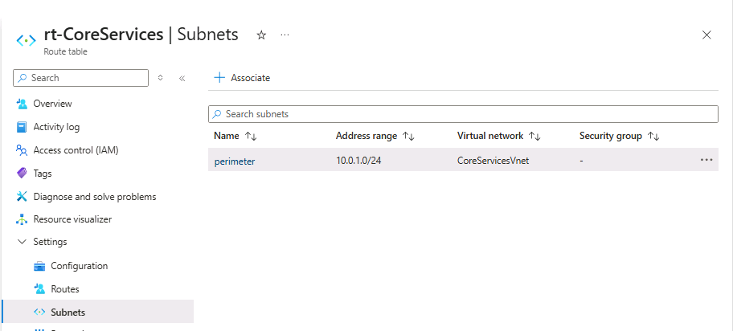

### Final Custom Route Configuration

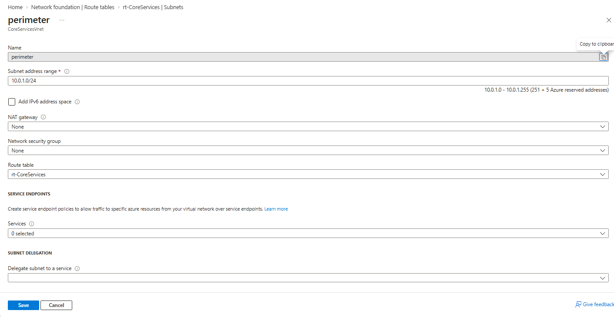

---

# 🧠 Understanding the Final Network Design

After completing the lab, the conceptual architecture is:

```text
                       Azure
                         │
        ┌────────────────┴─────────────────┐
        │                                  │
 CoreServicesVnet                   ManufacturingVnet
   10.0.0.0/16                       172.16.0.0/16
        │                                  │
   ┌────┴────┐                        ┌────┴────┐
   │         │                        │         │
 Core     Perimeter              Manufacturing │
10.0.0/24 10.0.1/24                 172.16.0/24
   │         │                           │
   │         │                           │
CoreVM      UDR                       MfgVM
            │
            ▼
      Future NVA
       10.0.1.7

          ◄──── VNet Peering ────►
```

### Traffic Flow Concept

For traffic destined for the Core Services network:

```text
Perimeter / DMZ
       │
       │ Destination: 10.0.0.0/16
       ▼
User Defined Route
       │
       ▼
Virtual Appliance
10.0.1.7
       │
       ▼
Core Services Network
10.0.0.0/16
```

This provides centralized control over how traffic is forwarded.

---

# 📊 Final Lab Configuration

| Component                   | Configuration       |
| --------------------------- | ------------------- |
| Resource Group              | `az104-rg5`         |
| Core VNet                   | `CoreServicesVnet`  |
| Core Address Space          | `10.0.0.0/16`       |
| Core VM                     | `CoreServicesVM`    |
| Core Subnet                 | `10.0.0.0/24`       |
| Manufacturing VNet          | `ManufacturingVnet` |
| Manufacturing Address Space | `172.16.0.0/16`     |
| Manufacturing VM            | `ManufacturingVM`   |
| Manufacturing Subnet        | `172.16.0.0/24`     |
| VNet Peering                | Configured          |
| Network Watcher             | Used                |
| Initial Connectivity        | Unreachable         |
| Final Connectivity          | Successful          |
| Perimeter Subnet            | `10.0.1.0/24`       |
| Route Table                 | `rt-CoreServices`   |
| Custom Route                | `PerimetertoCore`   |
| Destination                 | `10.0.0.0/16`       |
| Next Hop Type               | Virtual Appliance   |
| Next Hop Address            | `10.0.1.7`          |

---

# 🔍 Key Networking Concepts

## 1. Virtual Network Isolation

Azure VNets provide logical network isolation.

Without peering:

```text
VNet A  ───── X ─────  VNet B
```

Resources in separate VNets do not automatically communicate.

---

## 2. Virtual Network Peering

VNet peering connects Azure virtual networks using private connectivity.

```text
VNet A
  │
  │ Peering
  │
VNet B
```

The source lab notes that peered VNets appear as one for connectivity purposes and that traffic between VMs uses Microsoft's backbone infrastructure.

---

## 3. Network Watcher

Network Watcher provides Azure networking diagnostic capabilities.

In this lab, **Connection Troubleshoot** was used to:

* Select a source VM.
* Select a destination VM.
* Test TCP connectivity.
* Identify the initial connectivity failure.
* Verify connectivity after peering.

---

## 4. User Defined Routes

Azure automatically creates system routes for subnets.

A **User Defined Route** allows administrators to add custom routing behavior.

In this lab:

```text
Destination:
10.0.0.0/16

Next Hop:
10.0.1.7
```

The custom route overrides or adds routing behavior so traffic can be directed through a virtual appliance.

The source lab explicitly notes that system-defined routes are automatically created and that user-defined routes can override or add to the default system routes.

---

# 📝 Important Lab Notes & What They Mean

## Note 1 – VM Network Creation

**Source concept:** The virtual network can be created while creating the VM.

**Meaning:** Azure provides an integrated workflow for deploying the VM and its networking components. Alternatively, networking can be designed first and workloads deployed afterwards.

---

## Note 2 – Initial Connectivity

**Source concept:** The connection between the two VMs is initially unreachable.

**Meaning:** Separate VNets are isolated unless a connectivity mechanism such as VNet peering is configured.

---

## Note 3 – VNet Peering

**Source concept:** Peered VNets can communicate using Azure private networking.

**Meaning:** Peering creates a private network path between the VNets without requiring the VMs to have public IP connectivity.

---

## Note 4 – PowerShell Connectivity Test

**Source concept:** `Test-NetConnection` succeeds after peering.

**Meaning:** This provides practical verification that the network path between the two VNets is working.

---

## Note 5 – User Defined Route

**Source concept:** A UDR was created to direct traffic from the DMZ/perimeter toward the NVA.

**Meaning:** The route provides explicit control over the next hop for traffic destined for the Core Services network.

```text
DMZ / Perimeter
      │
      │ UDR
      ▼
Future NVA
10.0.1.7
      │
      ▼
Core Services
10.0.0.0/16
```

The lab uses `10.0.1.7` as the future NVA address; an actual NVA is not deployed as part of this task.

---

# 🛠️ Commands Used

### Enable Windows Remote Desktop Firewall Rule

```powershell
Enable-NetFirewallRule -DisplayGroup "Remote Desktop"
```

### Test TCP Connectivity

```powershell
Test-NetConnection <CoreServicesVM-private-IP> -Port 3389
```

These commands were executed through Azure VM **Run Command / PowerShell**.

---

# 🧹 Resource Cleanup

For a personal Azure subscription, the lab resources should be deleted after completing the exercises to avoid unnecessary costs.

The main resource group is:

```text
az104-rg5
```

### Azure PowerShell

```powershell
Remove-AzResourceGroup -Name az104-rg5
```

### Azure CLI

```bash
az group delete --name az104-rg5
```

> **Warning:** Deleting the resource group permanently removes the resources contained within it.

---

# 📁 Repository Structure

```text
06-implement-intersite-connectivity/
│
├── README.md
│
├── screenshots/
│   ├── 00-architecture-diagram.png
│   ├── 01-core-services-vm-created.png
│   ├── 02-core-services-vnet-config.png
│   ├── 03-core-services-vm-overview.png
│   ├── 04-manufacturing-vm-created.png
│   ├── 05-manufacturing-vnet-config.png
│   ├── 06-manufacturing-vm-overview.png
│   ├── 07-network-watcher-connection-test.png
│   ├── 08-connection-test-unreachable.png
│   ├── 09-core-services-peering.png
│   ├── 10-manufacturing-peering.png
│   ├── 11-vnet-peering-connected.png
│   ├── 12-core-services-private-ip.png
│   ├── 13-enable-rdp-firewall-rule.png
│   ├── 14-test-netconnection-command.png
│   ├── 15-test-netconnection-success.png
│   ├── 16-perimeter-subnet-created.png
│   ├── 17-route-table-created.png
│   ├── 18-custom-route-created.png
│   ├── 19-route-table-subnet-association.png
│   └── 20-custom-route-overview.png
│
└── notes/
    ├── connectivity-commands.md
    └── vnet-peering-and-routing.md
```

---

# 🎓 AZ-104 Skills Demonstrated

This lab provides hands-on experience with:

* Azure Virtual Networks
* VNet address spaces
* Subnet configuration
* Azure Virtual Machines
* Private IP networking
* Network Watcher
* Connection Troubleshoot
* Virtual Network Peering
* Azure VM Run Command
* PowerShell networking commands
* Route Tables
* User Defined Routes
* Next-hop configuration
* Network Virtual Appliance routing concepts
* Azure network troubleshooting

---

# 💼 Portfolio Value

This lab demonstrates practical Azure networking knowledge beyond basic resource deployment.

### Key portfolio evidence

**1. Initial connectivity failure**

Demonstrates understanding of VNet isolation.

**2. VNet Peering**

Demonstrates how isolated Azure networks can be connected.

**3. Successful `Test-NetConnection`**

Provides practical evidence of private connectivity.

**4. Network Watcher**

Demonstrates network troubleshooting capability.

**5. User Defined Route**

Demonstrates understanding of advanced Azure traffic routing and NVA-based network architectures.

---

# ✅ Lab Completion Summary

The lab was completed by creating two isolated Azure virtual networks with virtual machines, testing their initial connectivity, configuring VNet peering, validating private connectivity using Network Watcher and PowerShell, and implementing a custom route using an Azure Route Table.

### Final Outcome

```text
✓ CoreServicesVnet created
✓ CoreServicesVM deployed
✓ ManufacturingVnet created
✓ ManufacturingVM deployed
✓ Network Watcher connectivity test completed
✓ Initial connectivity failure verified
✓ VNet peering configured
✓ Peering status verified as Connected
✓ Private connectivity successfully tested
✓ Perimeter subnet created
✓ Route table created
✓ Custom route configured
✓ Future NVA next-hop configured
✓ Route table associated with perimeter subnet
```

## Status: ✅ Completed

---

## 📚 References

* Microsoft Learn – Azure Virtual Networks
* Microsoft Learn – Azure Network Watcher
* Microsoft Learn – Virtual Network Peering
* Microsoft Learn – Azure Route Tables and User Defined Routes
* Microsoft AZ-104 Microsoft Azure Administrator – Implement Intersite Connectivity Lab
