# Lab 06 – Implement Network Traffic Management


## 📌 Lab Overview

This lab focuses on implementing Azure network traffic management solutions using:

* **Azure Load Balancer**
* **Azure Application Gateway**

The lab begins by deploying the required infrastructure using an ARM template. The infrastructure includes one virtual network, three subnets, a Network Security Group, and three virtual machines.

An **Azure Public Load Balancer** is then configured to distribute incoming TCP traffic across two virtual machines.

Finally, an **Azure Application Gateway** is configured to provide Layer 7 HTTP routing. Path-based routing is used to send image requests to one backend virtual machine and video requests to another.

---

# 🎯 Learning Objectives

By completing this lab, I learned how to:

* Deploy Azure infrastructure using an ARM template.
* Configure an Azure Standard Public Load Balancer.
* Create a public frontend IP configuration.
* Configure a backend pool.
* Configure a load balancing rule.
* Configure a health probe.
* Verify load balancing between virtual machines.
* Create a dedicated Application Gateway subnet.
* Deploy an Azure Application Gateway.
* Configure Application Gateway backend pools.
* Configure HTTP listeners.
* Configure path-based routing.
* Monitor Application Gateway backend health.
* Test Layer 7 application routing.
* Understand the difference between Layer 4 and Layer 7 load balancing.

---

# 🏗️ Lab Scenario

The organization hosts a public website and needs to distribute incoming requests across multiple virtual machines.

The organization also needs to serve:

* General web traffic
* Images
* Videos

The design therefore uses two different Azure traffic management technologies:

```text
Internet
   │
   ├───────────────┐
   │               │
   ▼               ▼
Azure Load       Application
Balancer         Gateway
Layer 4          Layer 7
   │               │
   ▼               ▼
VM0 / VM1       Path-based routing
                   │
              ┌────┴────┐
              ▼         ▼
           Images      Videos
             VM1         VM2
```

---

# 🏛️ Task 1 – Deploy the Infrastructure Using a Template

## Objective

The first task provisions the infrastructure required for the Load Balancer and Application Gateway exercises.

The provided ARM template deploys:

* One virtual network
* Three subnets
* One Network Security Group
* Three virtual machines

The lab uses resource group:

```text
az104-rg6
```

The source lab specifies `Standard_D2s_v5` as the first VM size to try, with alternative sizes available if capacity is unavailable.

### Template Configuration

| Setting           | Value              |
| ----------------- | ------------------ |
| Resource Group    | `az104-rg6`        |
| VM Size           | `Standard_D2s_v5`  |
| Deployment Method | ARM Template       |
| Infrastructure    | VNet + NSG + 3 VMs |

### Load Template

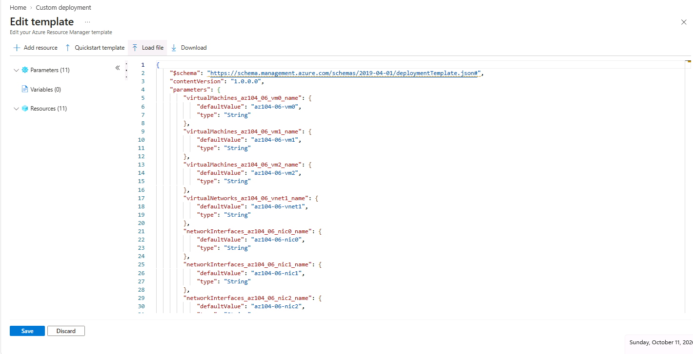

### Template Parameters

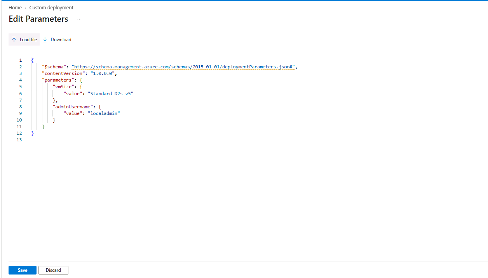

### Deployment Completed

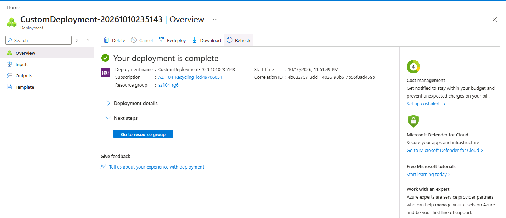

### Infrastructure Verification

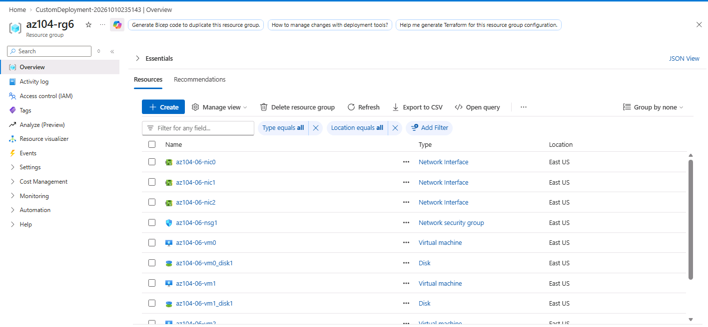

### 💡 Important Note – Template Deployment

The lab specifically recommends waiting for the infrastructure deployment to finish before starting the next task.

The deployed architecture contains one VNet with three subnets, with a virtual machine associated with each subnet.

**Why this matters:**

The remaining tasks depend on these existing VMs and their network interfaces.

The template therefore provides a consistent starting point for the Load Balancer and Application Gateway configurations.

---

# ⚖️ Task 2 – Configure an Azure Load Balancer

## Objective

Create a **Standard Public Azure Load Balancer** and distribute incoming TCP traffic across two backend virtual machines.

Azure Load Balancer operates at:

**OSI Layer 4 – Transport Layer**

It works with network protocols such as TCP and UDP.

---

# 🏗️ Load Balancer Architecture

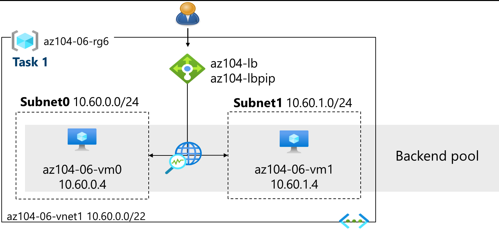

### Conceptual Flow

```text
                    Internet
                       │
                       ▼
              Public IP Address
                az104-lbpip
                       │
                       ▼
              Azure Load Balancer
                  az104-lb
                       │
                ┌──────┴──────┐
                │             │
                ▼             ▼
        az104-06-vm0    az104-06-vm1
```

The Load Balancer distributes incoming connections between the backend virtual machines.

---

## Step 1 – Create Load Balancer

### Configuration

| Setting        | Value              |
| -------------- | ------------------ |
| Resource Group | `az104-rg6`        |
| Name           | `az104-lb`         |
| SKU            | Standard           |
| Type           | Public             |
| Tier           | Regional           |
| Region         | Same region as VMs |

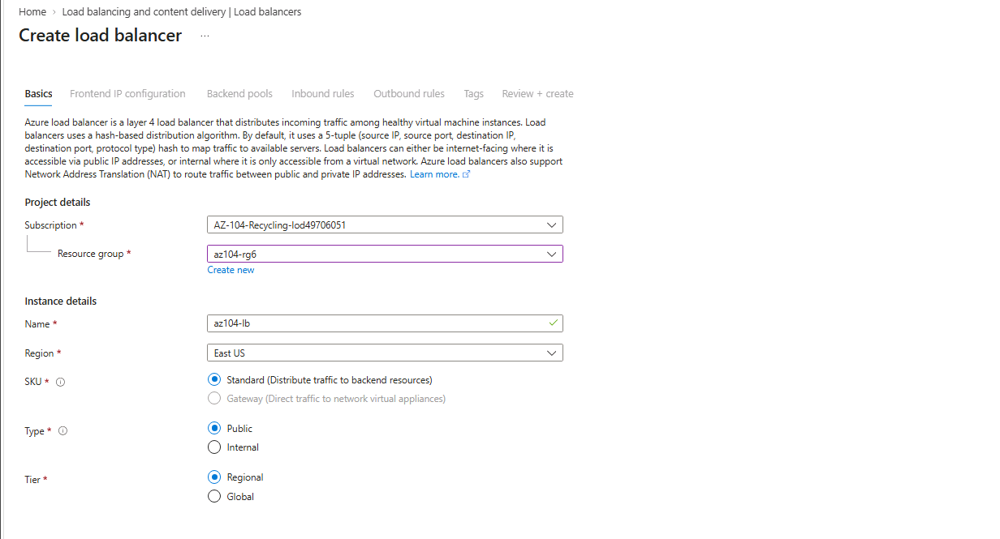

---

## Step 2 – Configure Frontend IP

A public frontend IP named:

```text
az104-fe
```

was configured.

The frontend uses public IP:

```text
az104-lbpip
```

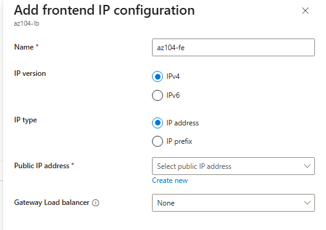

### Public IP Configuration

| Setting            | Value             |
| ------------------ | ----------------- |
| Name               | `az104-lbpip`     |
| SKU                | Standard          |
| Tier               | Regional          |
| Assignment         | Static            |
| Routing Preference | Microsoft network |

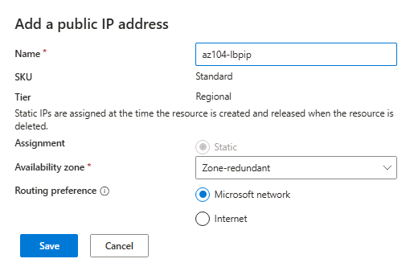

### 💡 Important Note – Standard Public IP

The lab notes that a Standard SKU public IP provides a static IP address. The address is assigned when the resource is created and released when the resource is deleted.

**Why this matters:**

A static frontend IP is useful when clients need a consistent public endpoint.

Conceptually:

```text
Internet
   │
   ▼
Static Public IP
   │
   ▼
Load Balancer
```

---

# Step 3 – Configure Backend Pool

A backend pool named:

```text
az104-be
```

was created.

The following virtual machines were added:

* `az104-06-vm0`
* `az104-06-vm1`

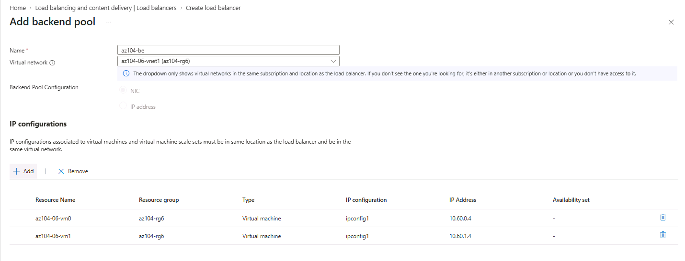

### Backend Architecture

```text
                az104-lb
                    │
              az104-be
               /     \
              /       \
             ▼         ▼
           VM0       VM1
```

---

# Step 4 – Create Load Balancing Rule

A rule named:

```text
az104-lbrule
```

was created.

### Rule Configuration

| Setting             | Value          |
| ------------------- | -------------- |
| Name                | `az104-lbrule` |
| IP Version          | IPv4           |
| Frontend            | `az104-fe`     |
| Backend Pool        | `az104-be`     |
| Protocol            | TCP            |
| Frontend Port       | `80`           |
| Backend Port        | `80`           |
| Health Probe        | `az104-hp`     |
| Session Persistence | None           |
| Idle Timeout        | 4 minutes      |
| TCP Reset           | Disabled       |
| Floating IP         | Disabled       |

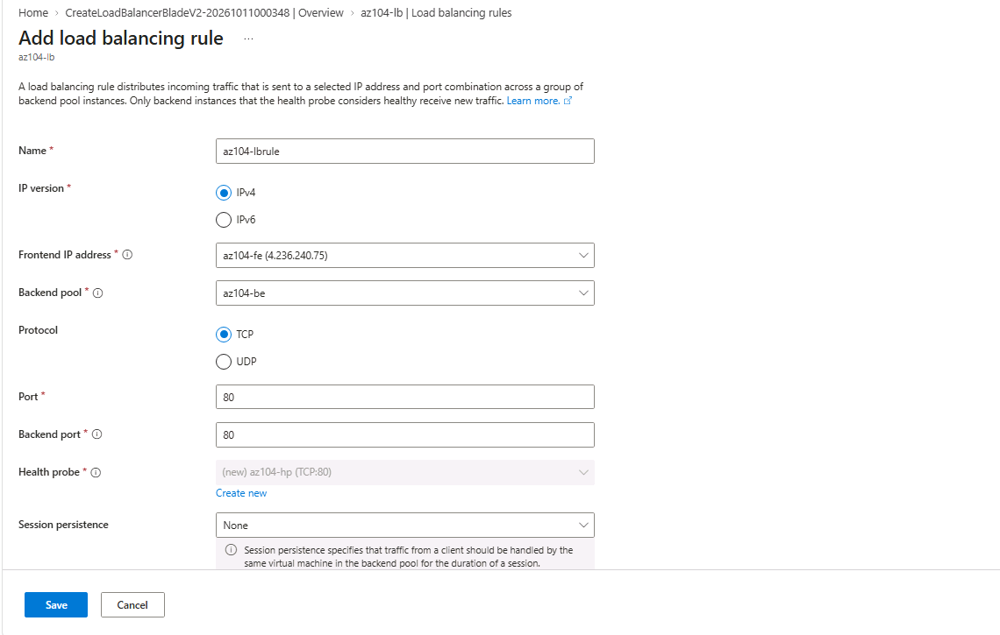

---

# Step 5 – Configure Health Probe

The Load Balancer health probe was configured as:

```text
Name: az104-hp
Protocol: TCP
Port: 80
Interval: 5 seconds
```

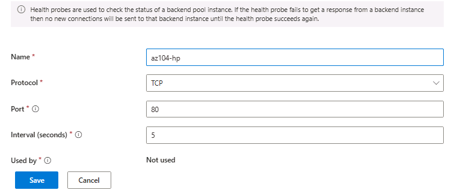

### 💡 Important Note – Health Probe

A health probe allows the Load Balancer to determine whether backend instances are available to receive traffic.

Conceptually:

```text
Load Balancer
     │
     ├── Health Check ──► VM0
     │
     └── Health Check ──► VM1
```

If a backend instance is considered unhealthy, the Load Balancer can stop sending new connections to that instance.

This is important because load balancing is not only about distributing traffic—it also needs to avoid sending traffic to unavailable backend resources.

---

# Step 6 – Verify the Load Balancer Public IP

The frontend public IP address was obtained from the Load Balancer.

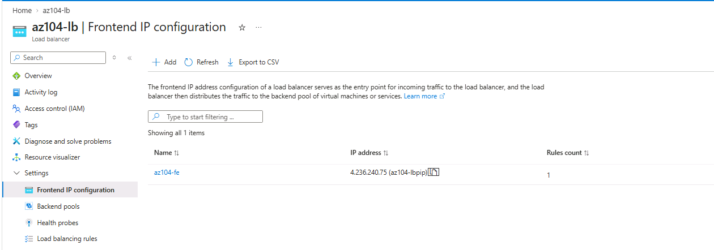

The public IP can then be opened in a browser.

---

# Step 7 – Verify Load Balancing

The browser initially displayed:

```text
Hello World from az104-06-vm0
```

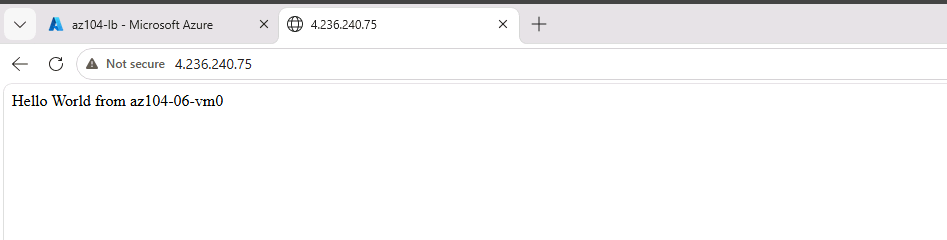

After refreshing the browser, the response changed to:

```text
Hello World from az104-06-vm1
```

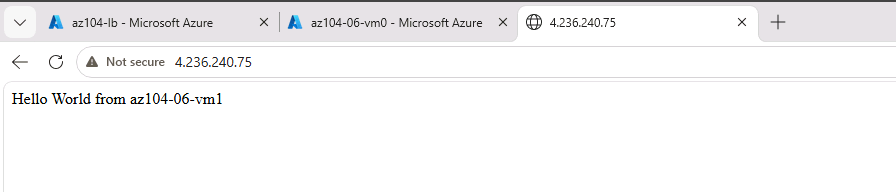

### 💡 Important Note – Why Does the Response Change?

This demonstrates that the Load Balancer is distributing incoming traffic across the backend pool.

```text
                 Public IP
                    │
                    ▼
             Azure Load Balancer
                    │
              ┌─────┴─────┐
              ▼           ▼
             VM0         VM1
```

The source lab specifically instructs refreshing the page to verify that the response changes between the two virtual machines.

> **Note:** You may need to refresh more than once or use an InPrivate browser window because of browser caching or connection behavior.

---

# 🌐 Task 3 – Configure an Azure Application Gateway

## Objective

Deploy an Azure Application Gateway to provide **Layer 7 web traffic management**.

Unlike the Load Balancer, Application Gateway understands HTTP-level traffic and can make routing decisions based on application request information.

The source lab describes Application Gateway as a Layer 7 load balancer that supports capabilities such as WAF, SSL termination, and end-to-end encryption.

---

# 🏗️ Application Gateway Architecture

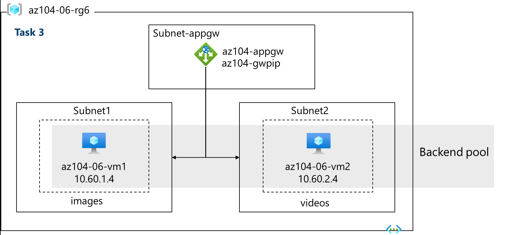

### Conceptual Architecture

```text
                         Internet
                            │
                            ▼
                    Application Gateway
                       az104-appgw
                            │
                    HTTP Listener :80
                            │
                   Path-Based Routing
                     ┌──────┴──────┐
                     │             │
               /image/*       /video/*
                     │             │
                     ▼             ▼
                  VM1             VM2
             Image Backend    Video Backend
```

---

# Step 1 – Create Dedicated Application Gateway Subnet

A dedicated subnet was added to the existing VNet.

### Configuration

| Setting          | Value          |
| ---------------- | -------------- |
| Name             | `subnet-appgw` |
| Starting Address | `10.60.3.224`  |
| Size             | `/27`          |
| Private Subnet   | Enabled        |

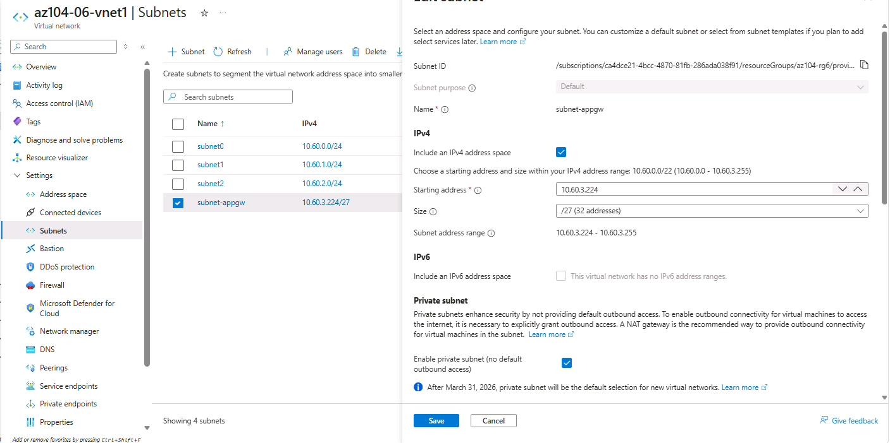

### 💡 Important Note – Dedicated Application Gateway Subnet

Application Gateway requires a dedicated subnet.

The lab specifies a `/27` or larger subnet for the Application Gateway.

**Why this matters:**

The Application Gateway requires its own subnet so that the gateway infrastructure can operate separately from application workloads.

```text
VNet
│
├── VM Subnet
├── VM Subnet
├── VM Subnet
└── subnet-appgw
       │
       └── Application Gateway
```

---

# Step 2 – Create Application Gateway

### Configuration

| Setting        | Value              |
| -------------- | ------------------ |
| Resource Group | `az104-rg6`        |
| Name           | `az104-appgw`      |
| Region         | Same region as VMs |
| Tier           | Standard V2        |
| Autoscaling    | No                 |
| Instance Count | 2                  |
| IP Type        | IPv4               |
| HTTP/2         | Disabled           |
| VNet           | `az104-06-vnet1`   |
| Subnet         | `subnet-appgw`     |

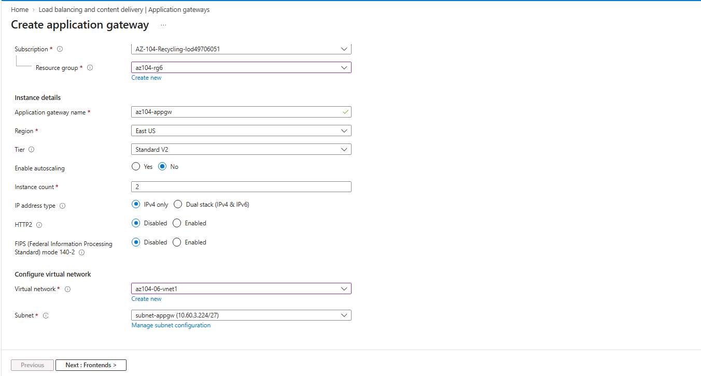

---

# Step 3 – Configure Frontend

A public frontend was configured for the Application Gateway.

### Public IP

```text
az104-gwpip
```

### Configuration

| Setting           | Value         |
| ----------------- | ------------- |
| Frontend IP Type  | Public        |
| Public IP         | `az104-gwpip` |
| Availability Zone | ZoneRedundant |

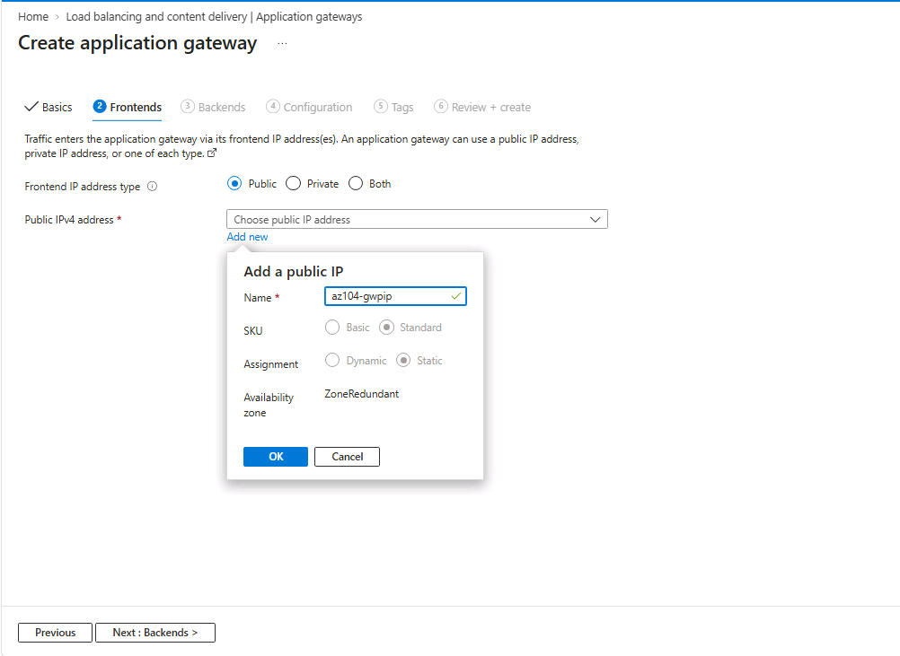

### 💡 Important Note – Public and Private Frontends

The source lab notes that an Application Gateway can have both public and private IP addresses.

This means an Application Gateway can be used for:

* Public-facing web applications
* Internal/private applications

depending on the frontend configuration.

---

# Step 4 – Configure Main Backend Pool

The main backend pool was configured as:

```text
az104-appgwbe
```

Targets:

* `az104-06-nic1` – `10.60.1.4`
* `az104-06-nic2` – `10.60.2.4`

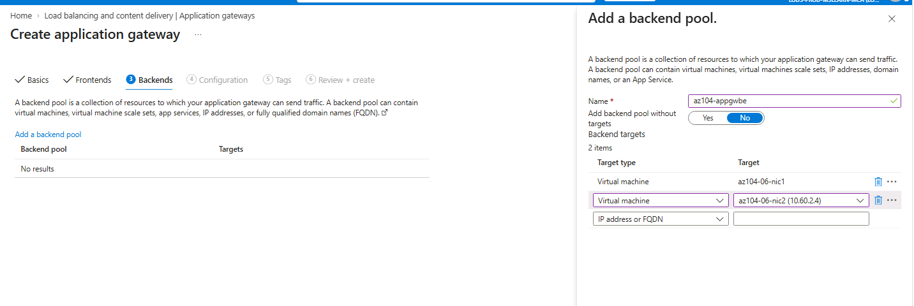

---

# Step 5 – Configure Image Backend Pool

A dedicated backend pool was created for image requests.

```text
az104-imagebe
```

Target:

```text
az104-06-nic1
10.60.1.4
```

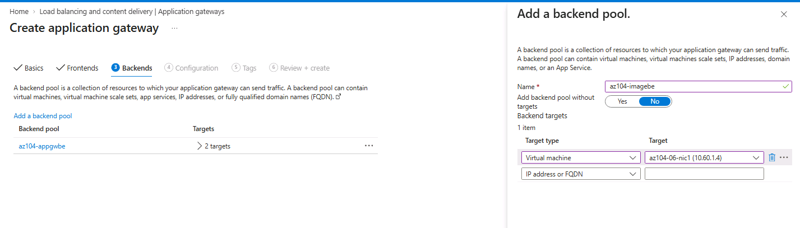

---

# Step 6 – Configure Video Backend Pool

A dedicated backend pool was created for video requests.

```text
az104-videobe
```

Target:

```text
az104-06-nic2
10.60.2.4
```

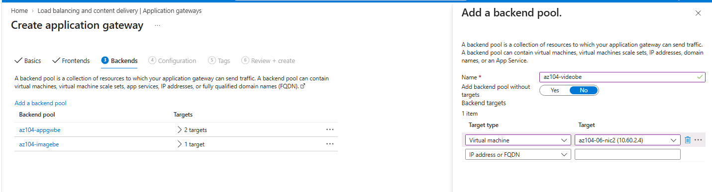

---

# 💡 Important Concept – Multiple Backend Pools

This is one of the most important parts of the Application Gateway task.

Instead of sending every request to the same backend pool, the Application Gateway can separate traffic based on the URL path.

```text
                    Application Gateway
                           │
                    Path-based routing
                           │
             ┌─────────────┴─────────────┐
             │                           │
         /image/*                    /video/*
             │                           │
             ▼                           ▼
       az104-imagebe              az104-videobe
             │                           │
             ▼                           ▼
           VM1                         VM2
```

This allows different application resources to be hosted on different backend servers.

---

# Step 7 – Configure HTTP Listener and Routing Rule

A routing rule named:

```text
az104-gwrule
```

was created.

### Listener Configuration

| Setting       | Value            |
| ------------- | ---------------- |
| Rule Name     | `az104-gwrule`   |
| Priority      | `10`             |
| Listener      | `az104-listener` |
| Frontend      | Public IPv4      |
| Protocol      | HTTP             |
| Port          | 80               |
| Listener Type | Basic            |

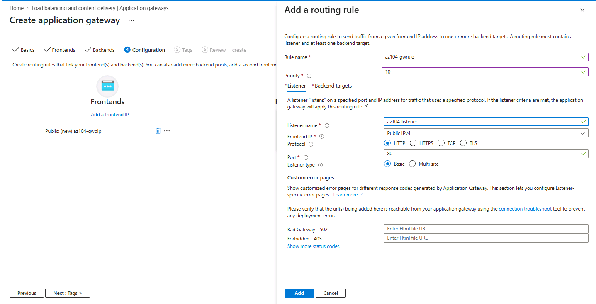

---

# Step 8 – Configure Path-Based Routing

Two path-based routing rules were configured.

## Image Routing

```text
/image/*
```

Target:

```text
az104-imagebe
```

## Video Routing

```text
/video/*
```

Target:

```text
az104-videobe
```

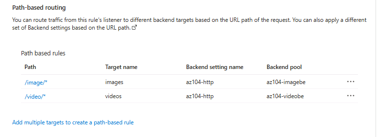

### 💡 Important Note – Path-Based Routing

Path-based routing allows Application Gateway to make routing decisions based on the URI requested by the client.

For example:

```text
http://<frontend-ip>/image/
```

is sent to the image backend.

While:

```text
http://<frontend-ip>/video/
```

is sent to the video backend.

This is a major difference from a basic Layer 4 Load Balancer.

---

# Step 9 – Deploy Application Gateway

After reviewing the configuration, the Application Gateway was deployed.

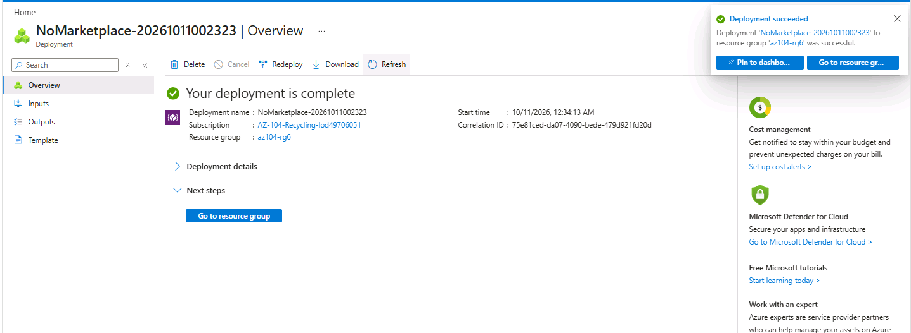

> **Note:** Application Gateway deployment can take several minutes. The source lab indicates approximately 5–10 minutes for deployment.

---

# Step 10 – Verify Backend Health

After deployment, the Application Gateway **Backend health** section was checked.

Both backend servers should display:

```text
Healthy
```

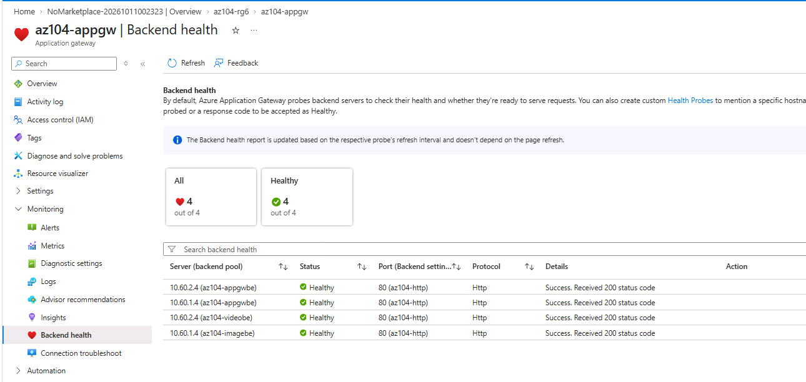

### 💡 Important Note – Backend Health

Backend health is important because Application Gateway needs to know whether backend resources are available before forwarding application traffic.

Conceptually:

```text
Application Gateway
       │
       ├── VM1 → Healthy
       │
       └── VM2 → Healthy
```

If a backend becomes unhealthy, the gateway can avoid routing traffic to that backend.

---

# Step 11 – Test Image Routing

The Application Gateway frontend public IP was used to test:

```text
http://<frontend-ip>/image/
```

The request was successfully directed to the image server.

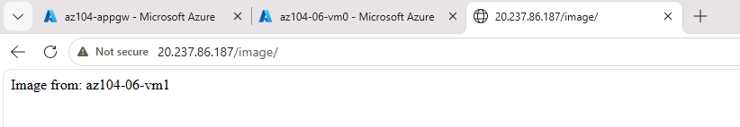

### Expected Result

The response should indicate that the request reached the image backend server.

---

# Step 12 – Test Video Routing

The following URL was tested:

```text
http://<frontend-ip>/video/
```

The request was successfully directed to the video server.

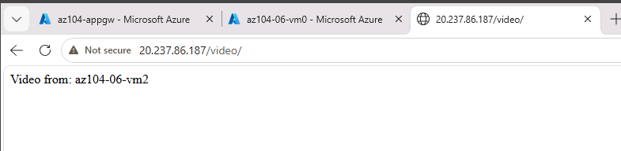

### Expected Result

The response should indicate that the request reached the video backend server.

---

# 🧠 Load Balancer vs Application Gateway

| Feature            | Azure Load Balancer               | Azure Application Gateway          |
| ------------------ | --------------------------------- | ---------------------------------- |
| OSI Layer          | Layer 4                           | Layer 7                            |
| Primary Protocols  | TCP / UDP                         | HTTP / HTTPS                       |
| Traffic Awareness  | Network/transport                 | Application/web                    |
| Backend Pools      | Yes                               | Yes                                |
| Health Probes      | Yes                               | Yes                                |
| Path-Based Routing | No                                | Yes                                |
| URL-Based Routing  | No                                | Yes                                |
| WAF Capability     | No                                | Available with WAF tier            |
| SSL/TLS Features   | Limited compared with App Gateway | Supported                          |
| Typical Use        | Network traffic distribution      | Web application traffic management |

### Simple way to remember

```text
Load Balancer
     ↓
"Which backend VM should receive this connection?"

Application Gateway
     ↓
"What type of web request is this,
and which backend should handle it?"
```

---

# 🔍 Important Lab Concepts

## 1. Layer 4 Load Balancing

Azure Load Balancer operates at the transport layer.

```text
Client
  │
  │ TCP
  ▼
Load Balancer
  │
  ├── VM0
  └── VM1
```

It distributes network connections without needing to understand the application URL.

The source lab identifies Azure Load Balancer as an OSI Layer 4 solution for TCP and UDP traffic.

---

## 2. Layer 7 Application Routing

Application Gateway operates at the web/application layer.

```text
Client
  │
  │ HTTP Request
  ▼
Application Gateway
  │
  ├── /image/* → VM1
  │
  └── /video/* → VM2
```

The gateway can make routing decisions based on HTTP request information such as URI paths.

The source lab specifically highlights URI path and host-header based routing capabilities.

---

## 3. Health Probes

Both traffic management technologies use health checking concepts.

```text
Traffic Manager
      │
      ├── Backend 1 → Healthy
      │
      └── Backend 2 → Healthy
```

Health checks help prevent traffic from being sent to unavailable backend resources.

---

## 4. Path-Based Routing

Application Gateway can route traffic according to the URL path.

```text
/image/*  ─────► Image Backend ─────► VM1

/video/*  ─────► Video Backend ─────► VM2
```

This is useful when different application components are hosted on different backend servers.

---

# 📝 Important Notes Explained

## Note 1 – Load Balancer Uses Two VMs

The Load Balancer distributes traffic across two VMs in the same virtual network.

**Meaning:**

Both VMs belong to the same backend pool and can receive incoming traffic through the Load Balancer.

---

## Note 2 – Standard Public IP Is Static

The Standard public IP used by the Load Balancer is static.

**Meaning:**

The frontend public IP remains associated with the resource until the resource is deleted, providing a consistent public endpoint.

---

## Note 3 – Refresh the Browser

The lab may require multiple refreshes or an InPrivate window when testing Load Balancer responses.

**Meaning:**

Browser caching and existing connections can affect what response you see. The test should demonstrate responses from both backend VMs.

---

## Note 4 – Application Gateway Dedicated Subnet

Application Gateway requires a dedicated subnet of `/27` or larger according to this lab configuration.

**Meaning:**

The Application Gateway infrastructure should not share its dedicated subnet with ordinary VM workloads.

---

## Note 5 – Application Gateway Can Have Public and Private IPs

Application Gateway supports public and private frontend configurations.

**Meaning:**

It can be used for internet-facing applications or internal applications depending on the architecture.

---

## Note 6 – Same VNet for Load Balancer and Application Gateway

The source lab notes that the Application Gateway is deployed in the same virtual network as the Load Balancer and that this may not be typical for a production environment.

**Meaning:**

This is a lab design chosen to simplify the exercise.

In production, the exact network architecture would depend on security, segmentation, application design, and operational requirements.

---

## Note 7 – Cookie-Based Affinity and Connection Draining

The Application Gateway configuration provides information about:

* Cookie-based affinity
* Connection draining

**Cookie-based affinity** can help keep a client's requests associated with the same backend server.

**Connection draining** helps allow existing connections to finish when a backend is being removed or changed.

---

# ⚠️ Region Configuration Note

The main lab instructions state that the steps are written using **East US** and allow the region to be changed if necessary.

One later Load Balancer note in the supplied lab material mentions **North Europe** when discussing the public IP region. Because the public IP and Load Balancer must align with the actual VM deployment region, the practical rule is:

> **Use the same Azure region as the resources deployed in Task 1.**

This avoids region mismatch during the Load Balancer configuration.

---

# 📊 Final Lab Configuration

| Component                | Configuration    |
| ------------------------ | ---------------- |
| Resource Group           | `az104-rg6`      |
| Virtual Network          | `az104-06-vnet1` |
| Virtual Machines         | 3                |
| Load Balancer            | `az104-lb`       |
| Load Balancer SKU        | Standard         |
| Load Balancer Type       | Public           |
| Frontend                 | `az104-fe`       |
| Public IP                | `az104-lbpip`    |
| Backend Pool             | `az104-be`       |
| Load Balancing Rule      | `az104-lbrule`   |
| Health Probe             | `az104-hp`       |
| Application Gateway      | `az104-appgw`    |
| Application Gateway Tier | Standard V2      |
| App Gateway Subnet       | `subnet-appgw`   |
| App Gateway Public IP    | `az104-gwpip`    |
| Main Backend Pool        | `az104-appgwbe`  |
| Image Backend            | `az104-imagebe`  |
| Video Backend            | `az104-videobe`  |
| Routing Rule             | `az104-gwrule`   |
| Listener                 | `az104-listener` |
| Image Path               | `/image/*`       |
| Video Path               | `/video/*`       |

---

# 🧪 Traffic Flow Summary

## Azure Load Balancer

```text
                         Internet
                            │
                            ▼
                    Static Public IP
                     az104-lbpip
                            │
                            ▼
                    Azure Load Balancer
                       az104-lb
                            │
                       az104-be
                       /        \
                      ▼          ▼
                    VM0        VM1
```

## Azure Application Gateway

```text
                         Internet
                            │
                            ▼
                    Public IP
                    az104-gwpip
                            │
                            ▼
                 Application Gateway
                    az104-appgw
                            │
                     HTTP Listener
                            │
                  Path-Based Routing
                     /            \
                    /              \
                   ▼                ▼
              /image/*          /video/*
                   │                │
                   ▼                ▼
            az104-imagebe     az104-videobe
                   │                │
                   ▼                ▼
                  VM1              VM2
```

---

# 🛠️ Troubleshooting Considerations

When testing the Load Balancer:

* Verify the backend VMs are running.
* Verify the backend pool contains the correct VMs.
* Verify the health probe is configured correctly.
* Verify the frontend public IP.
* Refresh the browser or use InPrivate mode if necessary.

When testing Application Gateway:

* Verify the Application Gateway deployment completed.
* Verify the backend servers show **Healthy**.
* Verify the HTTP listener is configured on port `80`.
* Verify the path-based routing rules.
* Verify `/image/*` points to the image backend.
* Verify `/video/*` points to the video backend.
* Verify the frontend public IP.

---

# 🧹 Resource Cleanup

For a personal Azure subscription, delete the lab resources after completing the exercises to avoid unnecessary costs.

Main resource group:

```text
az104-rg6
```

### Azure PowerShell

```powershell
Remove-AzResourceGroup -Name az104-rg6
```

### Azure CLI

```bash
az group delete --name az104-rg6
```

> **Warning:** Deleting the resource group permanently removes the resources contained within it.

---

# 📁 Repository Structure

```text
07-implement-network-traffic-management/
│
├── README.md
│
├── screenshots/
│   ├── 00-architecture-diagram-load-balancer.png
│   ├── 01-infrastructure-template-loaded.png
│   ├── 02-infrastructure-template-parameters.png
│   ├── 03-infrastructure-deployment-success.png
│   ├── 04-vnet-and-three-vms-created.png
│   ├── 05-load-balancer-create.png
│   ├── 06-load-balancer-frontend-ip.png
│   ├── 07-load-balancer-public-ip-created.png
│   ├── 08-load-balancer-backend-pool.png
│   ├── 09-load-balancer-created.png
│   ├── 10-load-balancing-rule.png
│   ├── 11-load-balancer-health-probe.png
│   ├── 12-load-balancer-public-ip.png
│   ├── 13-load-balancer-vm0-response.png
│   ├── 14-load-balancer-vm1-response.png
│   ├── 15-application-gateway-architecture.png
│   ├── 16-appgw-subnet-created.png
│   ├── 17-application-gateway-basics.png
│   ├── 18-appgw-frontend-public-ip.png
│   ├── 19-appgw-backend-pool.png
│   ├── 20-appgw-image-backend-pool.png
│   ├── 21-appgw-video-backend-pool.png
│   ├── 22-appgw-routing-rule.png
│   ├── 23-appgw-path-based-routing.png
│   ├── 24-application-gateway-deployment.png
│   ├── 25-appgw-backend-health.png
│   ├── 26-appgw-image-routing-test.png
│   └── 27-appgw-video-routing-test.png
│
└── notes/
    ├── load-balancer-vs-application-gateway.md
    └── traffic-management-concepts.md
```

---

# 🎓 AZ-104 Skills Demonstrated

This lab provides hands-on experience with:

* Azure Load Balancer
* Standard Public Load Balancer
* Public IP configuration
* Backend pools
* Health probes
* Load balancing rules
* Azure Application Gateway
* Application Gateway Standard V2
* Application Gateway dedicated subnet
* HTTP listeners
* Backend pools
* Backend health monitoring
* Path-based routing
* Layer 4 traffic management
* Layer 7 traffic management
* Azure VM traffic distribution
* Web application traffic routing

---

# 💼 Portfolio Value

This lab demonstrates practical knowledge of Azure traffic management and shows the difference between network-level and application-level load balancing.

### Strong portfolio evidence

**1. Load Balancer backend distribution**

The two different VM responses demonstrate that incoming traffic is being distributed.

**2. Health Probe**

Demonstrates backend availability monitoring.

**3. Application Gateway backend health**

Demonstrates verification of application backend availability.

**4. Path-Based Routing**

Demonstrates Layer 7 routing based on URL paths.

**5. End-to-End Testing**

The `/image/` and `/video/` tests provide direct evidence that different application requests are being routed to different backend servers.

---

# ✅ Lab Completion Summary

The lab was completed by deploying the required Azure infrastructure using an ARM template, configuring a Standard Public Azure Load Balancer, verifying traffic distribution between virtual machines, deploying an Azure Application Gateway, configuring backend pools and HTTP routing, and implementing path-based routing for image and video traffic.

### Final Outcome

```text
✓ Infrastructure deployed using ARM template
✓ Virtual network and three VMs deployed
✓ Standard Public Load Balancer created
✓ Static public frontend IP configured
✓ Backend pool configured
✓ Load balancing rule created
✓ Health probe configured
✓ Load Balancer traffic distribution verified
✓ Application Gateway subnet created
✓ Application Gateway deployed
✓ Public frontend configured
✓ Backend pools configured
✓ Image backend configured
✓ Video backend configured
✓ HTTP listener configured
✓ Path-based routing configured
✓ Backend health verified
✓ Image routing tested successfully
✓ Video routing tested successfully
```

## Status: ✅ Completed

---

# 📚 References

* Microsoft Learn – Azure Load Balancer
* Microsoft Learn – Azure Application Gateway
* Microsoft Learn – Azure Network Traffic Management
* Microsoft AZ-104 Microsoft Azure Administrator – Implement Network Traffic Management Lab
