# Lab 07 – Manage Azure Storage

[](https://azure.microsoft.com/)
[](https://learn.microsoft.com/credentials/certifications/azure-administrator/)
[](https://azure.microsoft.com/products/storage)

> **Microsoft AZ-104: Azure Administrator – Manage Azure Storage**

---

## 1. Overview

This lab focuses on creating, configuring, securing, and managing Azure Storage resources.

The lab covers Azure Storage accounts, Blob Storage, Azure Files, storage redundancy, network access controls, lifecycle management, immutable storage, role-based access control (RBAC), Shared Access Signatures (SAS), Storage Browser, and virtual network restrictions.

The scenario is based on an organization that currently stores data in on-premises data stores. Infrequently accessed data can be moved to lower-cost storage tiers, while Azure Storage security and Azure Files capabilities are evaluated for future use.

The lab is designed for approximately **50 minutes** and uses **East US** in the original instructions.

---

## 2. Learning Objectives

By completing this lab, I learned how to:

* Create and configure an Azure Storage account.
* Configure geo-redundant storage.
* Configure read access to the secondary region.
* Control public network access.
* Configure storage lifecycle management.
* Create a private Blob container.
* Configure immutable blob storage.
* Configure time-based retention.
* Upload and manage blobs.
* Assign Azure Storage RBAC roles.
* Generate a user delegation SAS.
* Configure Azure File shares.
* Use Azure Storage Browser.
* Configure a virtual network service endpoint for Microsoft.Storage.
* Restrict storage access to a selected virtual network.
* Validate unauthorized access from outside the allowed network.

---

## 3. Lab Scenario

The organization currently stores data in on-premises data stores.

Most of the data is not accessed frequently, so the organization wants to:

1. Reduce storage costs by using lower-cost storage tiers for infrequently accessed data.
2. Explore Azure Storage redundancy options.
3. Secure storage through network access controls.
4. Use authentication and authorization controls.
5. Evaluate Azure Files as a solution for on-premises file shares.

---

## 4. Architecture

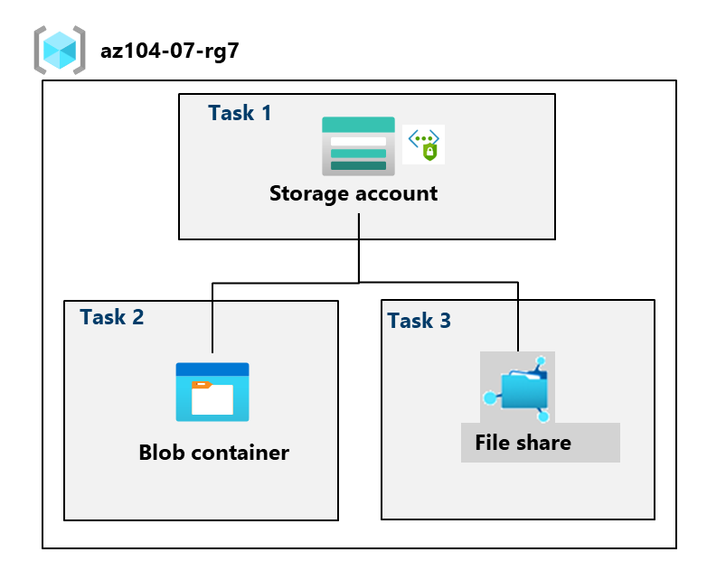

### High-Level Architecture

```text
                         Azure Storage
                              |
             +----------------+----------------+
             |                |                |
             v                v                v
       Storage Account   Blob Storage      Azure Files
             |                |                |
             |                |                |
             |          Private Container    share1
             |                |
             |          SAS-controlled
             |             access
             |
             +----------------------+
                                    |
                              Network Controls
                                    |
                              Virtual Network
                                    |
                              Service Endpoint
                              Microsoft.Storage
```

---

# Task 1 – Create and Configure a Storage Account

## 5. Storage Account Creation

The storage account was configured using the following settings:

| Setting                  | Configuration                                |
| ------------------------ | -------------------------------------------- |
| Resource Group           | `az104-rg7-lod66087236`                      |
| Storage Account Name     | Globally unique name                         |
| Region                   | East US                                      |
| Performance              | Standard                                     |
| Preferred Storage Type   | Azure Blob Storage / Azure Data Lake Storage |
| Redundancy               | Geo-redundant storage (GRS)                  |
| Read Access to Secondary | Enabled                                      |
| Public Network Access    | Initially Disabled                           |

The lab uses Standard performance and geo-redundant storage for the storage account.

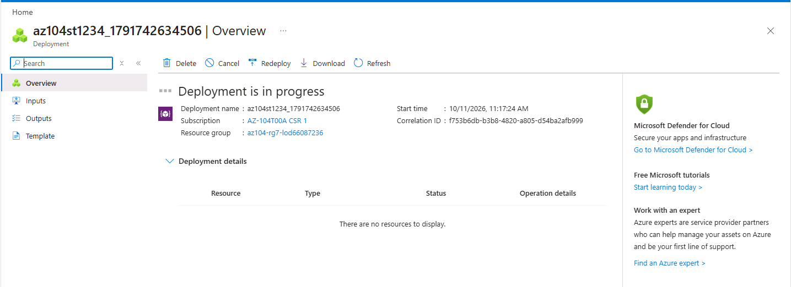

### Storage Account Basics

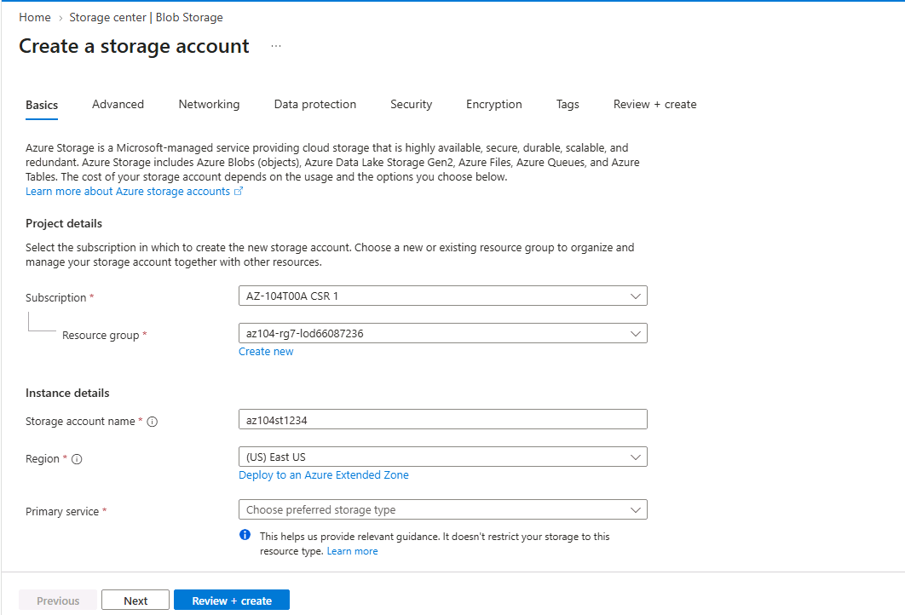

### Redundancy Configuration

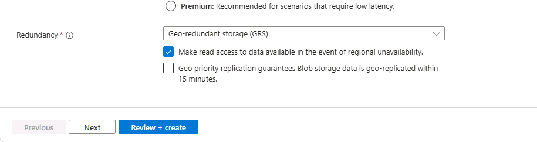

### Important Note – Standard vs Premium

Standard performance is suitable for most general-purpose workloads, while Premium performance is intended for enterprise or high-performance workloads.

---

## 6. Disable Public Network Access

During the initial configuration, public network access was disabled.

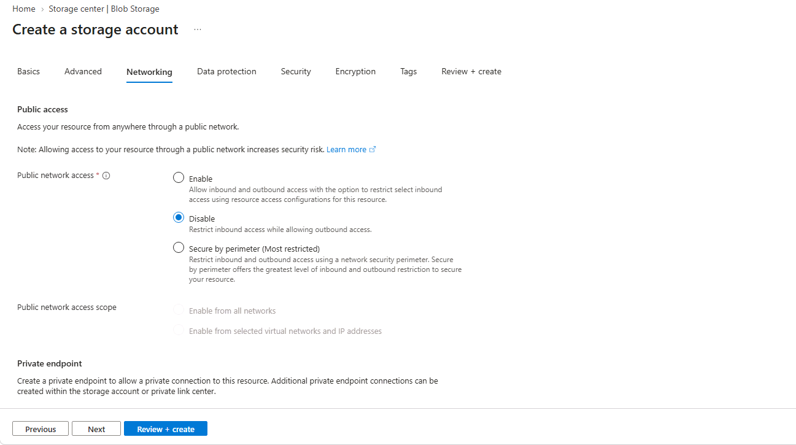

This provides a more restrictive initial network configuration for the storage account.

After deployment, the lab changes the configuration to allow access only from selected networks and the client IPv4 address.

---

## 7. Storage Account Deployment

After validation, the storage account was deployed successfully.

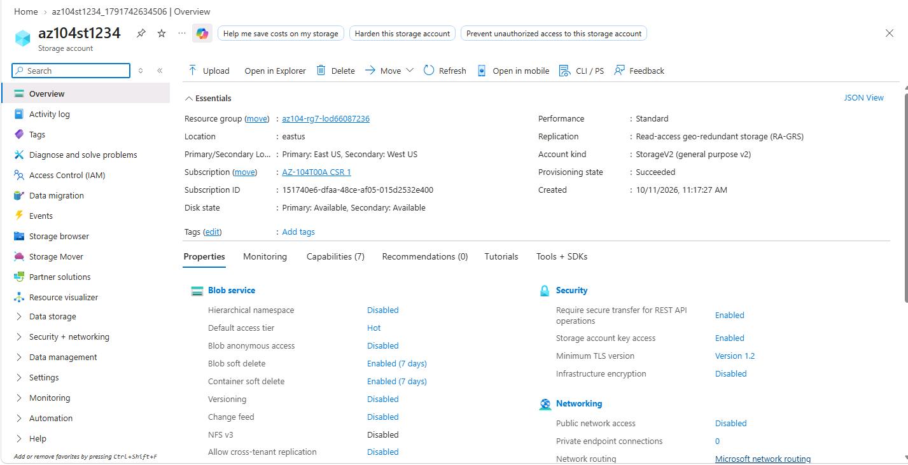

### Storage Account Overview

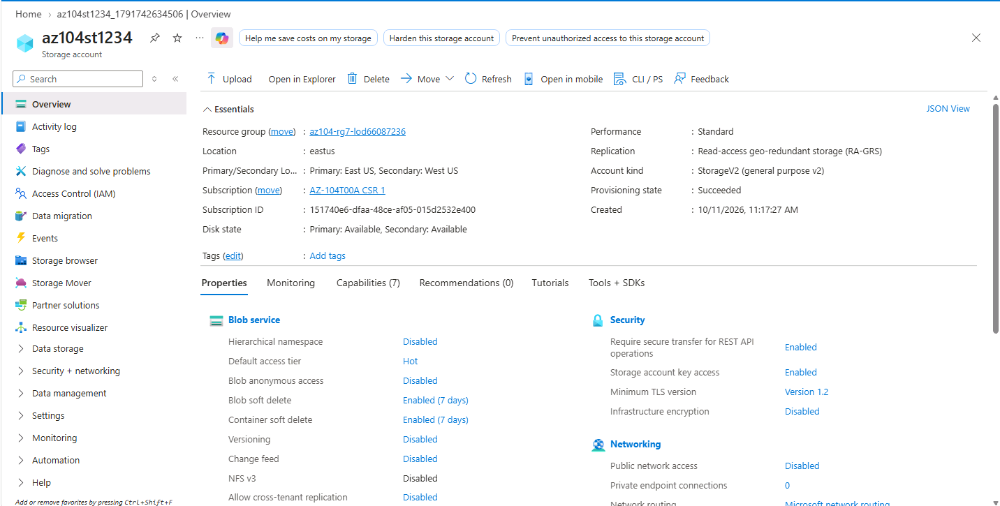

An Azure Storage account provides a namespace for Azure Storage data objects such as:

* Blob containers
* File shares
* Queues
* Tables

---

## 8. Configure Selected Network Access

Public network access was later configured to allow traffic from selected networks.

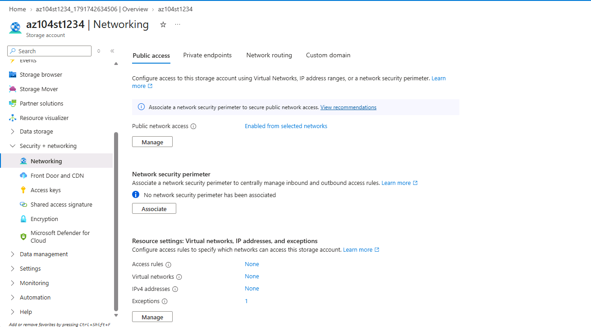

The client's IPv4 address was added as an allowed network source.

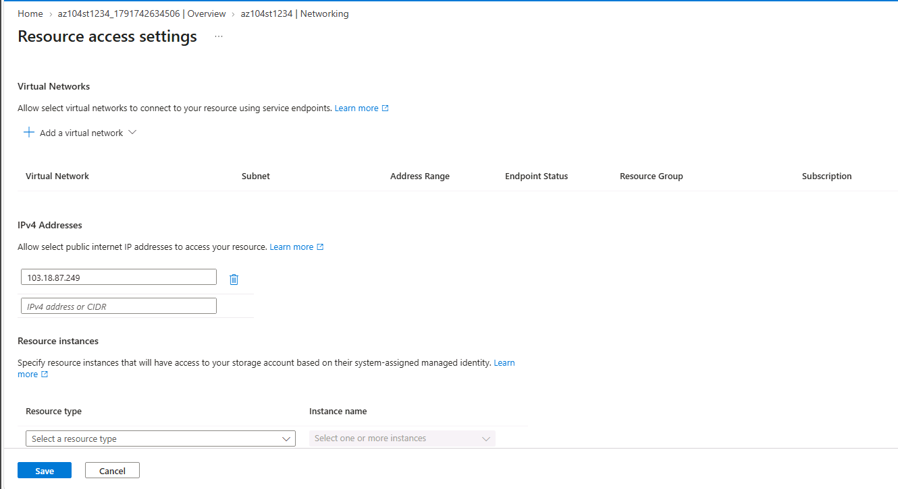

This demonstrates how storage account network access can be restricted rather than allowing unrestricted public connectivity.

---

## 9. Review Storage Redundancy

The storage account was configured with **Geo-redundant storage (GRS)**.

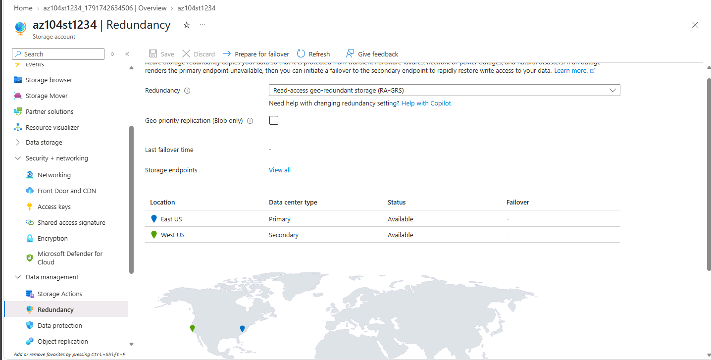

GRS maintains replicated data in a secondary Azure region to provide protection against regional failures.

---

## 10. Configure Lifecycle Management

Azure Storage lifecycle management can automatically transition data between access tiers based on defined conditions.

A lifecycle management rule named:

```text
Movetocool
```

was created.

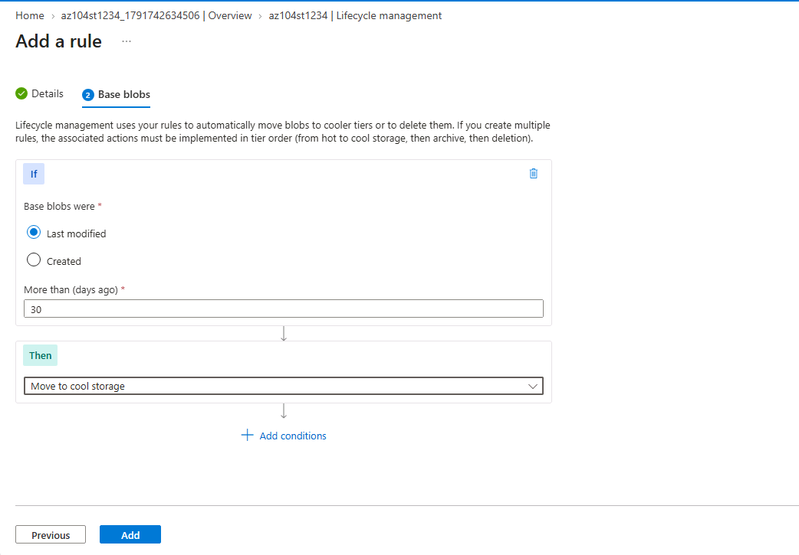

The rule was configured to move base blobs to the Cool tier when they had not been modified for more than **30 days**.

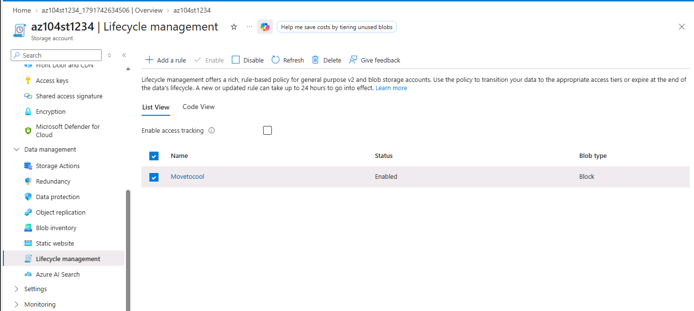

### Lifecycle Flow

```text
Hot
 |
 | 30+ days without modification
 v
Cool
```

### Why Lifecycle Management?

Lifecycle management can help reduce storage costs for data that is accessed less frequently.

---

# Task 2 – Create and Configure Secure Blob Storage

## 11. Create a Blob Container

A Blob container named:

```text
data
```

was created.

The container was configured with private access.

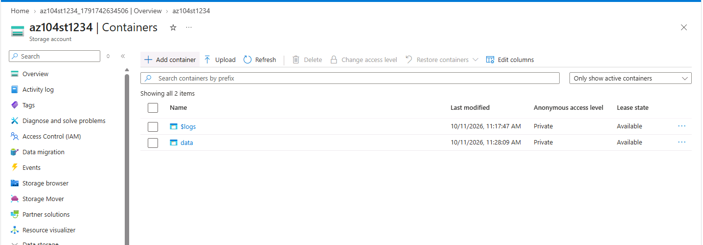

### Container Access

The public access level was kept private.

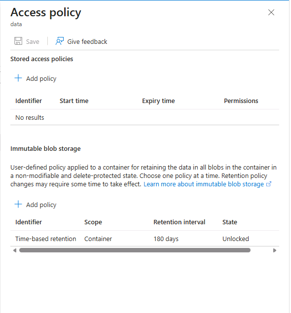

This means anonymous public access to the container is not permitted.

---

## 12. Configure Immutable Blob Storage

A time-based retention policy was configured for the container.

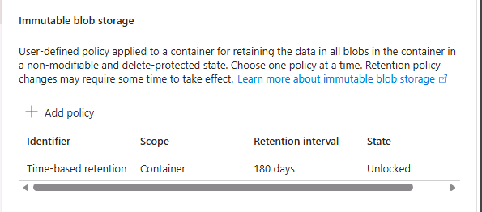

Configuration:

| Setting          | Value                |
| ---------------- | -------------------- |
| Policy Type      | Time-based retention |
| Retention Period | 180 days             |

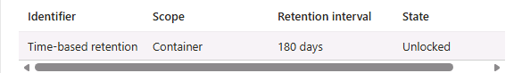

### Immutable Storage

Immutable storage provides a **Write Once, Read Many (WORM)** capability.

Once protected by an appropriate immutable policy, data cannot simply be modified or deleted during the retention period.

---

## 13. Configure Storage Account Key Access

Storage account key access was enabled for the lab's upload configuration.

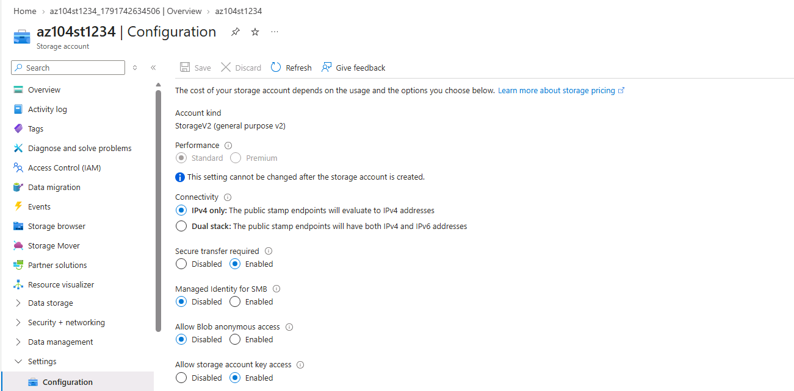

The lab then configures Azure RBAC permissions for the user account.

---

## 14. Configure Blob RBAC

The following role was assigned:

```text
Storage Blob Data Contributor
```

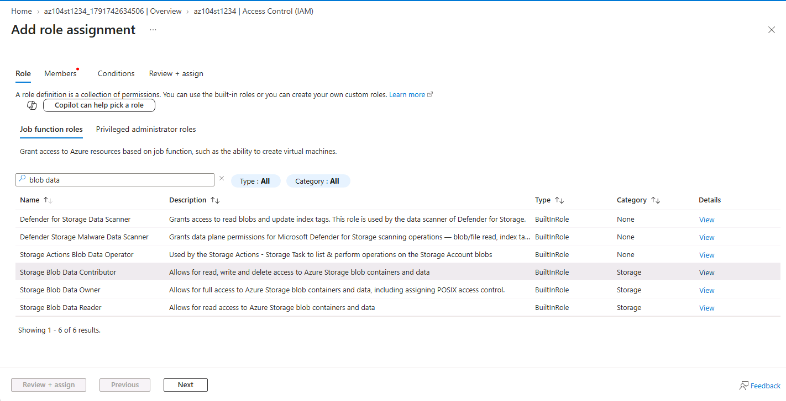

A file-storage related role was also assigned as required by the lab:

```text
Storage File Data Privileged Contributor
```

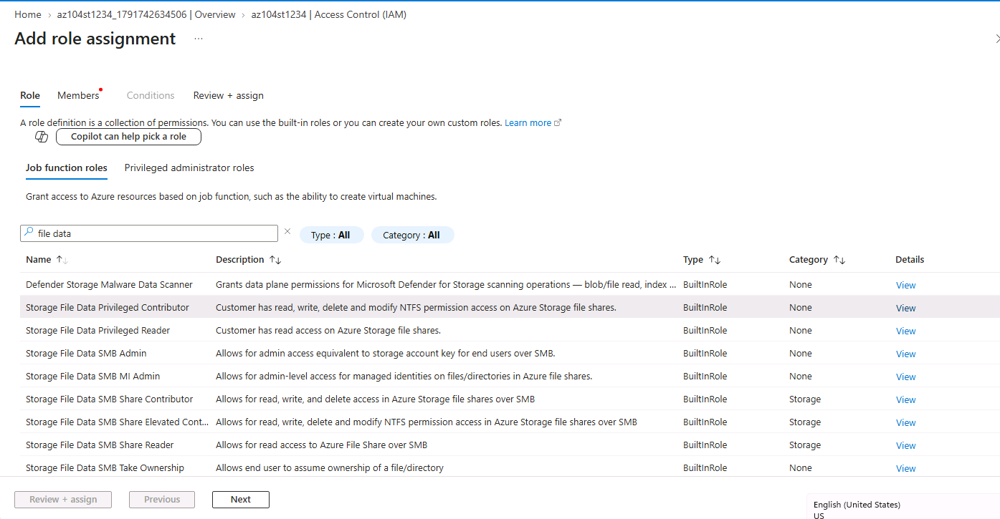

### Why RBAC?

Azure role-based access control allows permissions to be assigned according to a user's required access level instead of providing unnecessary administrative privileges.

---

## 15. Upload a Blob

A file was uploaded to the `data` container.

The upload configuration used:

| Setting          | Value                            |
| ---------------- | -------------------------------- |
| Blob Type        | Block blob                       |
| Block Size       | 4 MiB                            |
| Access Tier      | Hot                              |
| Upload Folder    | `securitytest`                   |
| Encryption Scope | Existing default container scope |

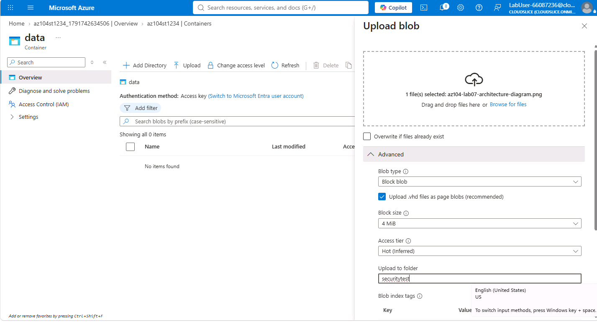

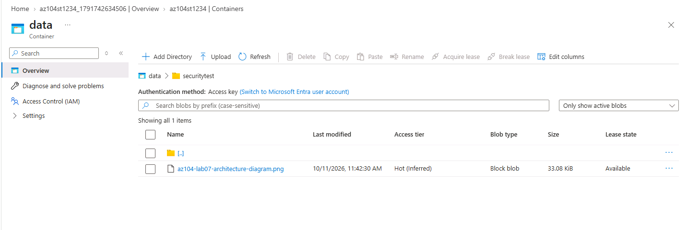

---

## 16. Review Blob Properties

The uploaded blob properties were reviewed.

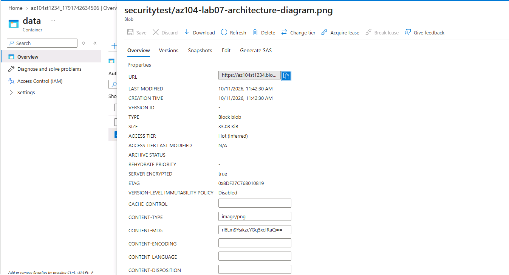

The blob interface provides actions such as:

* Download
* Delete
* Change tier
* Acquire lease
* Generate SAS

---

## 17. Test Private Blob Access

The blob URL was opened directly using an InPrivate browser window.

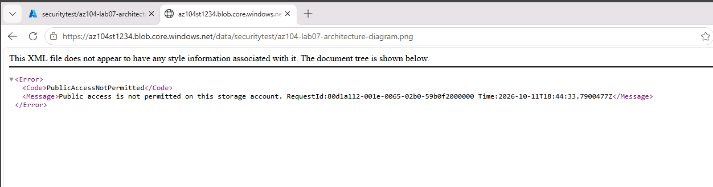

The expected result is an error such as:

```text
ResourceNotFound
```

or:

```text
PublicAccessNotPermitted
```

This is expected because the container was configured as:

```text
Private (no anonymous access)
```

---

## 18. Generate a User Delegation SAS

A Shared Access Signature was generated for the uploaded blob.

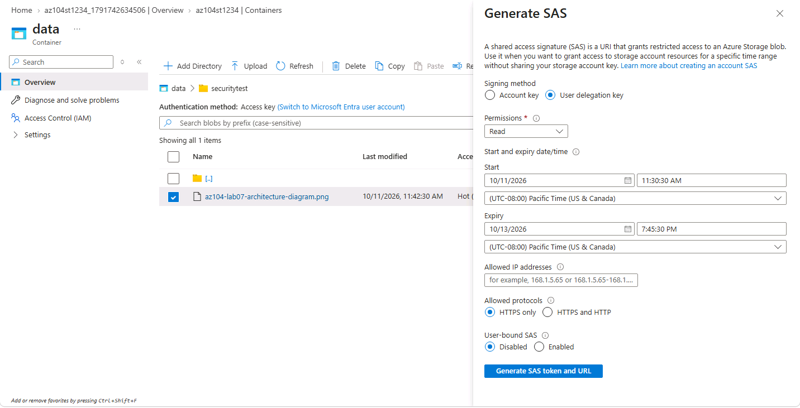

The lab uses a **User delegation key** as the signing method.

### SAS Configuration

| Setting              | Value               |
| -------------------- | ------------------- |
| Signing Method       | User delegation key |
| Permission           | Read                |
| Start Date           | Previous day        |
| Start Time           | Current time        |
| Expiry Date          | Next day            |
| Expiry Time          | Current time        |
| Allowed IP Addresses | Blank               |

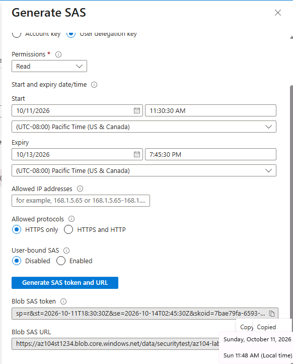

The generated Blob SAS URL was then tested using an InPrivate browser.

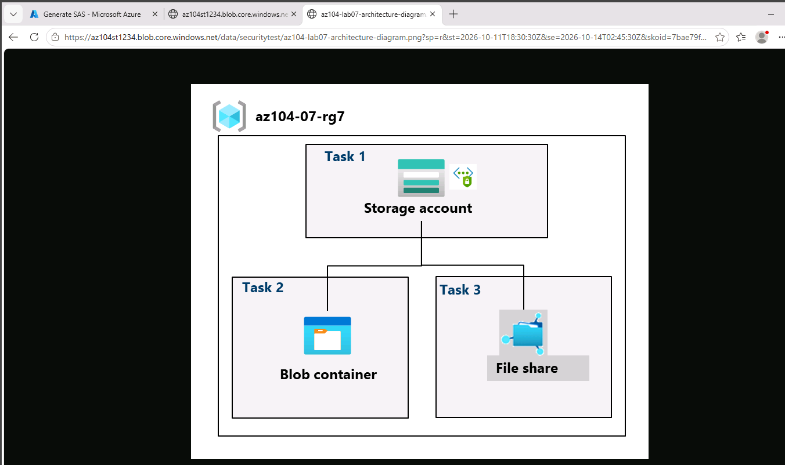

### SAS Concept

A SAS provides controlled, time-limited access to a storage resource without making the entire container publicly accessible.

```text
Private Blob
     |
     | User Delegation SAS
     v
Temporary Read Access
```

---

# Task 3 – Create and Configure Azure File Storage

## 19. Create Azure File Share

An Azure File share named:

```text
share1
```

was created.

The default access tier was:

```text
Transaction optimized
```

Backup was disabled for this lab configuration.

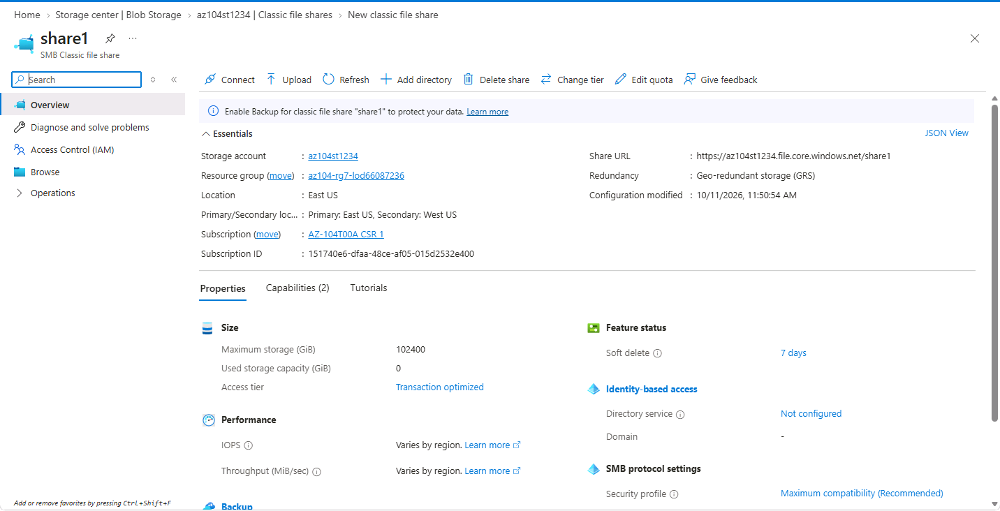

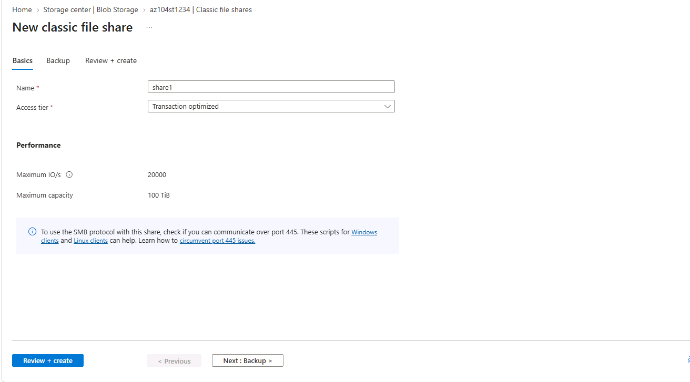

---

## 20. Explore Storage Browser

Azure Storage Browser was used to manage the file share.

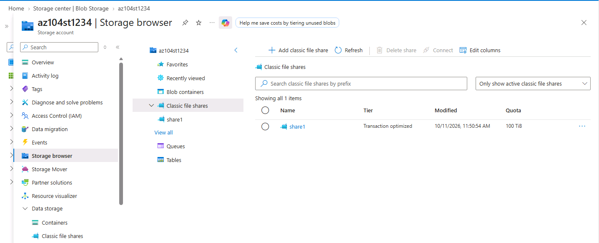

The `share1` directory was verified through Storage Browser.

A directory structure can also be created inside the file share.

---

## 21. Upload a File

A file was uploaded to the Azure File share.

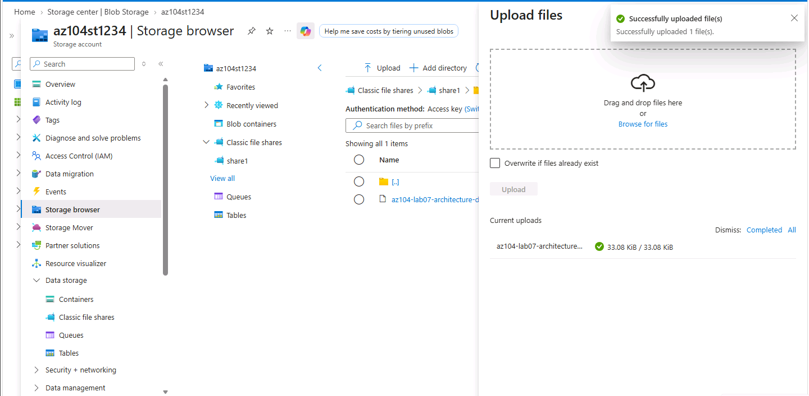

Storage Browser provides a convenient interface for viewing and managing storage resources.

---

## 22. Create a Virtual Network

A virtual network named:

```text
vnet1
```

was created in the same resource group.

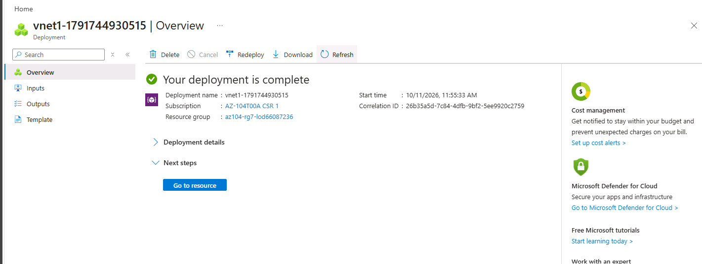

The virtual network is later used to restrict access to the storage account.

---

## 23. Configure Microsoft.Storage Service Endpoint

A service endpoint for:

```text
Microsoft.Storage
```

was enabled on the default subnet.

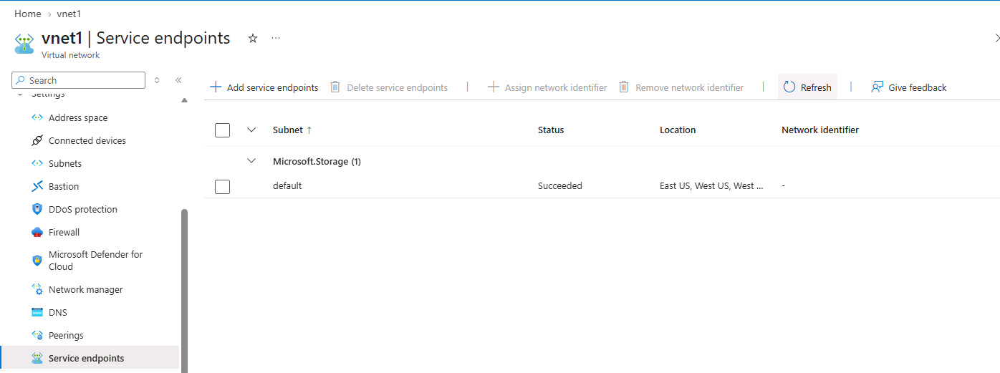

### Service Endpoint Flow

```text
Virtual Network
      |
      v
Default Subnet
      |
      | Microsoft.Storage Service Endpoint
      v
Azure Storage
```

This allows the storage account to recognize traffic originating from the selected virtual network.

---

## 24. Restrict Storage Account to the Virtual Network

The storage account networking configuration was updated to allow access from:

```text
vnet1
```

and its:

```text
default
```

subnet.

The previously allowed client IP address was removed.

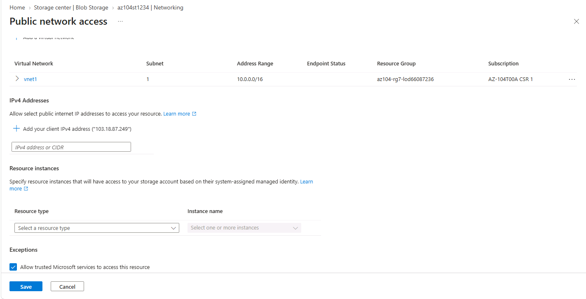

The resulting configuration allows traffic only from the configured virtual network.

---

## 25. Test Unauthorized Access

After restricting access to the virtual network, Storage Browser was refreshed.

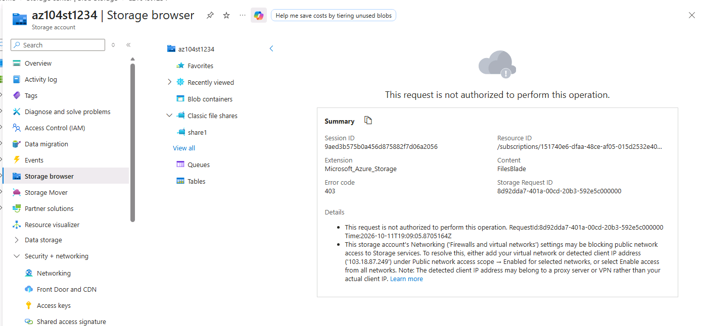

The expected result is an authorization error because the current client is not connecting from the allowed virtual network.

The lab notes that it may take a few minutes for the network restriction to take effect.

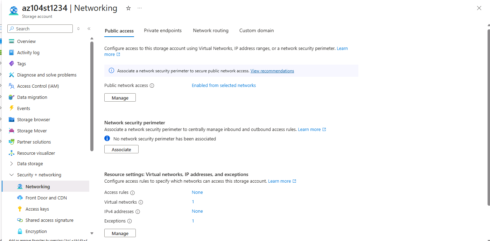

### Access Flow

```text
External Client
      |
      X
      |
Azure Storage
      ^
      |
      | Allowed
      |
   vnet1
      |
   Default Subnet
      |
Microsoft.Storage
Service Endpoint
```

---

# 26. Security Controls Demonstrated

This lab demonstrates multiple Azure Storage security mechanisms.

| Security Mechanism   | Purpose                                 |
| -------------------- | --------------------------------------- |
| Private container    | Prevent anonymous blob access           |
| Storage networking   | Restrict network sources                |
| RBAC                 | Control user permissions                |
| User delegation SAS  | Provide temporary controlled access     |
| Immutable storage    | Protect data from modification/deletion |
| Service endpoint     | Restrict storage access to a VNet       |
| Lifecycle management | Automatically transition data tiers     |

---

# 27. Storage Redundancy

The storage account was configured with:

```text
Geo-Redundant Storage (GRS)
```

Azure Storage supports several redundancy models, including:

* LRS – Locally Redundant Storage
* ZRS – Zone-Redundant Storage
* GRS – Geo-Redundant Storage

GRS provides replication to a secondary region for additional protection against regional failures.

---

# 28. Blob Storage vs Azure Files

| Feature          | Azure Blob Storage                 | Azure Files           |
| ---------------- | ---------------------------------- | --------------------- |
| Primary Purpose  | Object storage                     | Managed file shares   |
| Data Type        | Unstructured objects               | Files and directories |
| Container/Share  | Blob container                     | File share            |
| Folder Structure | Virtual hierarchy                  | Directory hierarchy   |
| Typical Use      | Images, videos, backups, documents | Shared file storage   |
| Lab Resource     | `data`                             | `share1`              |
| Management Tool  | Azure Portal / Storage Browser     | Storage Browser       |

---

# 29. Key Concepts

### Storage Account

A storage account provides a unique namespace for Azure Storage data.

It can contain:

```text
Storage Account
├── Blob containers
├── File shares
├── Queues
└── Tables
```

### Blob

A blob is an object used to store unstructured data such as images, documents, and multimedia.

### Blob Access Tier

Blob data can use different access tiers depending on access frequency and storage requirements.

The lab demonstrates the **Hot** tier and lifecycle transition to **Cool**.

### Azure Files

Azure Files provides managed shared file storage organized using directories and files.

### SAS

A Shared Access Signature provides controlled access to storage resources for a specified period and with specified permissions.

### RBAC

Azure RBAC controls what authenticated users are authorized to do with Azure resources.

### Immutable Storage

Immutable storage supports WORM-style data protection using policies such as time-based retention.

### Service Endpoint

A service endpoint allows a virtual network subnet to access supported Azure services using the Azure backbone and allows the service to identify traffic from that subnet.

---

# 30. Validation Summary

| Validation                 | Expected Result                          |
| -------------------------- | ---------------------------------------- |
| Storage account deployment | Successful                               |
| GRS configuration          | Enabled                                  |
| Public access              | Restricted                               |
| Lifecycle rule             | `Movetocool` configured                  |
| Blob container             | `data` created                           |
| Container anonymous access | Disabled                                 |
| Retention policy           | 180 days                                 |
| Blob upload                | Successful                               |
| Direct blob URL            | Access denied                            |
| SAS URL                    | Blob accessible                          |
| Azure File share           | `share1` created                         |
| Storage Browser            | File share accessible before restriction |
| `vnet1`                    | Created                                  |
| Microsoft.Storage endpoint | Configured                               |
| External storage access    | Unauthorized after restriction           |

---

# 31. What I Learned

Through this lab, I gained practical experience with:

* Creating Azure Storage accounts.
* Selecting appropriate storage redundancy.
* Restricting storage network access.
* Managing Blob containers.
* Configuring blob lifecycle policies.
* Using Cool storage for less frequently accessed data.
* Configuring immutable blob retention.
* Assigning Azure Storage RBAC roles.
* Generating user delegation SAS URLs.
* Creating Azure File shares.
* Using Azure Storage Browser.
* Restricting storage access through a virtual network.
* Configuring the Microsoft.Storage service endpoint.
* Validating storage security through access testing.

---

# 32. Skills Demonstrated

* Azure Storage Administration
* Azure Blob Storage
* Azure Files
* Azure RBAC
* Storage Security
* Storage Networking
* Storage Redundancy
* Lifecycle Management
* Immutable Storage
* Shared Access Signatures
* Azure Virtual Networking
* Service Endpoints
* Access Control
* Cloud Storage Architecture

---

# 33. Cleanup

If using a personal Azure subscription, delete the lab resource group after completing the required screenshots and documentation.

Resource group:

```text
az104-rg7-lod66087236
```

### Azure CLI

```bash
az group delete --name az104-rg7-lod66087236
```

### Azure PowerShell

```powershell
Remove-AzResourceGroup -Name az104-rg7-lod66087236
```

> **Important:** Only delete the resource group if it contains resources created specifically for this lab.

---

# 34. Lab Completion

**Status:** Completed

### Completed Tasks

* [x] Created and configured an Azure Storage account
* [x] Configured geo-redundant storage
* [x] Configured storage network restrictions
* [x] Created a Blob container
* [x] Configured private blob access
* [x] Configured 180-day immutable retention
* [x] Uploaded a block blob
* [x] Configured Azure Storage RBAC
* [x] Generated a user delegation SAS
* [x] Created an Azure File share
* [x] Used Storage Browser
* [x] Created a virtual network
* [x] Configured Microsoft.Storage service endpoint
* [x] Restricted storage access to the virtual network
* [x] Validated unauthorized access

---

## 35. References

* Microsoft Learn – AZ-104: Manage Azure Storage
* Azure Storage documentation
* Azure Blob Storage documentation
* Azure Files documentation
* Azure Storage security and networking documentation

---

## Repository Structure

```text
08-manage-azure-storage/
├── README.md
├── screenshots/
│   ├── 00-architecture-diagram.png
│   ├── 01-storage-account-create.png
│   ├── 02-storage-account-basics.png
│   ├── 03-storage-account-redundancy.png
│   ├── 04-storage-account-networking-disabled.png
│   ├── 05-storage-account-deployment-success.png
│   ├── 06-storage-account-overview.png
│   ├── 07-storage-account-network-selected-networks.png
│   ├── 08-storage-account-client-ip-allowed.png
│   ├── 09-storage-account-redundancy-overview.png
│   ├── 10-lifecycle-management-rule.png
│   ├── 11-lifecycle-movetocool-condition.png
│   ├── 12-blob-container-created.png
│   ├── 13-container-private-access.png
│   ├── 14-blob-immutability-policy.png
│   ├── 15-blob-retention-180-days.png
│   ├── 16-storage-account-key-access.png
│   ├── 17-blob-data-contributor-role.png
│   ├── 18-storage-file-data-contributor-role.png
│   ├── 19-blob-upload-configuration.png
│   ├── 20-blob-upload-success.png
│   ├── 21-blob-overview-properties.png
│   ├── 22-private-blob-access-denied.png
│   ├── 23-generate-blob-sas.png
│   ├── 24-user-delegation-sas-settings.png
│   ├── 25-blob-sas-access-success.png
│   ├── 26-file-share-created.png
│   ├── 27-file-share-configuration.png
│   ├── 28-storage-browser-file-share.png
│   ├── 29-file-upload-success.png
│   ├── 30-vnet1-created.png
│   ├── 31-storage-service-endpoint.png
│   ├── 32-storage-vnet-access-restricted.png
│   ├── 33-storage-browser-unauthorized.png
│   └── 34-storage-networking-final-state.png
└── notes/
    ├── azure-storage-concepts.md
    └── blob-vs-file-storage.md
```
