# Lab 09 – Manage Virtual Machines

## Overview

This lab explores the management of Azure virtual machines (VMs) and virtual machine scale sets (VMSS). It covers deploying virtual machines across availability zones, managing VM sizes, configuring scale sets, and implementing autoscaling policies.

The lab also introduces managing virtual machines through Azure PowerShell and the Azure CLI as optional exercises.

The practical work focuses on understanding how Azure compute resources can be deployed, scaled, monitored, and managed to support availability, performance, and operational requirements.

## Objectives

By completing and documenting this lab, the following Azure administration concepts are explored:

* Deploy virtual machines across availability zones.
* Understand the relationship between VM availability and availability zones.
* Stop and deallocate a virtual machine.
* Resize a virtual machine to meet changing workload requirements.
* Understand managed data disks and disk SKU availability.
* Deploy a virtual machine scale set across availability zones.
* Configure virtual networking, subnets, network security groups, and load balancing.
* Create autoscaling rules based on CPU utilization.
* Configure minimum, maximum, and default instance counts.
* Understand the use of Azure PowerShell and Azure CLI for VM management.

## Lab Environment

| Setting                                    | Value                                                                                                                           |
| ------------------------------------------ | ------------------------------------------------------------------------------------------------------------------------------- |
| Resource group                             | `az104-rg8-lod66120625`                                                                                                         |
| Primary VM region                          | `West US 2`                                                                                                                     |
| VM availability zones                      | Zones 1 and 2                                                                                                                   |
| VM image                                   | Windows Server 2025 Datacenter: Azure Edition / selected Windows Server 2025 Datacenter image, depending on portal availability |
| Initial VM size                            | `Standard_D2s_v5`                                                                                                               |
| Resized VM size                            | `Standard_D4s_v5`                                                                                                               |
| VM Scale Set                               | `vmss1`                                                                                                                         |
| VM Scale Set zones                         | Zones 1, 2, and 3                                                                                                               |
| VM Scale Set virtual network               | `vmss-vnet`                                                                                                                     |
| VM Scale Set subnet                        | `subnet0`                                                                                                                       |
| VM Scale Set subnet address range          | `10.82.0.0/24`                                                                                                                  |
| VM Scale Set virtual network address range | `10.82.0.0/20`                                                                                                                  |
| Network security group                     | `vmss1-nsg`                                                                                                                     |
| Load balancer                              | `vmss-lb`                                                                                                                       |
| Initial VMSS instance count                | 2                                                                                                                               |
| Minimum VMSS instances                     | 2                                                                                                                               |
| Maximum VMSS instances                     | 10                                                                                                                              |
| Default VMSS instances                     | 2                                                                                                                               |

> **Environment note:** Azure regions, availability zones, VM sizes, and managed disk SKUs have different availability constraints. The actual options presented in the Azure portal may differ from the lab instructions.

## Repository Structure

```text
09-manage-virtual-machines/
├── README.md
├── screenshots/
│   ├── 00-vm-architecture-diagram.png
│   ├── 01-create-zone-resilient-vms.png
│   ├── 02-vm-availability-zones.png
│   ├── 03-vm-deployment-success.png
│   ├── 04-vm1-overview.png
│   ├── 05-vm2-overview.png
│   ├── 06-vm1-stop-deallocated.png
│   ├── 07-vm1-resize-d4s-v5.png
│   ├── 08-vm1-resized-overview.png
│   ├── 09-vmss-architecture-diagram.png
│   ├── 10-create-vmss-basics.png
│   ├── 11-vmss-availability-zones.png
│   ├── 12-vmss-network-configuration.png
│   ├── 13-vmss-network-security-group.png
│   ├── 14-vmss-allow-http-rule.png
│   ├── 15-vmss-public-ip-enabled.png
│   ├── 16-vmss-load-balancer.png
│   ├── 17-vmss-deployment-success.png
│   ├── 18-vmss-overview.png
│   ├── 19-vmss-custom-autoscale.png
│   ├── 20-vmss-scale-out-rule.png
│   ├── 21-vmss-scale-in-rule.png
│   ├── 22-vmss-instance-limits.png
│   └── 23-vmss-instances-overview.png
└── notes/
    ├── vm-scaling-and-availability.md
    └── vmss-autoscaling-concepts.md
```

**Screenshot note:** This structure lists the intended screenshot filenames. Keep only images that have actually been captured. The optional PowerShell and Azure CLI exercises do not have screenshots in this lab submission.

---

# Task 1 – Deploy Zone-Resilient Virtual Machines

## Objective

Deploy two Azure virtual machines in the same region but in different availability zones.

This demonstrates how distributing workloads across availability zones can improve resilience to certain datacenter-level failures.

### Configuration

| Setting                    | Value                                |
| -------------------------- | ------------------------------------ |
| VM 1                       | `az104-vm1`                          |
| VM 2                       | `az104-vm2`                          |
| Availability zone for VM 1 | Zone 1                               |
| Availability zone for VM 2 | Zone 2                               |
| Region                     | West US 2                            |
| VM size                    | `Standard_D2s_v5`                    |
| Operating system           | Windows Server 2025 Datacenter image |
| Administrator username     | `localadmin`                         |
| Public inbound ports       | None                                 |
| OS disk type               | Premium SSD                          |
| Boot diagnostics           | Disabled                             |

### Procedure

1. Open the Azure portal.
2. Navigate to **Virtual machines**.
3. Start creating the first virtual machine, `az104-vm1`.
4. Select the resource group, region, availability zone, image, and VM size.
5. Configure the administrator account.
6. Leave public inbound ports disabled.
7. Select the required OS disk configuration.
8. Review the configuration and deploy the VM.
9. Repeat the process to create `az104-vm2`, selecting a different availability zone.
10. Verify both deployments and their assigned zones.

### Screenshots

**Architecture diagram**

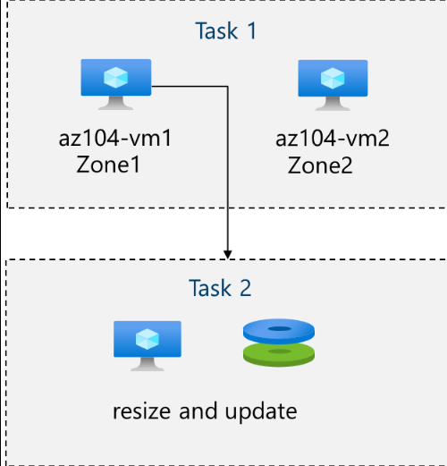

**VM creation configuration**

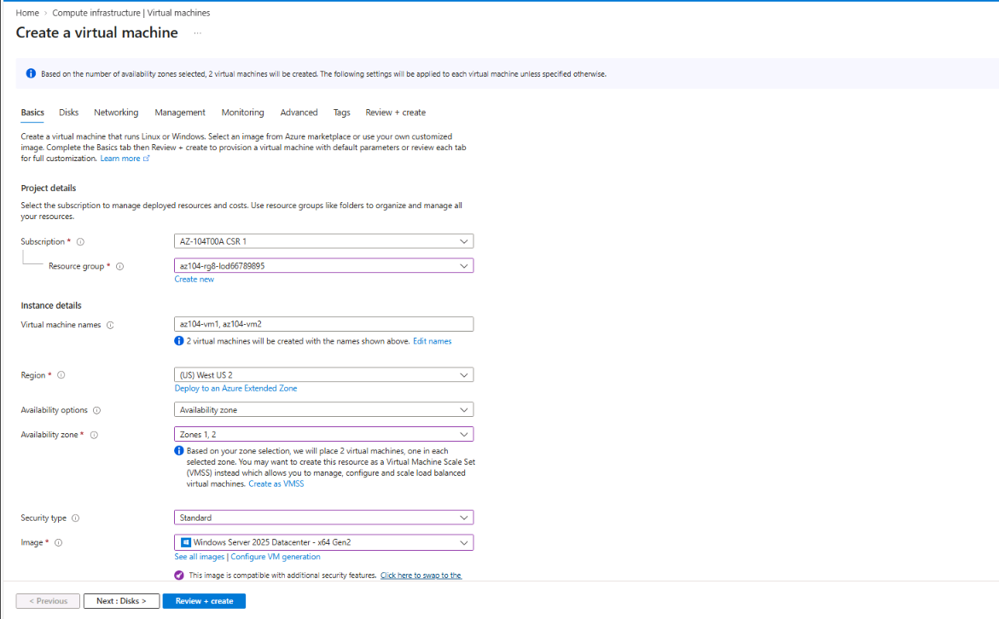

**Availability zone configuration**

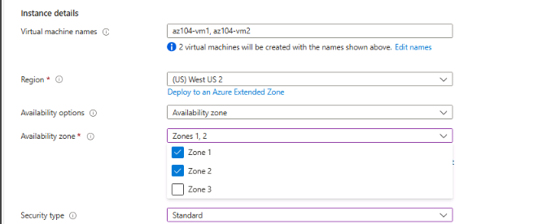

**Deployment result**

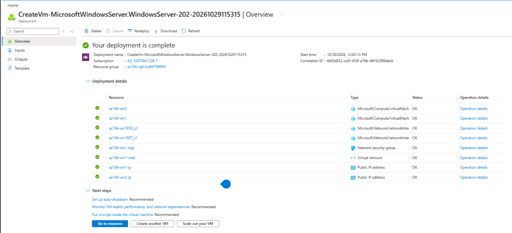

**VM 1 overview**

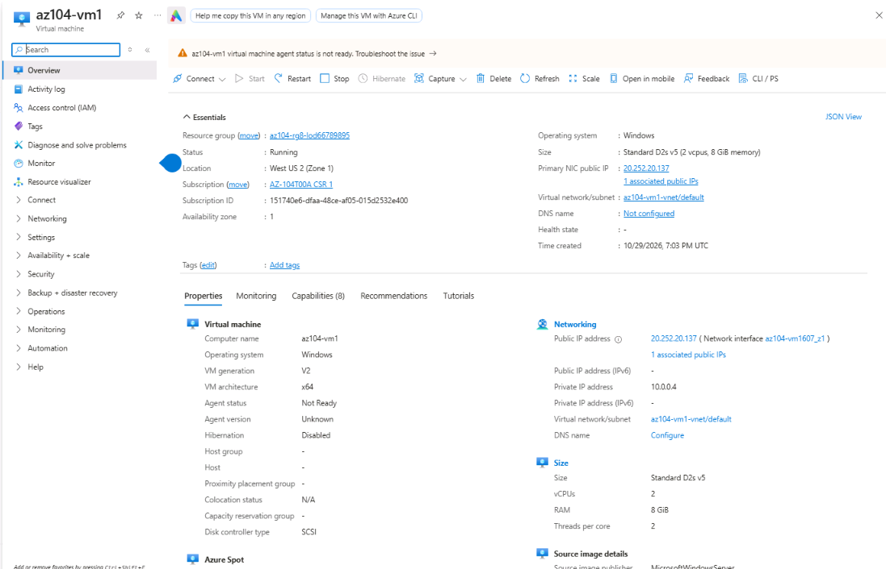

**VM 2 overview**

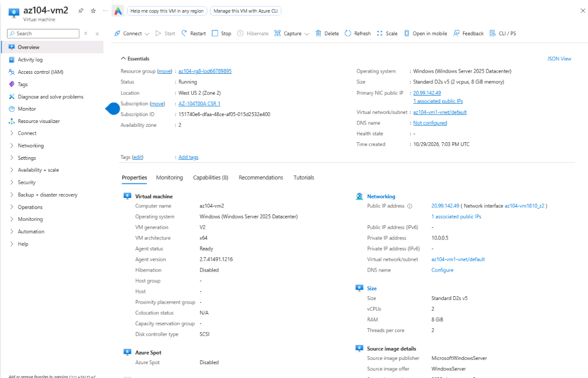

### Key Learning Points

* Availability zones are separate physical locations within a supported Azure region.
* Deploying workloads across zones can reduce the impact of a zonal failure.
* A zone-resilient design requires more than creating two VMs; application architecture, networking, storage, and failover behavior must also be considered.
* Azure VM availability SLAs depend on the deployment configuration and applicable service terms. A particular SLA should not be assumed solely because two VMs exist.

---

# Task 2 – Manage VM State, Resize a VM, and Understand Managed Disks

## Objective

Explore virtual machine power states, change the VM size, and understand the management of managed data disks.

## Part A – Stop and Deallocate VM 1

Azure distinguishes between shutting down an operating system and deallocating the underlying VM compute resources.

### Procedure

1. Open `az104-vm1` in the Azure portal.
2. Select **Stop**.
3. Confirm the operation if prompted.
4. Wait until the VM reaches the **Stopped (deallocated)** state.
5. Verify the final state in the VM overview.

### Screenshot

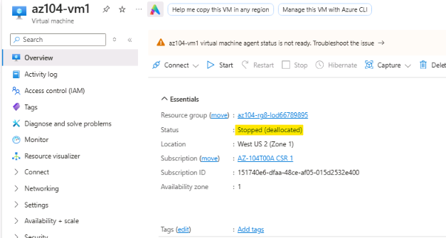

### Key Learning Points

* A stopped VM may still be allocated to a physical host.
* A deallocated VM releases its allocated compute resources.
* Deallocation generally stops VM compute charges, but disks and other retained resources may continue to incur charges.
* Static public IP addresses and other associated resources may remain billable.
* The behavior of networking resources depends on their configuration and pricing.

## Part B – Resize the Virtual Machine

The VM is resized from `Standard_D2s_v5` to `Standard_D4s_v5`.

| VM Size           | vCPUs | Memory |
| ----------------- | ----: | -----: |
| `Standard_D2s_v5` |     2 |  8 GiB |
| `Standard_D4s_v5` |     4 | 16 GiB |

### Procedure

1. Open `az104-vm1`.
2. Confirm that the VM is stopped and deallocated.
3. Navigate to **Size**.
4. Select `Standard_D4s_v5`, if available.
5. Apply the change.
6. Verify the selected size in the VM overview.

If the requested size is unavailable, Azure may offer alternatives depending on the region, zone, VM family, subscription quota, and current capacity.

### Screenshots

**VM resize configuration**

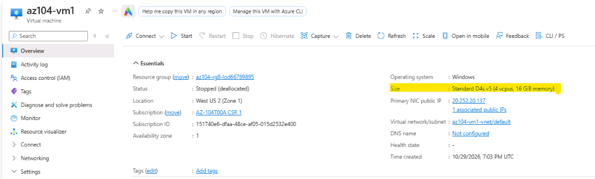

**Updated VM configuration**

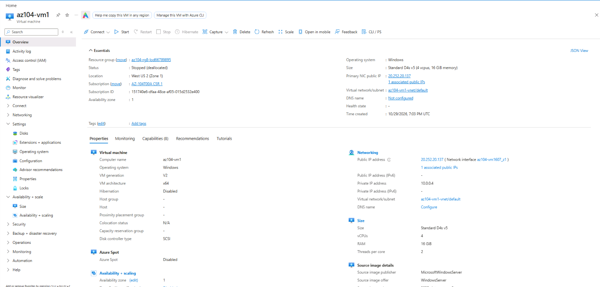

### Key Learning Points

* Vertical scaling changes the compute capacity of an existing VM.
* Resizing can require the VM to be stopped and deallocated.
* A larger VM size typically provides additional CPU and memory capacity.
* The selected VM size must be supported by the target region and, where applicable, availability zone.
* VM resizing can affect cost.

## Part C – Managed Data Disk Exercise

The original lab includes creating a managed data disk named `vm1-disk1`, detaching it, changing its disk type, and attaching it again.

### Intended Configuration

| Setting             | Value             |
| ------------------- | ----------------- |
| Disk name           | `vm1-disk1`       |
| Initial disk type   | Standard HDD      |
| Disk size           | 32 GiB            |
| Follow-up operation | Detach the disk   |
| Target disk type    | Standard SSD      |
| Final operation     | Reattach the disk |

### Environment Limitation

The selected Azure region and availability-zone configuration did not offer the required Standard HDD option for this exercise. Consequently, the disk workflow could not be completed as originally specified.

The Standard HDD disk task is therefore documented as **blocked by the available regional/zone disk configuration**. No screenshots are included for the disk operations, and successful completion is not claimed.

### Key Learning Points

* Azure managed disks provide persistent storage for virtual machines.
* Disk SKU availability depends on the selected region, zone, disk configuration, and other Azure constraints.
* Detaching a data disk does not automatically delete it.
* Changing a disk SKU may be possible when the target SKU is supported and the disk meets the applicable requirements.
* Disk operations should be verified in the portal before considering a task complete.

---

# Task 3 – Deploy a Virtual Machine Scale Set

## Objective

Create a virtual machine scale set that distributes instances across availability zones and uses Azure networking and load-balancing components.

A virtual machine scale set enables the deployment and management of a group of load-balanced VMs.

## VMSS Configuration

| Setting                       | Value                                |
| ----------------------------- | ------------------------------------ |
| VM Scale Set name             | `vmss1`                              |
| Resource group                | `az104-rg8-lod66120625`              |
| Region                        | West US 2                            |
| Availability zones            | Zones 1, 2, and 3                    |
| Orchestration mode            | Uniform                              |
| Security type                 | Standard                             |
| Operating system              | Windows Server 2025 Datacenter image |
| VM size                       | `Standard_D2s_v5`                    |
| Administrator username        | `localadmin`                         |
| Virtual network               | `vmss-vnet`                          |
| Virtual network address space | `10.82.0.0/20`                       |
| Subnet                        | `subnet0`                            |
| Subnet address range          | `10.82.0.0/24`                       |
| Network security group        | `vmss1-nsg`                          |
| Load balancer                 | `vmss-lb`                            |
| Public IP                     | Enabled                              |
| Boot diagnostics              | Disabled                             |

### Procedure

1. Navigate to **Virtual machine scale sets** in the Azure portal.
2. Select **Create**.
3. Choose the resource group and region.
4. Enter `vmss1` as the scale set name.
5. Configure Uniform orchestration and the required security setting.
6. Select the Windows Server image and `Standard_D2s_v5` VM size.
7. Configure availability zones 1, 2, and 3, where supported.
8. Configure the virtual network and subnet.
9. Configure the network security group.
10. Enable the required public IP and load-balancing configuration.
11. Review and deploy the scale set.
12. Verify the deployment and instance configuration.

### Screenshots

**VMSS architecture**

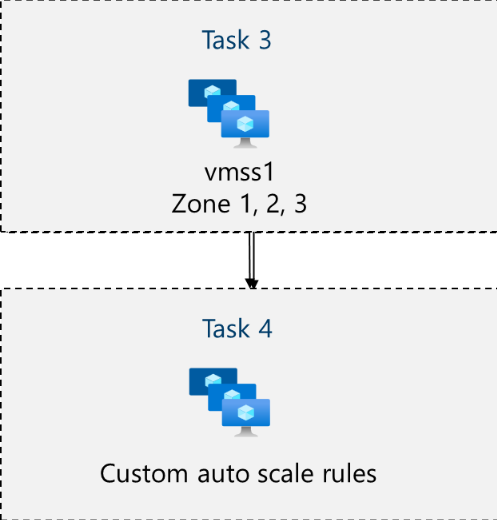

**VMSS basic configuration**

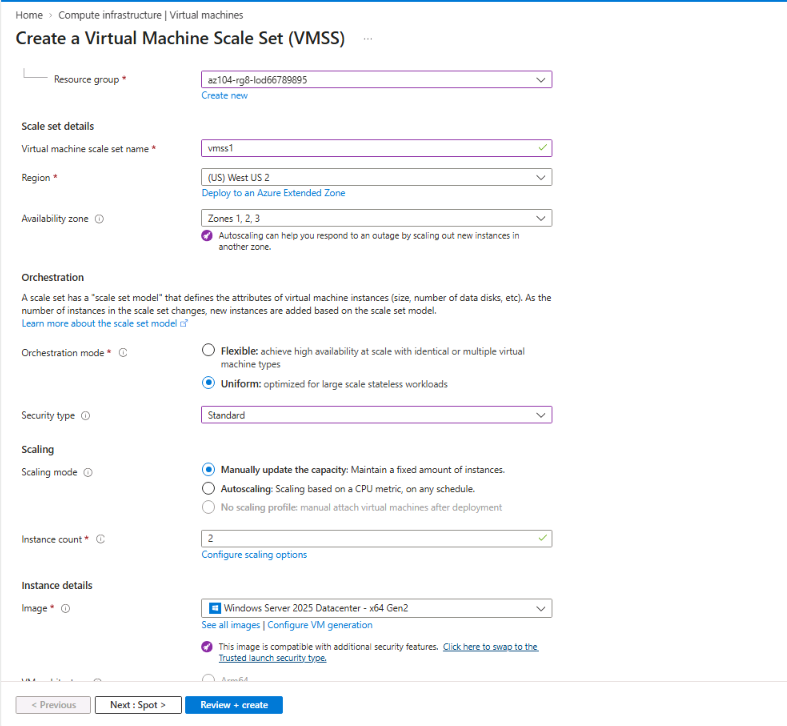

**Availability zones**

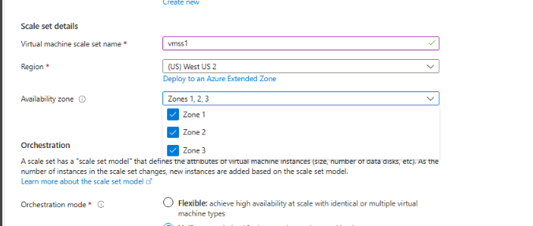

**Network configuration**

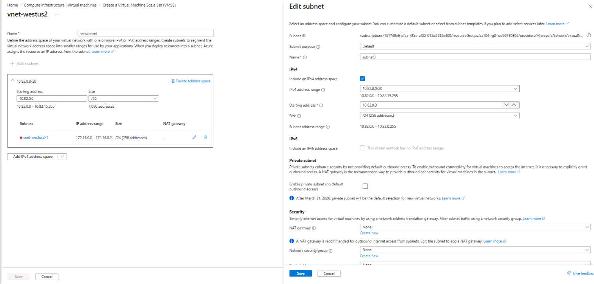

**Network security group**

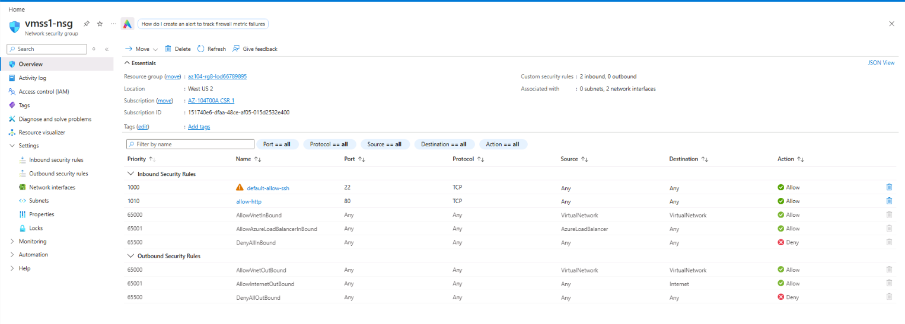

**HTTP inbound rule**

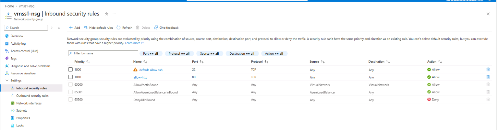

**Public IP configuration**

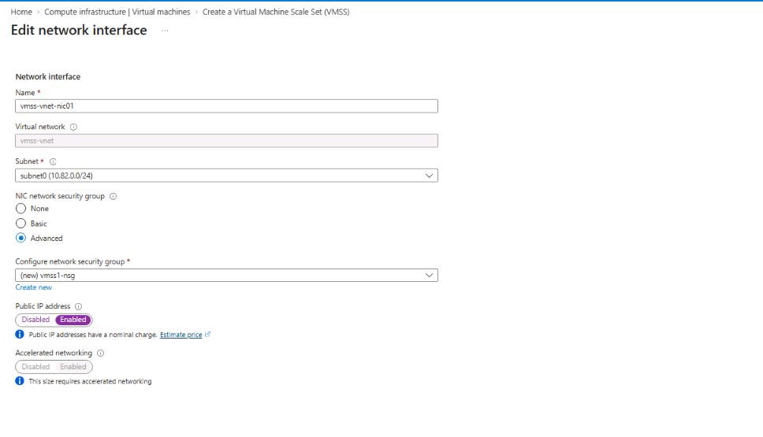

**Load balancer configuration**

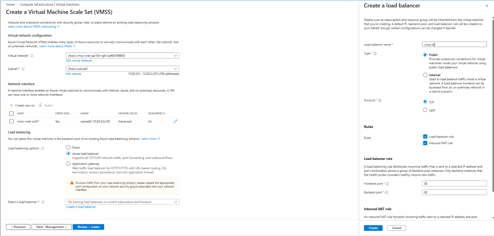

**Deployment result**

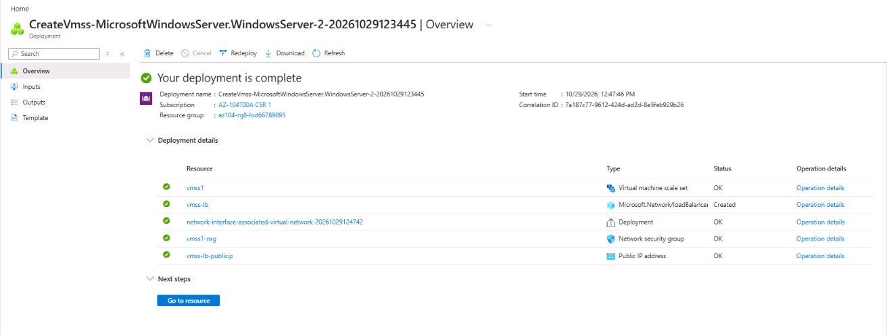

**VMSS overview**

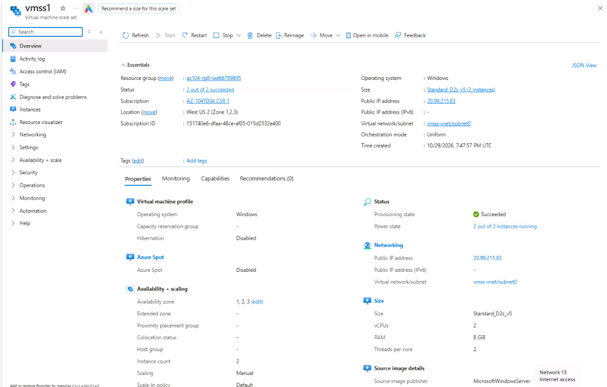

### Key Learning Points

* VMSS centralizes the management of a group of VM instances.
* Uniform orchestration provides a consistent model for managing scale-set instances.
* Availability-zone distribution can improve resilience to zonal failures.
* A load balancer distributes traffic across configured backend instances.
* The NSG controls network traffic according to its inbound and outbound rules.
* A public IP configuration does not, by itself, guarantee that an application is reachable. Routing, security rules, load-balancing rules, and application configuration must also be correct.

---

# Task 4 – Configure VMSS Autoscaling

## Objective

Configure autoscaling rules based on CPU utilization and set instance-count limits.

Autoscaling allows a scale set to adjust the number of VM instances according to workload demand and configured rules.

## Autoscaling Configuration

| Setting                       | Intended value                 |
| ----------------------------- | ------------------------------ |
| Scale set                     | `vmss1`                        |
| Metric source                 | Current VMSS resource          |
| Metric namespace              | Virtual Machine Host           |
| Metric                        | Percentage CPU                 |
| Scale-out threshold           | Greater than 70%               |
| Scale-out evaluation duration | 10 minutes                     |
| Scale-out operation           | Increase instance count by 50% |
| Scale-out cooldown            | 5 minutes                      |
| Scale-in threshold            | Less than 30%                  |
| Instance minimum              | 2                              |
| Instance maximum              | 10                             |
| Default instance count        | 2                              |

> **Configuration verification:** The source lab instructions contain inconsistent scale-in percentage values: the introductory explanation refers to a 20% decrease, while the configuration table specifies a 50% decrease. Verify the saved rule in your Azure environment and document the value actually configured. Do not assume both values are equivalent.

## Part A – Create the Autoscaling Setting

1. Open `vmss1`.
2. Navigate to **Scaling**.
3. Select the option to configure custom autoscaling.
4. Choose the current VMSS as the metric source.
5. Configure the instance minimum, maximum, and default values.
6. Create a scale-out rule.
7. Create a scale-in rule.
8. Save the autoscaling configuration.
9. Verify the saved rules and instance limits.

### Screenshot

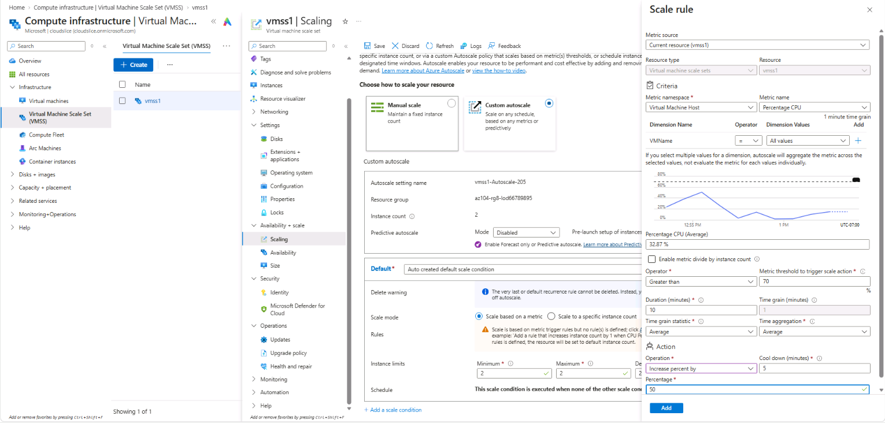

## Part B – Configure the Scale-Out Rule

Configure the rule to increase the number of instances when CPU utilization exceeds the threshold.

| Parameter  | Value               |
| ---------- | ------------------- |
| Metric     | Percentage CPU      |
| Condition  | Greater than        |
| Threshold  | 70%                 |
| Duration   | 10 minutes          |
| Operation  | Increase percent by |
| Percentage | 50%                 |
| Cooldown   | 5 minutes           |

### Important Configuration Detail

The operation must be configured as **Increase percent by** if the intention is to scale the instance count proportionally.

This is different from **Increase count by**, which adds a fixed number of instances.

### Screenshot

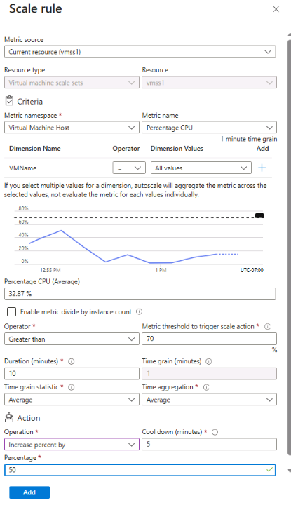

## Part C – Configure the Scale-In Rule

The intended scale-in condition is CPU utilization below 30%.

Configure the scale-in rule according to the source lab requirements, then verify the saved operation and percentage value in Azure.

### Screenshot

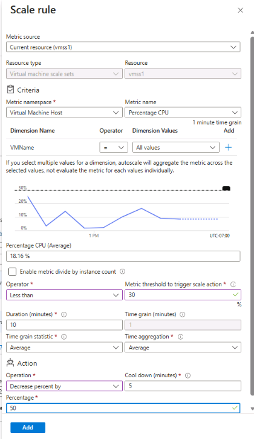

## Part D – Configure Instance Limits

| Parameter         | Value |
| ----------------- | ----: |
| Minimum instances |     2 |
| Maximum instances |    10 |
| Default instances |     2 |

These values define the minimum and maximum scale-set size and the default count used by the autoscaling configuration.

### Screenshots

**Instance limits**

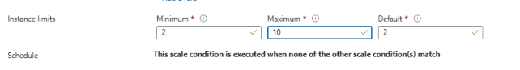

**VMSS instances overview**

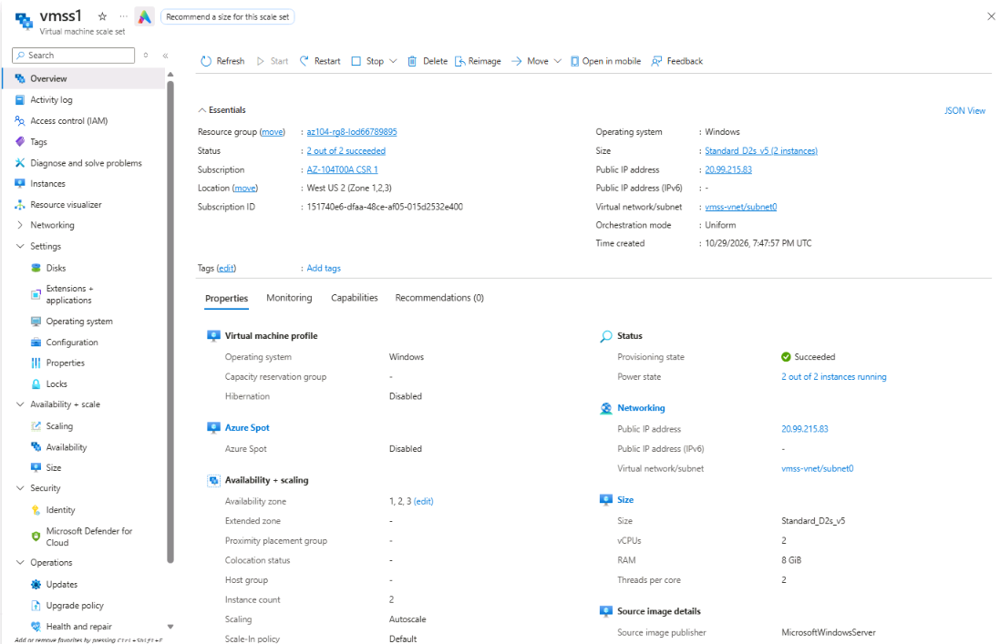

## Key Learning Points

* Scale-out adds instances when demand increases.
* Scale-in removes instances when demand decreases.
* Percentage-based scaling adjusts the instance count proportionally, subject to configured limits and Azure scaling behavior.
* Cooldown periods help prevent scaling actions from occurring too frequently.
* Minimum and maximum counts constrain autoscaling.
* A configured rule does not prove that a scale action occurred. Actual scaling depends on metrics, evaluation windows, cooldowns, limits, and workload conditions.

For a more detailed explanation, see [`notes/vmss-autoscaling-concepts.md`](notes/vmss-autoscaling-concepts.md).

---

# Optional Exercises – Azure PowerShell and Azure CLI

The original lab also introduces VM management through Azure PowerShell and the Azure CLI.

These optional exercises are retained here as reference topics. They were not captured in the practical screenshots for this submission, and successful execution has not been verified as part of this documentation.

## Azure PowerShell Reference

Example commands from the lab:

```powershell
New-AzVM `
  -ResourceGroupName 'az104-rg8-lod66120625' `
  -Name 'myPSVM' `
  -Location 'East US' `
  -Image 'Win2019Datacenter' `
  -Zone '1' `
  -Size 'Standard_D2s_v5' `
  -Credential (Get-Credential)
```

Check the VM status:

```powershell
Get-AzVM `
  -ResourceGroupName 'az104-rg8-lod66120625' `
  -Name 'myPSVM' `
  -Status
```

Stop and deallocate the VM:

```powershell
Stop-AzVM `
  -ResourceGroupName 'az104-rg8-lod66120625' `
  -Name 'myPSVM'
```

The exact image, location, zone, and VM size must be supported by the target Azure environment.

## Azure CLI Reference

Example command from the lab:

```bash
az vm create \
  --name myCLIVM \
  --resource-group az104-rg8-lod66120625 \
  --image Canonical:0001-com-ubuntu-server-jammy:22_04-lts:latest \
  --admin-username localadmin \
  --generate-ssh-keys
```

Check VM details:

```bash
az vm show \
  --name myCLIVM \
  --resource-group az104-rg8-lod66120625 \
  --show-details \
  --output table
```

Deallocate the VM:

```bash
az vm deallocate \
  --name myCLIVM \
  --resource-group az104-rg8-lod66120625
```

These commands are reference examples, not evidence that the optional exercises were completed.

---

# Important AZ-104 Concepts

| Concept                 | Key takeaway                                                    |
| ----------------------- | --------------------------------------------------------------- |
| Availability zones      | Separate physical locations within supported Azure regions      |
| Vertical scaling        | Changing the size of an existing VM                             |
| Horizontal scaling      | Increasing or decreasing the number of VM instances             |
| VM deallocation         | Releasing the allocated VM compute resources                    |
| Managed disks           | Persistent block storage used by Azure VMs                      |
| VM Scale Sets           | Manage and scale groups of VM instances                         |
| Network security groups | Filter network traffic through security rules                   |
| Azure Load Balancer     | Distribute network traffic across backend instances             |
| Autoscaling             | Adjust instance count according to configured rules and metrics |
| Cooldown                | Time period used to reduce repeated scaling actions             |
| Instance limits         | Set the permitted minimum and maximum scale-set capacity        |

## Troubleshooting Notes

### VM Size Unavailable

Possible causes include:

* The size is not supported in the selected region or availability zone.
* The subscription does not have sufficient quota.
* The required capacity is temporarily unavailable.
* The VM's current configuration restricts the available resize options.

Check the available sizes and quota before selecting an alternative.

### Managed Disk SKU Unavailable

Possible causes include:

* The disk SKU is not supported for the selected region or zone.
* The requested configuration is not supported by the selected resource.
* The portal is restricting the available options based on the current deployment configuration.

For this lab, the required Standard HDD option was unavailable in the selected environment. The disk exercise is therefore recorded as blocked rather than completed.

### VMSS Deployment Issues

Check:

* Availability-zone support.
* VM size availability and quota.
* Virtual network and subnet configuration.
* NSG rules and network dependencies.
* Load-balancer configuration.
* Deployment error details in the Azure portal.

### Autoscaling Does Not Trigger

Check:

* The selected metric and metric source.
* The configured threshold and evaluation duration.
* The saved scale-out and scale-in rules.
* The cooldown period.
* Minimum and maximum instance counts.
* Whether the workload produces the expected metric values.

---

# Lab Completion Summary

| Exercise                                     | Documentation status                                        |
| -------------------------------------------- | ----------------------------------------------------------- |
| Deploy two VMs across availability zones     | Documented with the intended screenshot set                 |
| Verify VM configuration                      | Documented with the intended screenshot set                 |
| Stop and deallocate a VM                     | Documented with the intended screenshot set                 |
| Resize a VM                                  | Documented with the intended screenshot set                 |
| Create and change a Standard HDD data disk   | Blocked by the selected environment's disk SKU availability |
| Deploy a VM Scale Set                        | Documented with the intended screenshot set                 |
| Configure VMSS networking and load balancing | Documented with the intended screenshot set                 |
| Configure autoscaling                        | Documented with the intended screenshot set                 |
| Configure VMSS instance limits               | Documented with the intended screenshot set                 |
| Optional PowerShell VM exercise              | Reference commands only; execution not verified             |
| Optional Azure CLI VM exercise               | Reference commands only; execution not verified             |

**Important:** The screenshot filenames in this README represent the planned documentation structure. Confirm that each image exists before treating its associated evidence as captured.

## Cleanup

To avoid unnecessary Azure charges, delete the lab resources when they are no longer needed.

1. Open **Resource groups** in the Azure portal.
2. Select `az104-rg8-lod66120625`.
3. Review the resources within the resource group.
4. Confirm that no resources need to be retained.
5. Select **Delete resource group**.
6. Enter the resource group name to confirm deletion.
7. Verify that the resource group has been removed.

> **Warning:** Deleting the resource group permanently deletes the resources contained within it. Confirm that any required evidence, configurations, and data have been saved before proceeding.

## Related Notes

* [VM Scaling and Availability](notes/vm-scaling-and-availability.md)
* [VMSS Autoscaling Concepts](notes/vmss-autoscaling-concepts.md)

---

**Lab:** Manage Virtual Machines
**Focus:** Azure Compute, Availability Zones, Managed Disks, VM Scale Sets, Networking, and Autoscaling
**Certification:** Microsoft Certified: Azure Administrator Associate (AZ-104)
