# Lab 10 – Implement Web Apps

## Overview

This lab explores Azure App Service and the management of Azure Web Apps.

The practical exercises demonstrate how to deploy a PHP-based web application, create a staging deployment slot, configure deployment from an external Git repository, swap staging and production slots, and configure automatic scaling.

The lab uses an Azure Web App running on Linux with PHP 8.2 and an external GitHub repository containing a sample Hello World application.

It also introduces Azure Load Testing to observe application performance under simulated traffic.

## Objectives

By completing and documenting this lab, the following Azure administration concepts are explored:

* Create and configure an Azure Web App.
* Understand Azure App Service and App Service Plans.
* Configure a PHP runtime stack on Linux.
* Create and manage deployment slots.
* Configure external Git deployment.
* Deploy an application from a GitHub repository.
* Verify application deployment through the default domain.
* Swap staging and production deployment slots.
* Configure automatic scaling.
* Understand minimum instances and maximum burst.
* Configure staging slot elastic instance settings.
* Create an Azure Load Testing resource.
* Configure HTTP requests for load testing.
* Review virtual users, response time, and requests per second.

## Lab Environment

| Setting                                | Value                                |
| -------------------------------------- | ------------------------------------ |
| Azure service                          | Azure App Service                    |
| Resource group                         | `az104-rg9-lod66837092`              |
| Web App name                           | `WebApp66837092`                     |
| Publish method                         | Code                                 |
| Runtime stack                          | PHP 8.2                              |
| Operating system                       | Linux                                |
| Region                                 | East US                              |
| App Service Plan                       | Premium V3 P1V3                      |
| Zone redundancy                        | Default configuration                |
| Production slot                        | Production                           |
| Staging slot                           | `staging`                            |
| Deployment source                      | External Git                         |
| GitHub repository                      | `Azure-Samples/php-docs-hello-world` |
| Git branch                             | `master`                             |
| Scaling method                         | Automatic                            |
| Maximum burst                          | 2                                    |
| Minimum instances                      | 1                                    |
| Staging minimum elastic instance count | 1                                    |

> **Environment note:** The original lab uses East US. If deployment fails because of regional quota or availability restrictions, the lab instructions allow selecting another supported region. Record the actual region used in your environment.

## Repository Structure

```text
10-implement-web-apps/
├── README.md
│
├── screenshots/
│   ├── 00-web-app-architecture-diagram.png
│   ├── 01-create-web-app-basics.png
│   ├── 02-web-app-runtime-configuration.png
│   ├── 03-app-service-plan-configuration.png
│   ├── 04-web-app-deployment-success.png
│   ├── 05-production-web-app-overview.png
│   ├── 06-production-default-domain.png
│   ├── 07-create-staging-deployment-slot.png
│   ├── 08-deployment-slots-overview.png
│   ├── 09-staging-slot-overview.png
│   ├── 10-staging-slot-default-domain.png
│   ├── 11-staging-general-settings.png
│   ├── 12-scm-basic-auth-configuration.png
│   ├── 13-external-git-deployment-settings.png
│   ├── 14-github-repository-configuration.png
│   ├── 15-staging-hello-world-application.png
│   ├── 16-deployment-slot-swap-configuration.png
│   ├── 17-deployment-slot-swap-success.png
│   ├── 18-production-hello-world-application.png
│   ├── 19-app-service-scaling-overview.png
│   ├── 20-automatic-scaling-configuration.png
│   ├── 21-maximum-burst-and-minimum-instances.png
│   ├── 22-staging-minimum-elastic-instance-command.png
│   ├── 23-create-azure-load-test.png
│   ├── 24-load-test-http-request-configuration.png
│   ├── 25-load-test-deployment-success.png
│   ├── 26-load-test-overview.png
│   └── 27-load-test-metrics.png
│
└── notes/
    ├── app-service-and-deployment-slots.md
    └── web-app-scaling-and-load-testing.md
```

---

# Task 1 – Create and Configure an Azure Web App

## Objective

Create an Azure Web App using Azure App Service.

Azure App Service is a Platform as a Service (PaaS) offering that enables organizations to host web applications without managing the underlying server infrastructure.

The selected App Service Plan determines the compute resources, storage, and available features for the Web App.

## Web App Configuration

| Setting          | Value                   |
| ---------------- | ----------------------- |
| Resource group   | `az104-rg9-lod66837092` |
| Web App name     | `WebApp66837092`        |
| Publish          | Code                    |
| Runtime stack    | PHP 8.2                 |
| Operating system | Linux                   |
| Region           | East US                 |
| Pricing plan     | Premium V3 P1V3         |
| Zone redundancy  | Default                 |

## Procedure

1. Sign in to the Azure portal.
2. Search for **App Services**.
3. Select **Create** and choose **Web App**.
4. Select the Azure subscription.
5. Create or select the resource group.
6. Enter the Web App name.
7. Configure the publishing method as **Code**.
8. Select PHP 8.2 as the runtime stack.
9. Select Linux as the operating system.
10. Select the required region.
11. Configure the Premium V3 P1V3 App Service Plan.
12. Review the configuration.
13. Select **Create**.
14. Wait for deployment to finish.
15. Open the newly created Web App using **Go to resource**.

## Screenshots

**Web App creation**

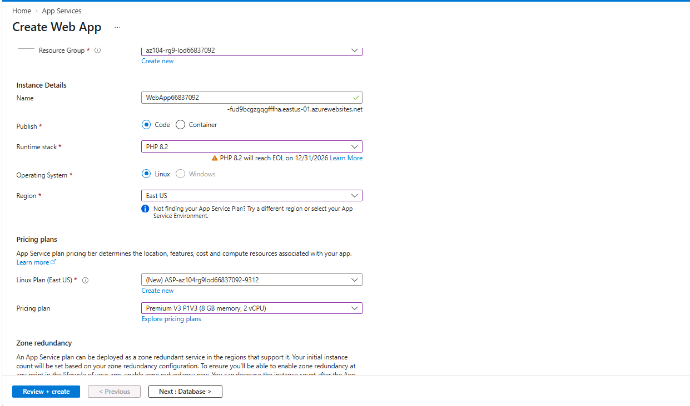

**Runtime configuration**

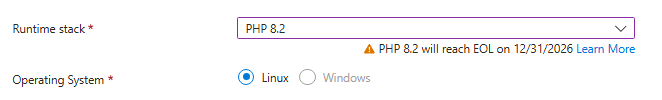

**App Service Plan**

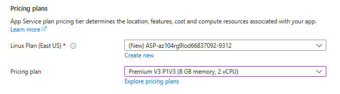

**Deployment result**

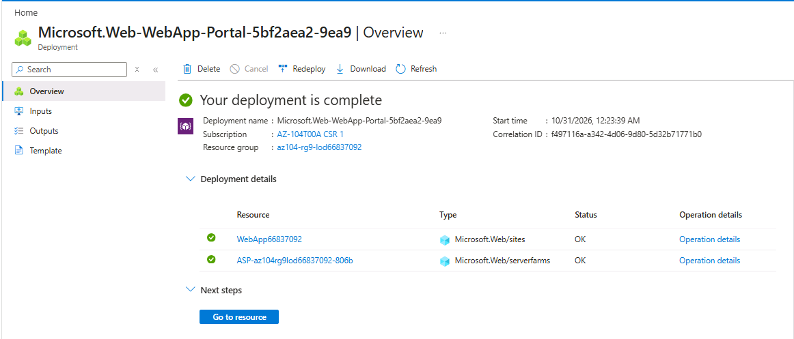

**Production Web App overview**

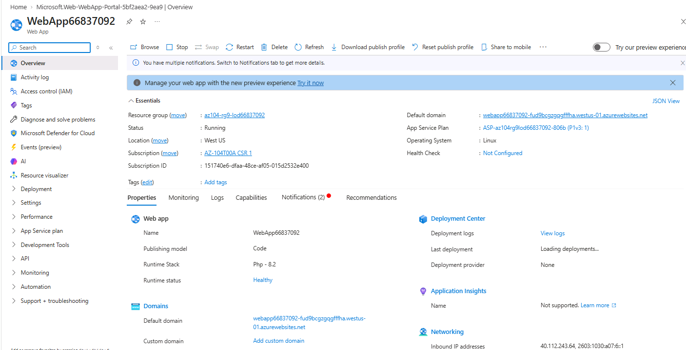

**Default domain**


## Key Learning Points

* Azure App Service is a PaaS hosting platform.
* The publishing option determines whether the application is deployed as code or through another supported method.
* Runtime stack and operating system must be compatible with the application.
* The App Service Plan determines compute capacity and available features.
* Premium plans provide additional capabilities compared with lower pricing tiers.
* Azure Web Apps provide managed hosting without requiring administrators to maintain the underlying operating system.

---

# Task 2 – Create and Configure a Deployment Slot

## Objective

Create a staging deployment slot for the production Web App.

Deployment slots provide separate environments where applications can be deployed and tested before being made available to end users.

The lab creates a slot named `staging`.

## Deployment Slot Configuration

| Setting             | Value                 |
| ------------------- | --------------------- |
| Web App             | `WebApp66837092`      |
| Slot name           | `staging`             |
| Clone settings from | Do not clone settings |

## Procedure

1. Open the production Web App.
2. Select the **Default domain** link to view the default application page.
3. Return to the Azure portal.
4. Navigate to **Deployment slots**.
5. Select **Add slot**.
6. Enter `staging` as the slot name.
7. Select **Do not clone settings**.
8. Select **Add**.
9. Wait for the deployment slot to be created.
10. Refresh the Deployment slots page.
11. Verify that both Production and Staging slots are displayed.
12. Open the staging slot.
13. Review its overview and default domain.

## Screenshots

**Create staging slot**

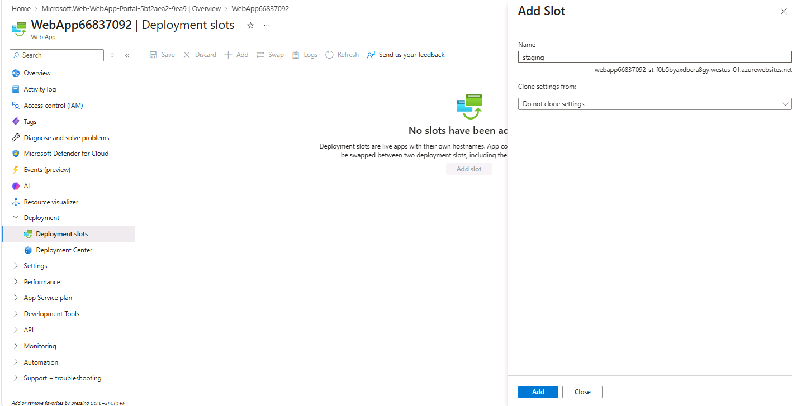

**Deployment slots overview**

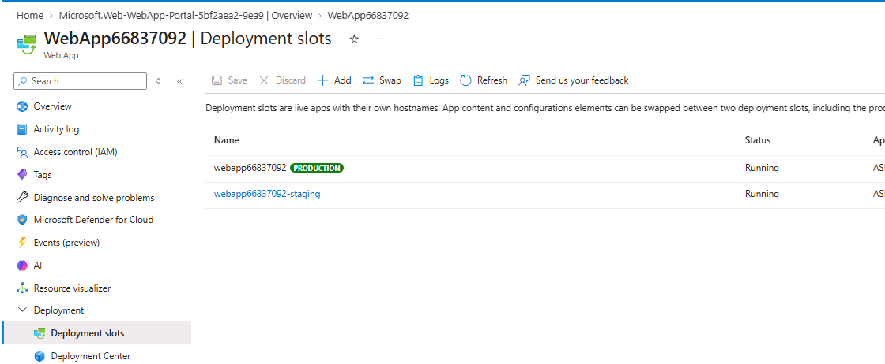

**Staging slot overview**

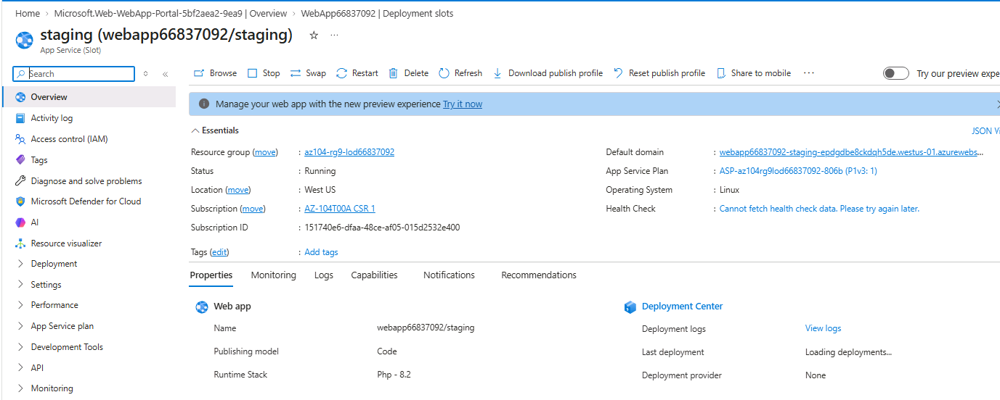

**Staging default domain**

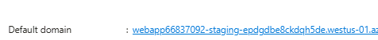

## Key Learning Points

* Deployment slots provide separate application environments.
* The production slot is the primary application environment.
* A staging slot can be used to validate an application before production deployment.
* Each slot has its own URL.
* Slots can be swapped to promote an application to production.
* App Service Plan tier and configuration determine deployment slot availability.

---

# Task 3 – Configure Web App Deployment Settings

## Objective

Configure the staging slot to deploy application code from an external GitHub repository.

The lab uses an external Git repository containing a PHP Hello World application.

## Deployment Configuration

| Setting                | Value                                                   |
| ---------------------- | ------------------------------------------------------- |
| Deployment slot        | `staging`                                               |
| Source                 | External Git                                            |
| Repository             | `Azure-Samples/php-docs-hello-world`                    |
| Branch                 | `master`                                                |
| Publishing credentials | SCM Basic Authentication enabled as required by the lab |

## Procedure

### Part A – Configure General Settings

1. Open the staging deployment slot.
2. Navigate to **Configuration**.
3. Select **General settings**.
4. Locate **SCM Basic Auth Publishing Credentials**.
5. Enable the setting.
6. Select **Apply**.

### Part B – Configure External Git

1. Expand the **Deployment** section.

2. Open **Deployment Center**.

3. Navigate to **Settings**.

4. If required, select the Manual deployment option to display the External Git source.

5. Select **External Git** as the source.

6. Enter the repository:

   `https://github.com/Azure-Samples/php-docs-hello-world`

7. Enter the branch:

   `master`

8. Select **Save**.

9. Return to the staging slot overview.

10. Open the staging default domain.

11. Refresh the application page if necessary.

12. Verify that the application displays **Hello World**.

## Screenshots

**Staging general settings**

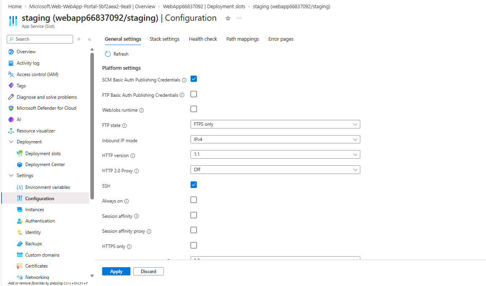

**SCM publishing credentials**

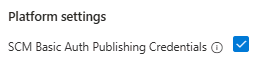

**External Git configuration**

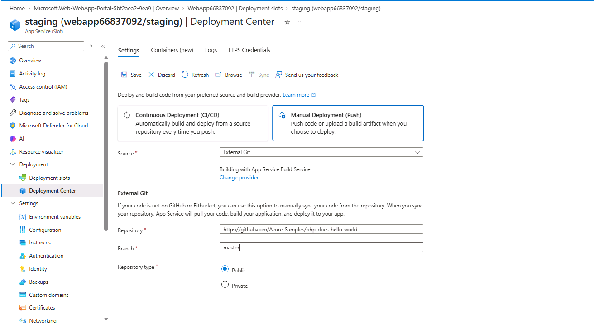

**GitHub repository configuration**

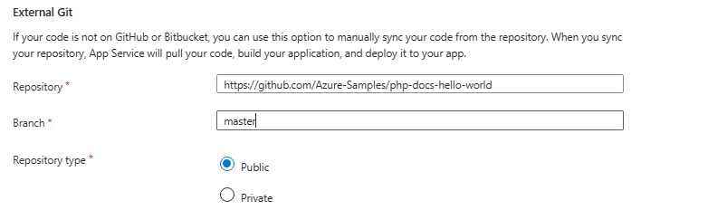

**Staging application result**

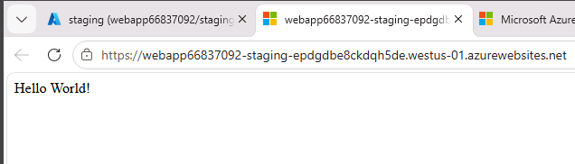

## Key Learning Points

* Deployment Center supports configuring application deployment.
* External Git deployment connects an App Service application to an external Git repository.
* A repository branch identifies the application version to deploy.
* The staging slot can be used to validate the application before production deployment.
* Deployment may take some time, so the application page should be refreshed before concluding that deployment has failed.

### Security Consideration

The original lab requires enabling SCM Basic Authentication for the publishing workflow.

Basic authentication is a security-sensitive setting. For production environments, prefer supported modern authentication methods and secure deployment credentials. Enable basic authentication only where required, restrict access, and review whether it can be disabled after the lab.

---

# Task 4 – Swap Deployment Slots

## Objective

Swap the staging slot with the production slot.

A slot swap promotes the application deployed in staging to production.

This approach helps organizations validate application changes before making them available to users.

## Procedure

1. Return to the production Web App.
2. Navigate to **Deployment slots**.
3. Select **Swap**.
4. Review the source and target slots.
5. Confirm that the staging slot is being swapped with production.
6. Select **Start Swap**.
7. Wait for the swap operation to complete.
8. Return to the production Web App overview.
9. Open the production default domain.
10. Verify that the production application displays **Hello World!**.
11. Save the production default domain URL for the next task.

## Screenshots

**Swap configuration**

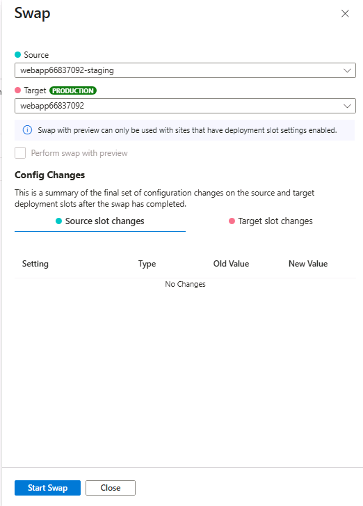

**Swap operation result**

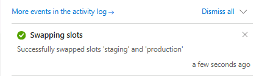

**Production application verification**

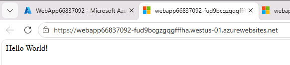

## Key Learning Points

* Slot swapping promotes application content between environments.
* Staging can be used for pre-production testing.
* The production slot can receive the tested application through a swap operation.
* Slot-specific application settings may behave differently during a swap.
* The production application should be verified after the swap.
* Slot swapping helps reduce deployment-related application downtime when the application and configuration support it.

---

# Task 5 – Configure and Test Autoscaling of the Azure Web App

## Objective

Configure automatic scaling for the App Service Plan and use Azure Load Testing to observe application performance under simulated traffic.

Autoscaling allows the application hosting environment to adjust capacity according to demand.

The original lab uses automatic scaling with a maximum burst value of 2 and a minimum instance count of 1.

## Part A – Configure Automatic Scaling

1. Open the production Web App.
2. Navigate to the **App Service Plan** section.
3. Select **Scale out**.
4. Confirm that the production slot is selected.
5. Under Scaling, select **Automatic**.
6. Review the available scaling options.
7. Set **Maximum burst** to 2.
8. Set **Minimum instances** to 1.
9. If a staging slot exists, configure its minimum elastic instance count as described in Part B.
10. Return to the production scaling page.
11. Select **Save**.

### Scaling Configuration

| Setting                                | Value     |
| -------------------------------------- | --------- |
| Scaling method                         | Automatic |
| Maximum burst                          | 2         |
| Minimum instances                      | 1         |
| Staging minimum elastic instance count | 1         |

### Screenshots

**App Service scaling overview**

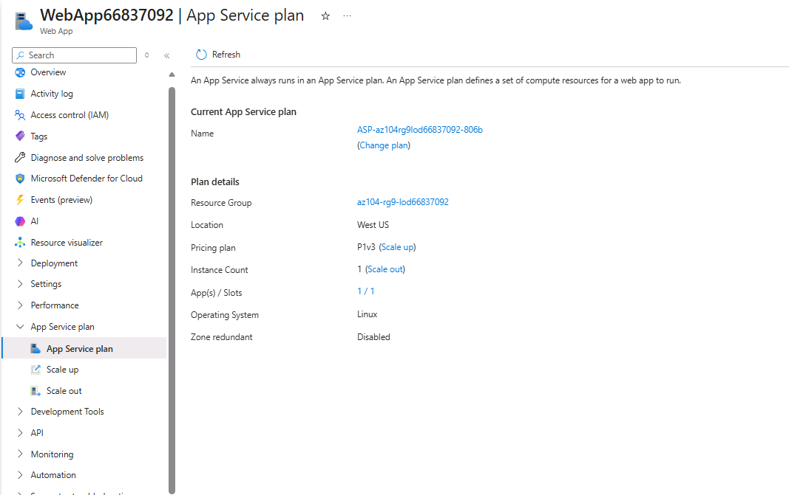

**Automatic scaling configuration**

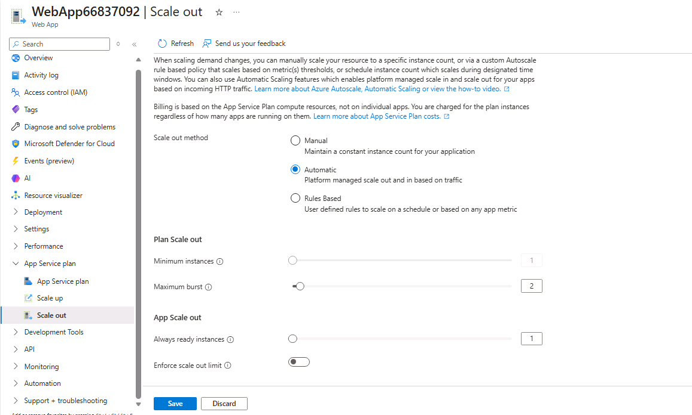

**Maximum burst and minimum instances**

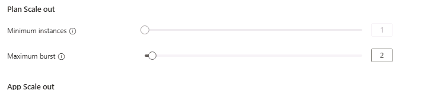

## Part B – Configure the Staging Slot Minimum Elastic Instance Count

The original lab provides an Azure CLI command to configure the staging slot minimum elastic instance count.

Open Azure Cloud Shell and execute:

```bash
az webapp update \
  --resource-group az104-rg9-lod66837092 \
  --name <your-web-app-name> \
  --slot staging \
  --minimum-elastic-instance-count 1
```

Replace `<your-web-app-name>` with the actual Web App name.

Example using the lab Web App name:

```bash
az webapp update \
  --resource-group az104-rg9-lod66837092 \
  --name WebApp66837092 \
  --slot staging \
  --minimum-elastic-instance-count 1
```

After the command succeeds:

1. Return to the production Web App.
2. Open **Scale out**.
3. Verify the automatic scaling configuration.
4. Select **Save**.

### Screenshot

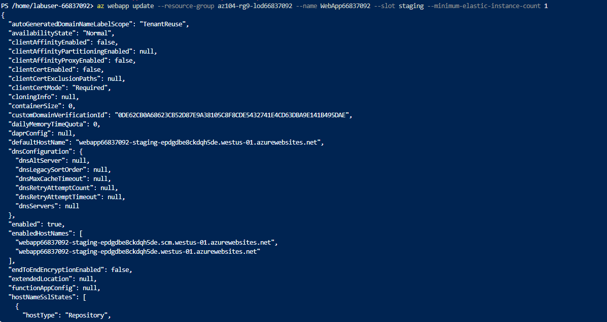

## Part C – Create an Azure Load Test

1. Open the production Web App.
2. Select **Diagnose and solve problems**.
3. Locate the **Load Test your App** section.
4. Select **Create Load Test**.
5. Select **Create**.
6. Enter a unique load test resource name.
7. Select **Review + create**.
8. Select **Create**.
9. Wait for the deployment to complete.
10. Open the newly created Azure Load Testing resource.

### Screenshot

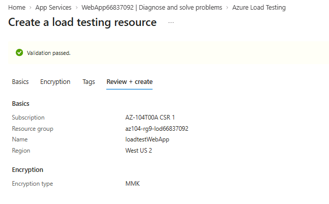

## Part D – Configure HTTP Requests

1. Open the Azure Load Testing resource.
2. Navigate to the Overview section.
3. Under **Create by adding HTTP requests**, select **Create**.
4. Open the **Test plan** tab.
5. Select **Add request**.
6. Enter the production Web App default domain URL.
7. Ensure that the URL starts with `https://`.
8. Select **Add**.
9. Select **Review + create**.
10. Select **Create**.
11. Wait for the test to be created.

### Screenshot

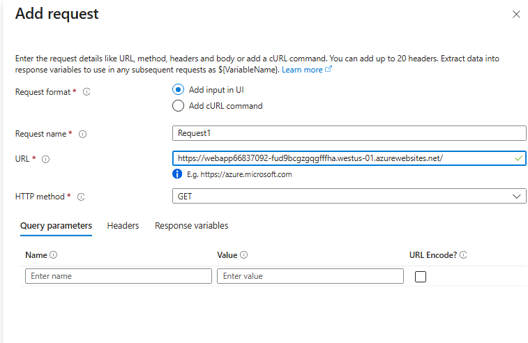

## Part E – Run and Review the Load Test

1. Navigate to the created load test.
2. Open the test run.
3. Refresh the page to review live metrics.
4. Observe:

   * Virtual users
   * Response time
   * Requests per second
5. Select **Stop** to initiate the stop request.
6. Confirm by selecting **Stop** again.

The original lab does not require waiting for the load test to complete.

### Screenshots

**Load test deployment**

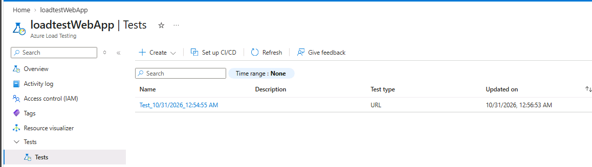

**Load test overview**

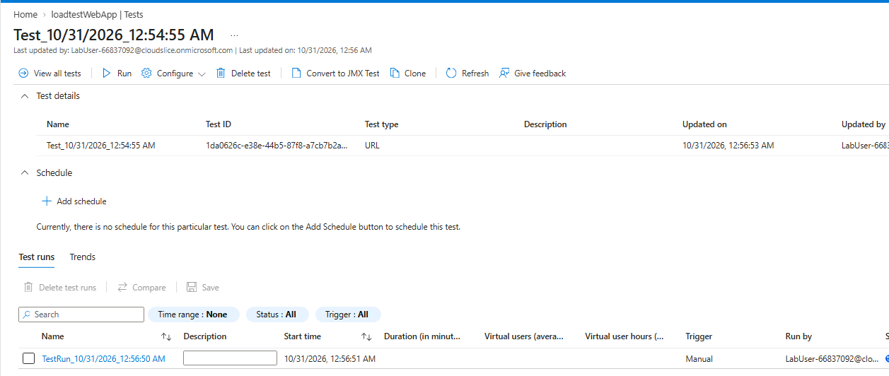

**Load test metrics**

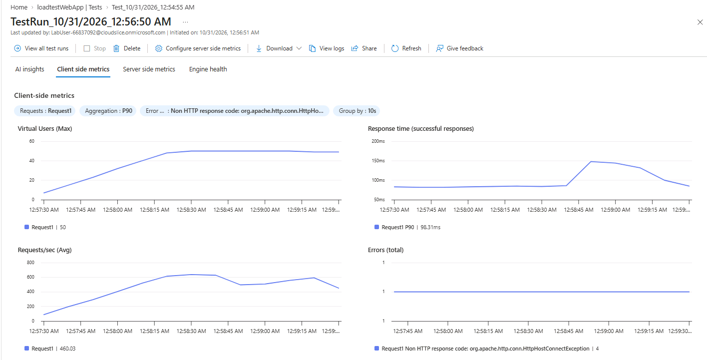

## Key Learning Points

* App Service automatic scaling adjusts hosting capacity according to its configured scaling behavior.
* Maximum burst controls the configured maximum burst capacity.
* Minimum instances establish the configured minimum capacity.
* Deployment slots can have their own elastic instance settings.
* Azure Load Testing can simulate application traffic.
* Virtual users, response time, and requests per second help evaluate application performance.
* Load testing results should be interpreted together with application metrics and scaling configuration.

---

# Important AZ-104 Concepts

| Concept             | Key takeaway                                                  |
| ------------------- | ------------------------------------------------------------- |
| Azure App Service   | PaaS platform for hosting web applications                    |
| App Service Plan    | Defines hosting compute resources, pricing tier, and features |
| Runtime stack       | Determines the application runtime environment                |
| Deployment slots    | Separate environments for application deployment              |
| External Git        | Connects App Service deployment to an external Git repository |
| Staging             | Environment for validating application changes                |
| Production          | Primary environment serving application users                 |
| Slot swapping       | Promotes application content between deployment slots         |
| Automatic scaling   | Adjusts application hosting capacity automatically            |
| Maximum burst       | Configured upper burst capacity for automatic scaling         |
| Minimum instances   | Configured minimum instance count                             |
| Azure Load Testing  | Simulates traffic to evaluate application performance         |
| Response time       | Measures the time taken to respond to requests                |
| Requests per second | Measures request throughput                                   |
| Virtual users       | Represents simulated concurrent users                         |

## Troubleshooting Notes

### Web App Deployment Failure

Possible causes:

* Regional quota limitations.
* Unsupported runtime or operating system combination.
* Unavailable App Service Plan capacity.
* Invalid Web App configuration.
* Subscription restrictions.

Recommended checks:

1. Review the deployment error.
2. Verify the selected region.
3. Check available App Service Plan options.
4. Confirm the PHP runtime and Linux configuration.
5. Retry using another supported region if necessary.

### Staging Slot Not Available

Possible causes:

* The selected App Service Plan tier does not support the required deployment slot functionality.
* The slot already exists.
* The deployment operation is still running.

Check the App Service Plan tier and deployment slot configuration.

### External Git Deployment Failure

Check:

* Repository URL.
* Repository branch.
* External Git source selection.
* SCM publishing credential settings.
* Deployment Center status.
* Application deployment logs.

### Application Does Not Display Hello World

Possible causes:

* Deployment is still in progress.
* The browser is displaying cached content.
* The repository or branch configuration is incorrect.
* The staging slot URL was confused with the production URL.

Refresh the page and verify the correct slot URL.

### Slot Swap Failure

Check:

* Source and target slot selection.
* Deployment status.
* Slot configuration.
* Application settings and other swap-related requirements.
* Azure Activity Log for operation details.

### Autoscaling Configuration Issues

Check:

* Whether the production slot is selected.
* Maximum burst configuration.
* Minimum instance count.
* Staging slot minimum elastic instance count.
* Whether the configuration was saved successfully.

### Load Testing Issues

Check:

* Load test resource deployment status.
* HTTP request URL.
* HTTPS formatting.
* Application availability.
* Test creation and execution status.
* Load test permissions and subscription restrictions.

---

# Lab Completion Summary

| Exercise                                 | Expected outcome                           |
| ---------------------------------------- | ------------------------------------------ |
| Create Azure Web App                     | Linux PHP 8.2 Web App                      |
| Configure App Service Plan               | Premium V3 P1V3                            |
| Create staging slot                      | Staging slot available                     |
| Configure External Git                   | GitHub repository connected                |
| Deploy Hello World                       | Application available in staging           |
| Swap deployment slots                    | Hello World available in production        |
| Configure automatic scaling              | Maximum burst 2, minimum instances 1       |
| Configure staging elastic instance count | Minimum elastic instance count 1           |
| Create Azure Load Test                   | Load test resource deployed                |
| Configure HTTP request                   | Production Web App URL configured          |
| Review load test metrics                 | Virtual users, response time, requests/sec |

**Documentation note:** This table describes the expected lab outcomes. Mark an exercise as completed only after verifying it in your Azure environment.

## Cleanup

To avoid unnecessary Azure charges, delete the lab resources when they are no longer required.

### Azure Portal

1. Open **Resource groups**.
2. Select `az104-rg9-lod66837092`.
3. Review the resources inside the resource group.
4. Confirm that any required evidence has been saved.
5. Select **Delete resource group**.
6. Enter the resource group name.
7. Confirm deletion.
8. Verify that the resource group has been removed.

### Azure PowerShell

```powershell
Remove-AzResourceGroup -Name "az104-rg9-lod66837092"
```

### Azure CLI

```bash
az group delete --name az104-rg9-lod66837092
```

> **Warning:** Deleting the resource group permanently deletes its contained resources. Review the resource list before confirming.

## Additional Learning Resources

* [Host a web application with Azure App Service](https://learn.microsoft.com/en-us/training/modules/host-a-web-app-with-azure-app-service/)
* [Configure web app settings](https://learn.microsoft.com/en-us/training/modules/configure-web-app-settings/)

## Related Notes

* [App Service and Deployment Slots](notes/app-service-and-deployment-slots.md)
* [Web App Scaling and Load Testing](notes/web-app-scaling-and-load-testing.md)

---

**Lab:** Implement Web Apps
**Focus:** Azure App Service, Deployment Slots, External Git, Slot Swapping, Automatic Scaling, and Load Testing
**Certification:** Microsoft Certified: Azure Administrator Associate (AZ-104)
