# Lab 11 – Implement Azure Container Instances

## Overview

This lab explores Azure Container Instances (ACI), a service that allows administrators to deploy and run containers in Microsoft Azure without provisioning or managing the underlying virtual machine infrastructure.

The practical exercises demonstrate how to deploy a Linux container using a Docker image, configure public DNS access, verify the container's running status, access a containerized web application, and inspect container logs.

The lab uses Microsoft's Azure Container Instances Hello World sample image.

## Objectives

By completing and documenting this lab, the following Azure administration concepts are explored:

* Understand Azure Container Instances.
* Understand container-based application deployment.
* Deploy a container using a Docker image.
* Configure container instance networking.
* Assign a public DNS name label.
* Deploy a Linux container using an Azure Quickstart image.
* Verify container deployment and running status.
* Access a containerized web application through its FQDN.
* Inspect container logs.
* Identify HTTP GET requests generated by browser access.
* Understand the benefits of running containers without managing virtual machines.

## Lab Environment

| Setting              | Value                                               |
| -------------------- | --------------------------------------------------- |
| Azure service        | Azure Container Instances                           |
| Resource group       | `az104-rg9-lod66839366`                             |
| Container name       | `az104-c1`                                          |
| Region               | East US                                             |
| Image source         | Quickstart images                                   |
| Container image      | `mcr.microsoft.com/azuredocs/aci-helloworld:latest` |
| Operating system     | Linux                                               |
| Networking           | Public                                              |
| DNS name label       | Custom globally unique label                        |
| Application protocol | HTTP                                                |
| Application port     | 80                                                  |
| Monitoring           | Container instance logs unchecked during creation   |

> **Environment note:** The original lab uses East US. If the selected region is unavailable, another supported Azure region can be used. The DNS name label must be globally unique within the applicable Azure DNS namespace.

## Repository Structure

```text
11-implement-azure-container-instances/
│
├── README.md
│
├── screenshots/
│   ├── 00-aci-architecture-diagram.png
│   ├── 01-create-container-instance-basics.png
│   ├── 02-container-image-configuration.png
│   ├── 03-container-dns-configuration.png
│   ├── 04-container-monitoring-configuration.png
│   ├── 05-container-review-and-create.png
│   ├── 06-container-deployment-success.png
│   ├── 07-container-instance-overview-running.png
│   ├── 08-container-instance-fqdn.png
│   ├── 09-aci-helloworld-web-application.png
│   ├── 10-container-logs-overview.png
│   └── 11-container-http-get-logs.png
│
└── notes/
    ├── azure-container-instances-fundamentals.md
    └── aci-deployment-networking-and-logs.md
```

---

# Task 1 – Deploy an Azure Container Instance Using a Docker Image

## Objective

Deploy a Linux-based Azure Container Instance using a Docker container image.

Azure Container Instances provides a managed environment for running containers without requiring administrators to create and maintain virtual machines.

The lab deploys a sample Hello World web application using Microsoft's container image.

## Container Configuration

| Setting          | Value                                               |
| ---------------- | --------------------------------------------------- |
| Resource group   | `az104-rg9-lod66839366`                             |
| Container name   | `az104-c1`                                          |
| Region           | East US                                             |
| Image source     | Quickstart images                                   |
| Container image  | `mcr.microsoft.com/azuredocs/aci-helloworld:latest` |
| Operating system | Linux                                               |

## Part A – Create the Container Instance

1. Sign in to the Azure portal.

2. Search for **Container instances**.

3. Open the Container instances service.

4. Select **+ Create**.

5. On the Basics tab, select the Azure subscription.

6. Create or select the resource group:

   `az104-rg9-lod66839366`

7. Enter the container name:

   `az104-c1`

8. Select the region:

   `East US`

9. Select **Quickstart images** as the image source.

10. Select the Linux image:

`mcr.microsoft.com/azuredocs/aci-helloworld:latest`

11. Continue to the Networking configuration.

### Screenshots

**Container instance basics**

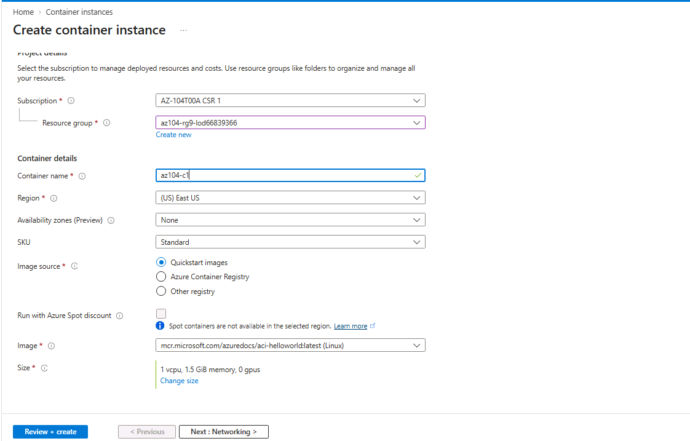

**Container image configuration**

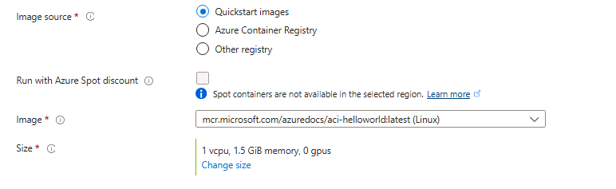

## Part B – Configure Networking

Configure the container to be accessible through a public DNS name.

### Networking Configuration

| Setting          | Value                        |
| ---------------- | ---------------------------- |
| DNS name label   | Custom globally unique value |
| DNS suffix       | `region.azurecontainer.io`   |
| Application port | 80                           |
| Access type      | Public                       |

### Procedure

1. Open the Networking tab.
2. Locate the DNS name label field.
3. Enter a globally unique DNS name label.
4. Ensure the required networking configuration is selected.
5. Continue to the Monitoring tab.

The public endpoint follows this general format:

```text
<dns-name-label>.<region>.azurecontainer.io
```

For example:

```text
az104-aci-demo.eastus.azurecontainer.io
```

The example is illustrative. Use the actual DNS name assigned to your container.

If Azure reports that the DNS name label is unavailable, choose another unique label.

### Screenshot

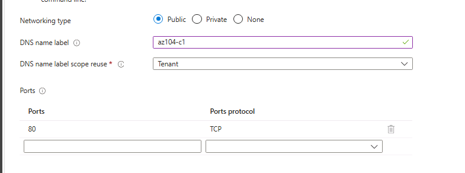

## Part C – Configure Monitoring

1. Open the Monitoring tab.
2. Locate **Enable container instance logs**.
3. Uncheck the option as specified in the original lab.
4. Continue to the Advanced tab.
5. Review the available settings without making additional changes.

### Screenshot

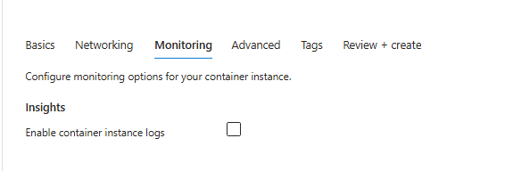

> **Note:** The lab specifically asks to disable this creation-time monitoring option and later inspect the container's Logs page. Follow the portal configuration and verify whether container logs are available in your deployed environment.

## Part D – Review and Deploy

1. Open the Advanced tab.
2. Review the configuration.
3. Select **Review + Create**.
4. Wait for validation to pass.
5. Select **Create**.
6. Wait for the deployment to complete.
7. Open the deployed resource using **Go to resource**.

Container deployment may take approximately 2–3 minutes.

### Screenshots

**Review and create**

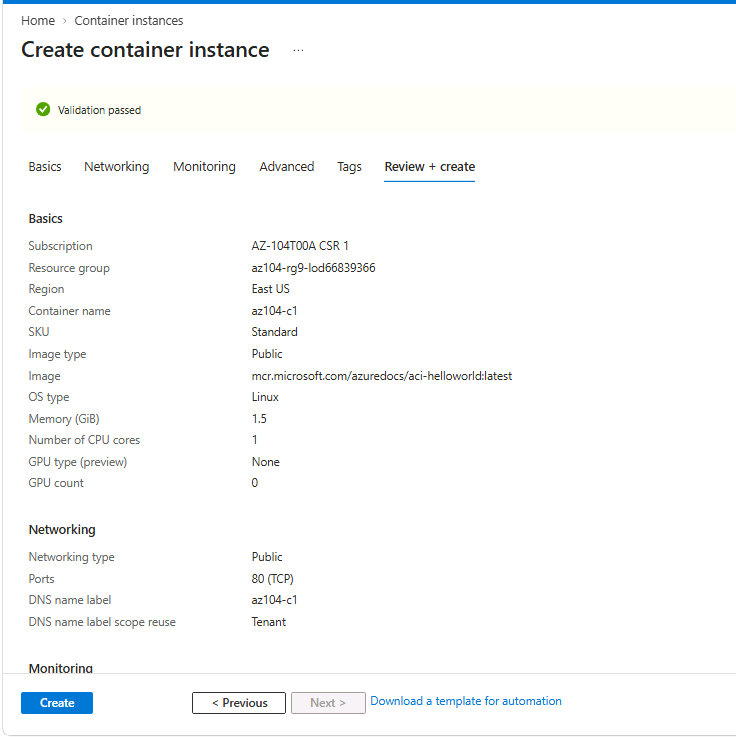

**Deployment success**

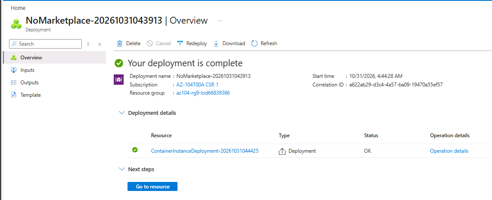

## Key Learning Points

* Azure Container Instances runs containerized applications without requiring VM management.
* Docker images package application code and dependencies.
* Container instances can be deployed directly from supported container images.
* Linux and Windows containers are supported by ACI.
* A public DNS name can provide access to a containerized application.
* Container deployment and application availability should be verified after creation.

---

# Task 2 – Test and Verify Deployment of an Azure Container Instance

## Objective

Verify that the container instance is running, access the deployed web application, and inspect the container logs.

By default, the lab application is accessible over port 80.

## Part A – Verify Container Deployment

1. Open the deployed container instance.

2. Navigate to the Overview blade.

3. Locate the Status field.

4. Verify that the container status is:

   `Running`

5. Review the container instance details.

6. Locate the Fully Qualified Domain Name (FQDN).

7. Copy the FQDN for the next step.

### Screenshots

**Container instance overview**

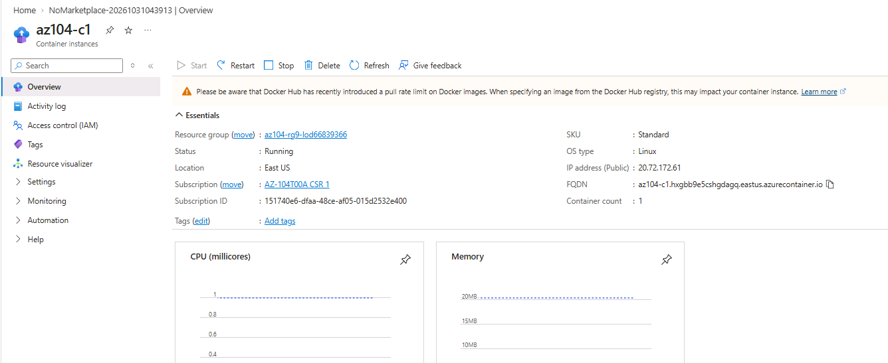

**Container FQDN**

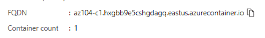

## Part B – Access the Web Application

1. Copy the container instance FQDN.
2. Open a new browser tab.
3. Navigate to the container FQDN using HTTP.
4. Verify that the application page is displayed.

The expected application message is:

**Welcome to Azure Container Instance**

5. Refresh the page several times.
6. Close the browser tab after generating HTTP requests.

### Application URL Format

```text
http://<container-fqdn>
```

The sample application uses port 80 by default.

### Screenshot

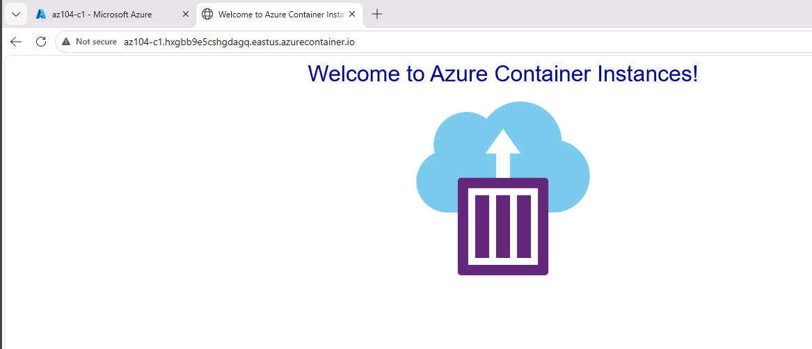

## Part C – Inspect Container Logs

1. Return to the Azure portal.
2. Open the container instance resource.
3. Under Settings, select **Containers**.
4. Select the container.
5. Open the **Logs** section.
6. Review the available log entries.
7. Identify HTTP GET requests generated by accessing the web application.
8. Capture the relevant log output.

### Screenshots

**Container logs overview**

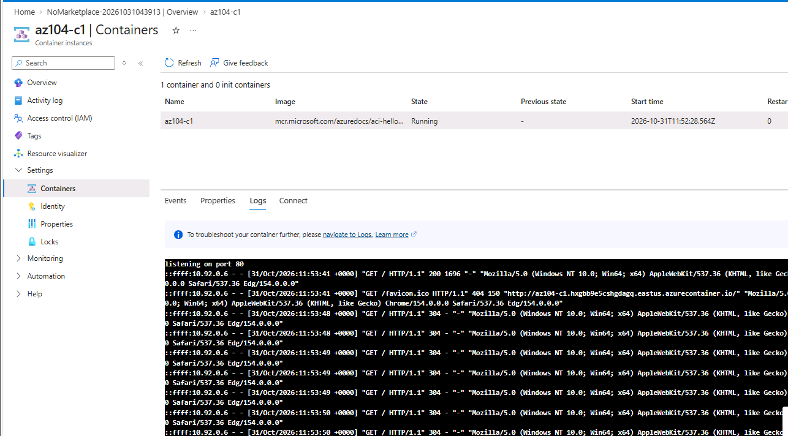

**HTTP GET requests**

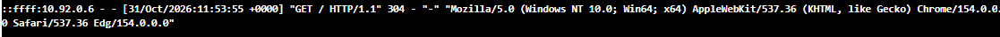

## Expected Results

| Verification         | Expected result                                                      |
| -------------------- | -------------------------------------------------------------------- |
| Container deployment | Successful                                                           |
| Container status     | Running                                                              |
| Container image      | Azure ACI Hello World                                                |
| Networking           | Public                                                               |
| DNS name             | Globally unique FQDN                                                 |
| Application access   | Successful                                                           |
| Application port     | 80                                                                   |
| Application message  | Welcome to Azure Container Instance                                  |
| Container logs       | HTTP GET entries visible, if available in the configured environment |

## Key Learning Points

* Container deployment should be verified through the Azure portal.
* Running status indicates that the container is running.
* A public FQDN provides a hostname for accessing the application.
* Port 80 is used by the sample web application.
* Container logs help administrators inspect application activity.
* HTTP GET entries can be generated by accessing or refreshing the application in a browser.

---

# Important AZ-104 Concepts

| Concept                      | Key takeaway                                                           |
| ---------------------------- | ---------------------------------------------------------------------- |
| Azure Container Instances    | Managed Azure service for running containers                           |
| Docker                       | Platform for packaging and running applications in containers          |
| Container image              | Contains application code and required dependencies                    |
| Container instance           | Running container workload deployed in Azure                           |
| Linux container              | Container using a Linux-based environment                              |
| Public DNS label             | Provides a hostname for accessing the container                        |
| FQDN                         | Fully Qualified Domain Name assigned to the container endpoint         |
| Port 80                      | Default HTTP application port used in this lab                         |
| Container logs               | Provide information about container application activity               |
| PaaS-style container hosting | Allows containers to run without managing underlying VM infrastructure |

## Troubleshooting Notes

### Container Deployment Failure

Possible causes:

* Invalid container image.
* Incorrect resource configuration.
* Regional availability restrictions.
* Subscription limitations.
* Resource deployment errors.

Recommended checks:

1. Review the deployment error details.
2. Confirm the resource group and region.
3. Verify the container image name.
4. Check the Azure Activity Log.
5. Retry deployment if the issue is temporary.

### DNS Name Label Unavailable

Azure requires the DNS name label to be globally unique within the applicable namespace.

If the label is unavailable:

1. Return to the Networking configuration.
2. Choose another DNS name label.
3. Retry validation.
4. Continue with deployment.

### Container Not Running

Check:

* Container deployment status.
* Image availability.
* Container events.
* Container logs.
* Configuration and resource errors.

### Web Application Not Accessible

Check:

* Container status is Running.
* Correct FQDN is being used.
* DNS resolution is successful.
* Application is listening on port 80.
* Public networking is configured.
* The URL uses the expected HTTP protocol.

### Container Logs Not Available

Check:

* The container is running.
* The correct container is selected.
* The Logs page is opened under the Containers settings.
* The creation-time monitoring configuration.
* Whether logs are available for the deployed container.

The original lab instructs disabling the container instance logs option during creation and later checking the container Logs page. If logs are unavailable, record the actual behavior rather than claiming that log verification succeeded.

---

# Lab Completion Summary

| Exercise                    | Expected outcome                              |
| --------------------------- | --------------------------------------------- |
| Create resource group       | Resource group available                      |
| Create container instance   | `az104-c1` deployed                           |
| Select Docker image         | ACI Hello World image configured              |
| Configure Linux container   | Linux selected                                |
| Configure public networking | Public endpoint enabled                       |
| Configure DNS label         | Unique DNS label assigned                     |
| Review deployment           | Validation successful                         |
| Verify container status     | Running                                       |
| Access web application      | Welcome to Azure Container Instance displayed |
| Inspect container logs      | HTTP GET requests identified, if available    |

> **Documentation note:** Record each exercise as completed only after verifying it in your Azure environment.

## Cleanup

To avoid unnecessary Azure charges, delete the lab resources when they are no longer needed.

### Azure Portal

1. Open **Resource groups**.
2. Select `az104-rg9-lod66839366`.
3. Review the resources inside the resource group.
4. Confirm that any required screenshots and evidence have been saved.
5. Select **Delete resource group**.
6. Enter the resource group name.
7. Confirm deletion.
8. Verify that the resource group has been removed.

### Azure PowerShell

```powershell
Remove-AzResourceGroup -Name "az104-rg9-lod66839366"
```

### Azure CLI

```bash
az group delete --name az104-rg9-lod66839366
```

> **Warning:** Deleting the resource group permanently deletes its contained resources. Review the resource list before confirming.

## Additional Learning Resource

* [Run container images in Azure Container Instances](https://learn.microsoft.com/training/modules/create-run-container-images-azure-container-instances/)

## Related Notes

* [Azure Container Instances Fundamentals](notes/azure-container-instances-fundamentals.md)
* [ACI Deployment, Networking and Logs](notes/aci-deployment-networking-and-logs.md)

---

**Lab:** Implement Azure Container Instances
**Focus:** Docker Images, Azure Container Instances, Container Networking, Public DNS, Application Verification, and Container Logs
**Certification:** Microsoft Certified: Azure Administrator Associate (AZ-104)
