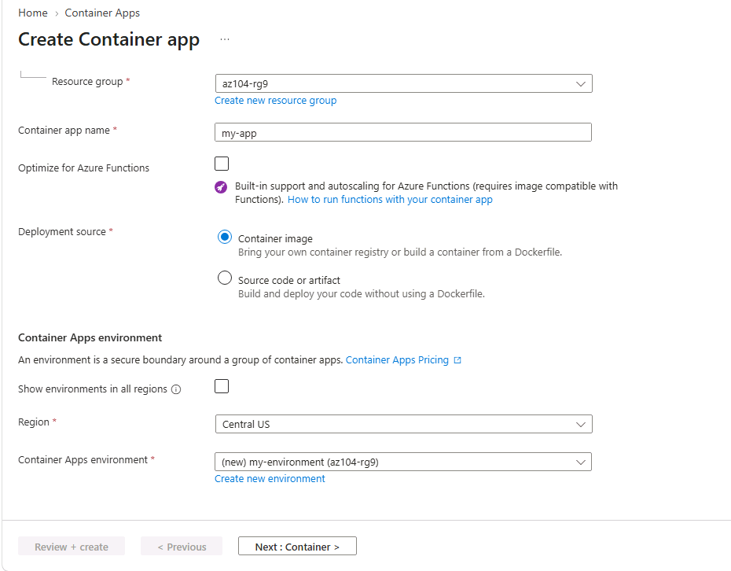
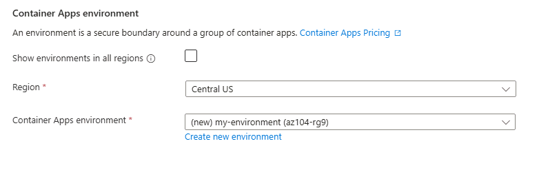
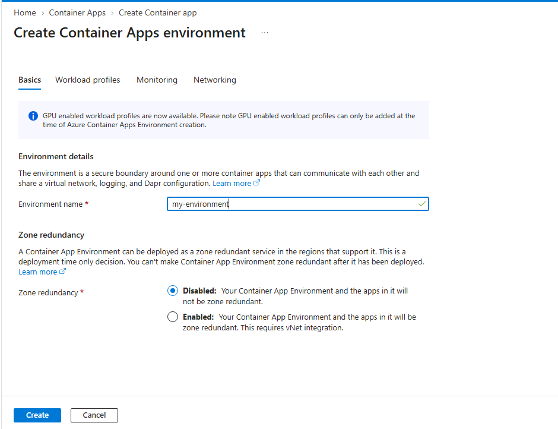
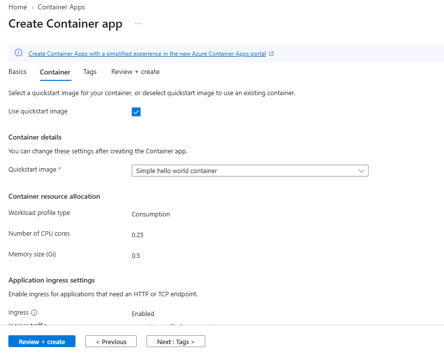
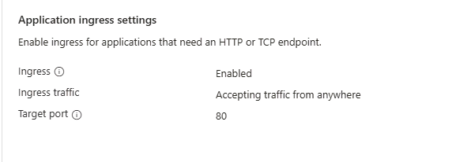
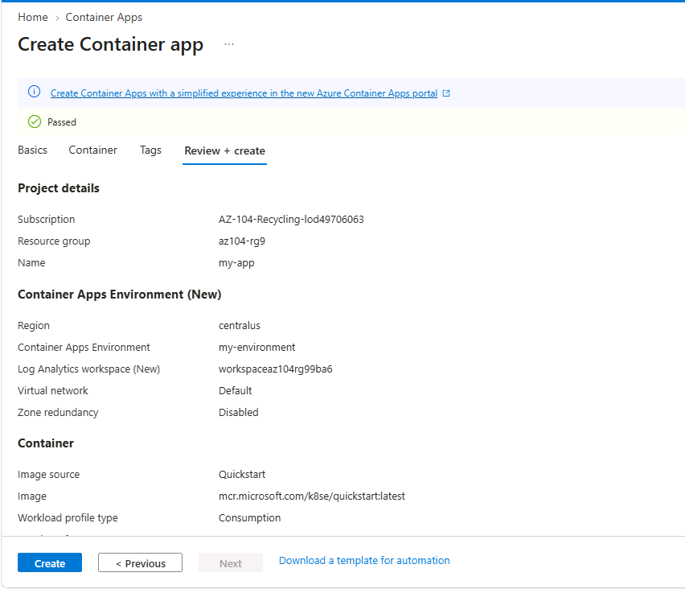
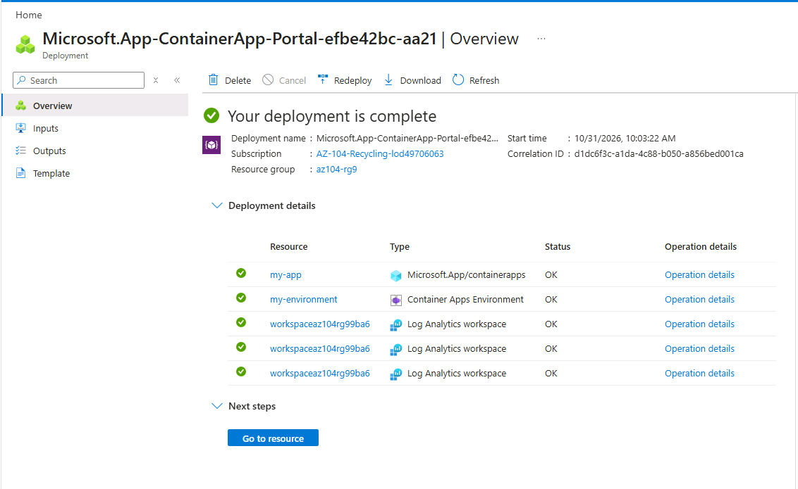
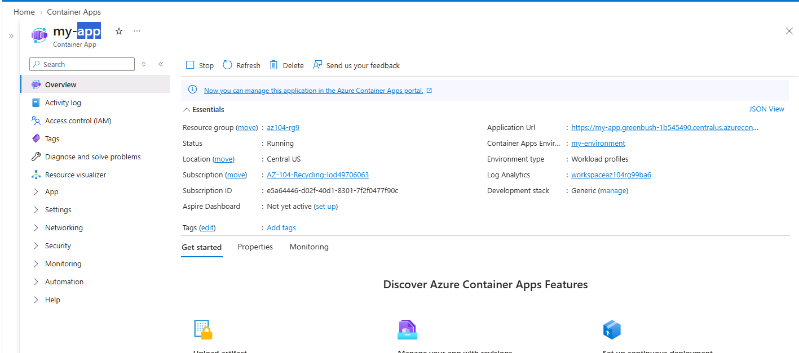
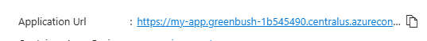
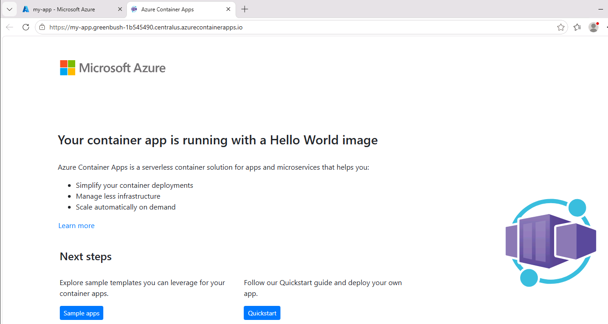

# Lab 12 – Implement Azure Container Apps

## Overview

This lab explores Azure Container Apps (ACA), a serverless platform for deploying and managing containerized applications without directly managing the underlying Kubernetes infrastructure.

The practical exercises demonstrate how to create a Container Apps Environment, deploy a containerized application using a Quickstart image, configure application ingress, and verify the deployed application through its automatically generated Application URL.

The lab uses the Simple Hello World container image provided through the Azure portal.

## Objectives

By completing and documenting this lab, the following Azure administration concepts are explored:

* Understand Azure Container Apps.
* Understand the purpose of a Container Apps Environment.
* Create and configure an Azure Container Apps Environment.
* Deploy a container app using a Quickstart image.
* Configure application ingress.
* Understand the relationship between a container app and its environment.
* Verify successful container app deployment.
* Access a deployed application through its Application URL.
* Understand the serverless container hosting model.
* Compare Azure Container Apps with Azure Kubernetes Service.

## Lab Environment

| Setting                    | Value                                 |
| -------------------------- | ------------------------------------- |
| Azure service              | Azure Container Apps                  |
| Resource group             | `az104-rg9`                           |
| Container App name         | `my-app`                              |
| Region                     | Central US                            |
| Container Apps Environment | `my-environment`                      |
| Image source               | Quickstart image                      |
| Quickstart image           | Simple Hello World container          |
| Application protocol       | HTTP                                  |
| Application port           | 80                                    |
| Application access         | Through the generated Application URL |

> **Environment note:** The original lab uses Central US. If the region is unavailable for your subscription, select another supported Azure region and record the actual region used.

## Repository Structure

```text
12-implement-azure-container-apps/
│
├── README.md
│
├── screenshots/
│   ├── 00-aca-architecture-diagram.png
│   ├── 01-create-container-app-basics.png
│   ├── 02-create-container-app-environment.png
│   ├── 03-container-app-environment-configuration.png
│   ├── 04-quickstart-image-configuration.png
│   ├── 05-container-app-ingress-configuration.png
│   ├── 06-container-app-review-and-create.png
│   ├── 07-container-app-deployment-success.png
│   ├── 08-container-app-overview.png
│   ├── 09-container-app-application-url.png
│   └── 10-hello-world-application.png
│
└── notes/
    ├── azure-container-apps-fundamentals.md
    └── aca-environments-ingress-and-deployment.md
```

---

# Task 1 – Create and Configure an Azure Container App and Environment

## Objective

Create an Azure Container Apps Environment and deploy a containerized application using the Simple Hello World Quickstart image.

Azure Container Apps provides a managed application platform built on Kubernetes technology. It manages the underlying environment and provides additional services that simplify container deployment and operation.

Unlike managing an Azure Kubernetes Service cluster directly, administrators using Azure Container Apps do not need to manage the Kubernetes cluster infrastructure themselves.

## Part A – Configure Container App Basics

### Configuration

| Setting                    | Value                  |
| -------------------------- | ---------------------- |
| Resource group             | `az104-rg9`            |
| Container App name         | `my-app`               |
| Region                     | Central US             |
| Container Apps Environment | Create new environment |
| Environment name           | `my-environment`       |

### Procedure

1. Sign in to the Azure portal.

2. Search for **Container Apps**.

3. Open the Container Apps service.

4. Select **Create**.

5. Choose **Container App**.

6. Select the appropriate Azure subscription.

7. Create or select the resource group:

   `az104-rg9`

8. Enter the Container App name:

   `my-app`

9. Select the region:

   `Central US`

10. Under Container Apps Environment, select **Create new environment**.

11. Enter the environment name:

    `my-environment`

12. Create the environment.

13. Verify that the selected environment is associated with the new container app.

### Screenshots

**Container App basics**



**Create Container Apps Environment**



**Environment configuration**



## Part B – Configure the Container Image

1. Navigate to the **Container** tab.

2. Ensure that **Use quickstart image** is checked.

3. Select the following Quickstart image:

   `Simple hello world container`

4. Review the container configuration.

5. Continue to the next configuration section.

### Configuration

| Setting         | Value                        |
| --------------- | ---------------------------- |
| Image source    | Quickstart image             |
| Image selection | Simple Hello World container |

### Screenshot



## Part C – Configure Application Ingress

Application ingress controls how incoming traffic reaches a container app.

The original lab instructs configuring ingress as needed.

1. Open the application ingress settings.
2. Review the available ingress options.
3. Configure the ingress required for external access to the sample application.
4. Verify that the application configuration is consistent with the sample application's HTTP port 80.
5. Continue to the Tags tab.

> **Important:** The original lab does not specify exact ingress field values. Record the actual ingress configuration selected in your Azure environment. Do not assume internal and external ingress are interchangeable.

### Screenshot



## Part D – Review and Deploy

1. Navigate to the Tags tab.
2. Review the available configuration.
3. Select **Review and create**.
4. Wait for validation to complete.
5. Select **Create**.
6. Wait for the deployment to finish.
7. Select **Go to resource**.

The deployment may take a couple of minutes.

### Screenshots

**Review and Create**



**Deployment success**



## Key Learning Points

* Azure Container Apps provides managed container application hosting.
* A Container Apps Environment provides the environment in which container apps run.
* A container app is associated with a Container Apps Environment.
* Quickstart images simplify initial container deployment.
* Application ingress controls how traffic reaches the application.
* Azure manages the underlying infrastructure and orchestration capabilities.

---

# Task 2 – Test and Verify Deployment of the Azure Container App

## Objective

Verify the deployed container app and access the Hello World application through its generated Application URL.

The lab's sample application accepts traffic on port 80 by default.

Azure Container Apps provides a DNS name for the application.

## Part A – Verify Container App Deployment

1. After deployment, select **Go to resource**.
2. Open the Container App overview.
3. Review the resource details.
4. Locate the Application URL.
5. Verify that the URL is available.
6. Capture the overview page.

### Screenshot



## Part B – Retrieve the Application URL

1. Locate the Application URL on the overview page.
2. Copy the URL.
3. Open a new browser tab.
4. Navigate to the Application URL.
5. Wait for the sample application to load.

### Screenshot



## Part C – Verify the Hello World Application

After opening the Application URL, verify that the page displays:

**Your container app is running with a Hello World image**

This confirms that the deployed containerized application is accessible through its generated endpoint.

### Screenshot



## Expected Results

| Verification             | Expected result               |
| ------------------------ | ----------------------------- |
| Container App deployment | Successful                    |
| Container App name       | `my-app`                      |
| Environment              | `my-environment`              |
| Container image          | Simple Hello World container  |
| Application URL          | Generated by Azure            |
| Application port         | 80                            |
| Application access       | Successful                    |
| Application response     | Hello World message displayed |

## Key Learning Points

* Azure Container Apps generates an Application URL for an appropriately configured application.
* Application ingress determines whether external clients can reach the application.
* The application can be tested through its generated DNS endpoint.
* The sample application uses port 80 by default.
* Verifying the Application URL confirms that the deployed application is reachable.

---

# Important AZ-104 Concepts

| Concept                    | Key takeaway                                                                    |
| -------------------------- | ------------------------------------------------------------------------------- |
| Azure Container Apps       | Managed platform for deploying containerized applications                       |
| Container Apps Environment | Provides the managed environment for container apps                             |
| Container App              | Application resource that runs containerized workloads                          |
| Quickstart image           | Preconfigured image used for initial deployment                                 |
| Ingress                    | Controls incoming application traffic                                           |
| External ingress           | Allows access from outside the Container Apps Environment                       |
| Internal ingress           | Restricts application access to the environment's internal network              |
| Application URL            | DNS endpoint provided for application access                                    |
| Serverless containers      | Run container workloads without directly managing the underlying infrastructure |
| Kubernetes                 | Container orchestration technology used by the platform                         |

## Troubleshooting Notes

### Container App Deployment Failure

Possible causes:

* Region availability restrictions.
* Subscription limitations.
* Environment creation failure.
* Invalid application configuration.
* Resource deployment errors.

Recommended checks:

1. Review the deployment error details.
2. Verify the selected subscription.
3. Check the resource group.
4. Confirm the selected region.
5. Verify that the Container Apps Environment was created successfully.
6. Review the Azure Activity Log.

### Container Apps Environment Creation Failure

Check:

* Environment name.
* Region availability.
* Resource group.
* Subscription permissions.
* Deployment validation errors.

### Application URL Not Available

Possible causes:

* Container App deployment is incomplete.
* Ingress has not been configured.
* The application has not started successfully.
* The container app configuration is incorrect.

Verify the deployment status and ingress configuration.

### Application Not Accessible

Check:

* The Application URL.
* External ingress configuration.
* Application port.
* Container app status.
* Application startup and deployment details.

If internal ingress was selected, the application may not be accessible directly from a public browser.

---

# Lab Completion Summary

| Exercise                          | Expected outcome              |
| --------------------------------- | ----------------------------- |
| Select Azure subscription         | Subscription selected         |
| Create resource group             | `az104-rg9`                   |
| Create Container Apps Environment | `my-environment`              |
| Create Container App              | `my-app`                      |
| Select Quickstart image           | Simple Hello World container  |
| Configure ingress                 | Application access configured |
| Review deployment                 | Validation successful         |
| Deploy container app              | Successful                    |
| Retrieve Application URL          | URL generated                 |
| Access application                | Hello World page displayed    |

> **Documentation note:** Record each exercise as completed only after verifying it in your Azure environment.

## Cleanup

To avoid unnecessary Azure charges, delete the lab resources when they are no longer needed.

### Azure Portal

1. Open **Resource groups**.
2. Select `az104-rg9`.
3. Review the resources within the resource group.
4. Confirm that the screenshots and required evidence have been saved.
5. Select **Delete resource group**.
6. Enter the resource group name.
7. Confirm deletion.
8. Verify that the resource group has been removed.

### Azure PowerShell

```powershell
Remove-AzResourceGroup -Name "az104-rg9"
```

### Azure CLI

```bash
az group delete --name az104-rg9
```

> **Warning:** Deleting the resource group permanently deletes its contained resources. Review the resource list before confirming.

## Additional Learning Resources

* [Configure a container app in Azure Container Apps](https://learn.microsoft.com/training/modules/configure-container-app-azure-container-apps/)
* [Implement Azure Container Apps](https://learn.microsoft.com/training/modules/implement-azure-container-apps/)

## Related Notes

* [Azure Container Apps Fundamentals](notes/azure-container-apps-fundamentals.md)
* [ACA Environments, Ingress and Deployment](notes/aca-environments-ingress-and-deployment.md)

---

**Lab:** Implement Azure Container Apps
**Focus:** Azure Container Apps, Managed Environments, Container Deployment, Application Ingress, and Application Verification
**Certification:** Microsoft Certified: Azure Administrator Associate (AZ-104)
