# 🔍 Lab 14 – Implement Monitoring

<p align="center">
  <b>AZ-104: Microsoft Azure Administrator</b><br>
  Infrastructure Monitoring | Log Analytics | Alerting | Notification Management
</p>

---

## 📌 Overview

Monitoring is an essential part of managing cloud infrastructure. Administrators need visibility into resource performance, operational activities, and unexpected infrastructure changes.

In this lab, Azure Monitor is used to monitor a Windows virtual machine, collect guest-level monitoring data, analyze logs, and configure automated notifications.

The lab also introduces Activity Log alerts and alert processing rules to demonstrate how administrators can detect important infrastructure changes and manage notifications during planned maintenance periods.

### 🎯 Learning Objectives

By completing this lab, the following skills are practiced:

* Deploy monitoring infrastructure using an ARM template.
* Configure Azure Monitor Agent (AMA).
* Understand Data Collection Rules (DCR).
* Work with Azure Log Analytics workspaces.
* Query monitoring data using Kusto Query Language (KQL).
* Verify VM heartbeat and performance data.
* Create Azure Monitor action groups.
* Configure email notifications.
* Create Activity Log alerts.
* Configure alert processing rules.
* Suppress notifications during maintenance periods.
* Trigger and investigate monitoring alerts.

---

## 🏗️ Lab Environment

| Component               | Configuration                    |
| ----------------------- | -------------------------------- |
| Cloud Platform          | Microsoft Azure                  |
| Region                  | East US                          |
| Resource Group          | `az104-rg11`                     |
| Virtual Machine         | `az104-vm0`                      |
| VM Size                 | `Standard_D2s_v5` (if available) |
| Log Analytics Workspace | `az104-law11-*`                  |
| Data Collection Rule    | `az104-dcr11`                    |
| Monitoring Agent        | Azure Monitor Agent              |
| Action Group            | `Alert the operations team`      |
| Alert Rule              | `VM was deleted`                 |
| Alert Processing Rule   | `Planned Maintenance`            |

### 🔧 Services Used

* Azure Monitor
* Log Analytics
* Azure Monitor Agent
* Data Collection Rules
* Azure Monitor Alerts
* Action Groups
* Activity Log
* Alert Processing Rules
* Azure Cloud Shell

---

# 🚀 Task 1 – Deploy the Lab Infrastructure

## Objective

Deploy a virtual machine and the required monitoring resources using a custom ARM template.

### Deployment Template

The lab provides the following template:

```text
az104-11-vm-template.json
```

Template location:

```text
F:\Allfiles\Labs\11\
```

### Deployment Configuration

| Setting        | Value                          |
| -------------- | ------------------------------ |
| Subscription   | Your Azure subscription        |
| Resource Group | `az104-rg11`                   |
| Region         | East US                        |
| VM Size        | `Standard_D2s_v5` if available |
| Username       | `localadmin`                   |
| Password       | A complex password             |

### Deployment Procedure

1. Sign in to the Azure Portal.
2. Search for **Deploy a custom template**.
3. Select **Build your own template in the editor**.
4. Load `az104-11-vm-template.json`.
5. Save the template.
6. Configure the deployment settings.
7. Select **Review + Create**.
8. Select **Create**.
9. Wait for deployment to complete.
10. Open the deployed resource group.

### VM Size Availability

If the selected VM size is unavailable, the lab provides these alternatives:

1. `Standard_D2s_v5`
2. `Standard_D2s_v6`
3. `Standard_D2s_v7`

### Verify Deployed Resources

Open `az104-rg11` and verify the following resources:

| Resource                | Expected Name       |
| ----------------------- | ------------------- |
| Virtual Machine         | `az104-vm0`         |
| Log Analytics Workspace | `az104-law11-*`     |
| Data Collection Rule    | `az104-dcr11`       |
| Virtual Network         | Created by template |
| Network Interface       | Created by template |
| Public IP Address       | Created by template |
| Network Security Group  | Created by template |
| Storage Account         | Created by template |

### Configure Azure Monitor Agent

1. Open `az104-vm0`.
2. Verify the VM is running.
3. Navigate to **Settings → Extensions + applications**.
4. Locate `AzureMonitorWindowsAgent`.
5. Verify its provisioning status.

Expected status:

```text
Provisioning succeeded
```

### Verify Data Collection Rule Association

1. Return to `az104-rg11`.
2. Open `az104-dcr11`.
3. Navigate to **Configuration → Resources**.
4. Verify that `az104-vm0` is associated with the rule.

### 📸 Screenshots

**01 – Custom Template Editor**

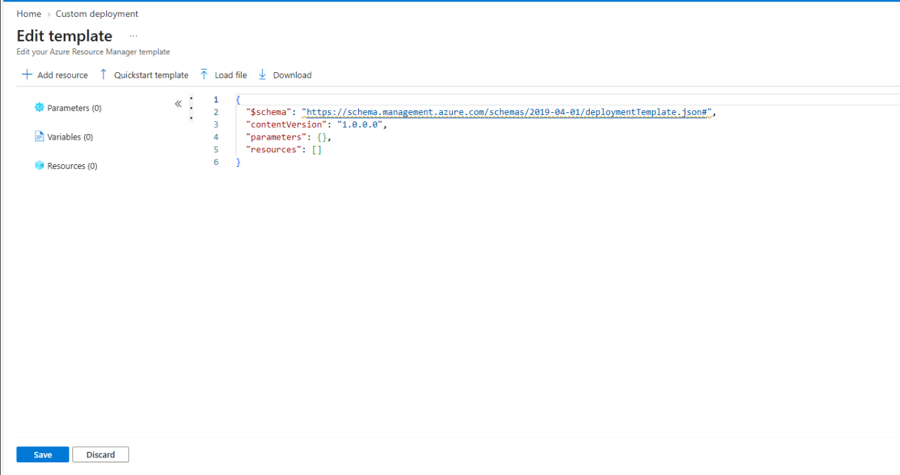

**02 – VM Template Loaded**

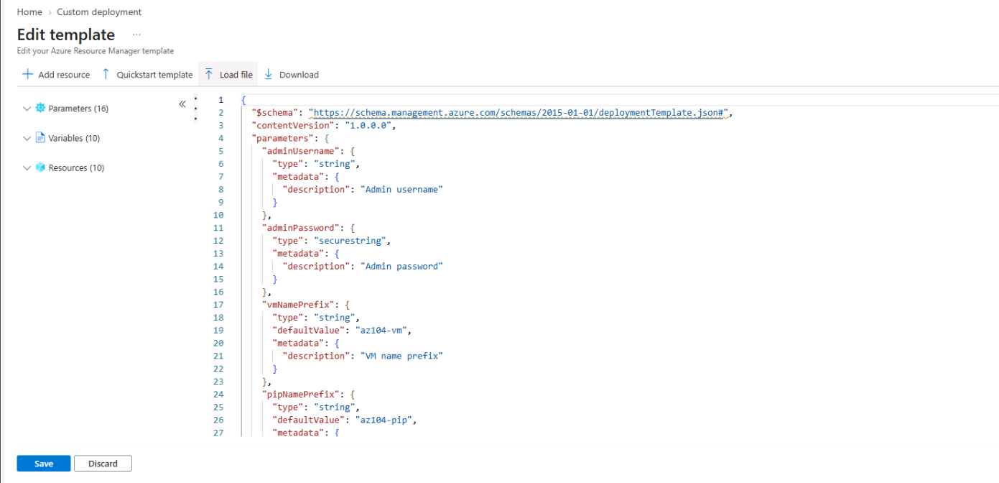

**03 – Infrastructure Deployment Settings**

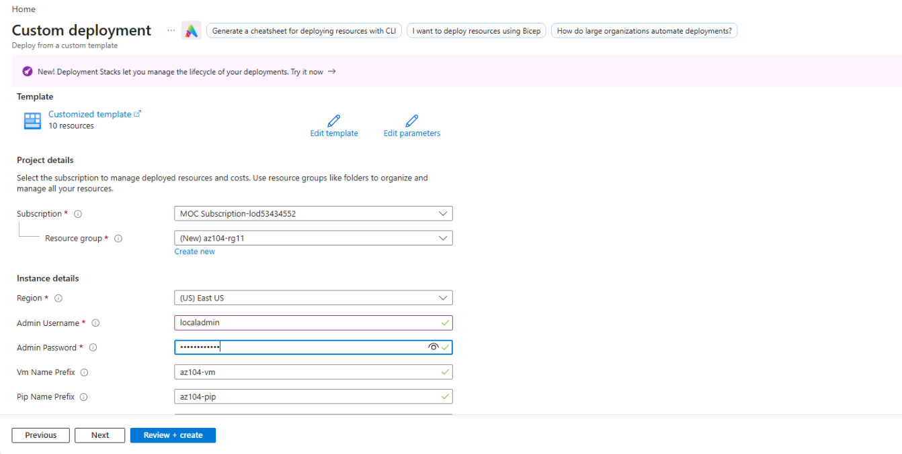

**04 – Infrastructure Deployment Completed**

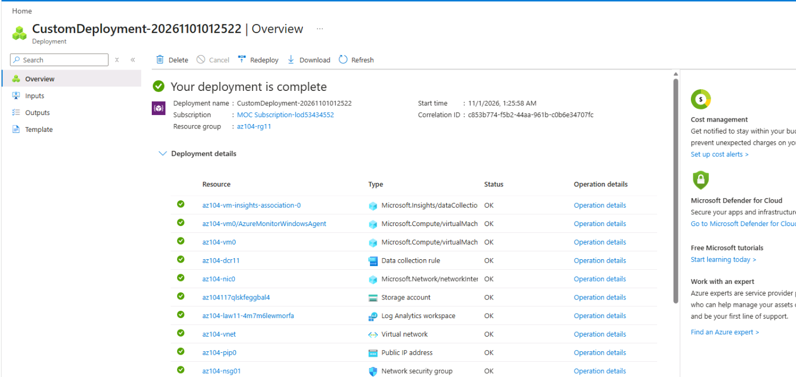

**05 – Deployed Resources Overview**

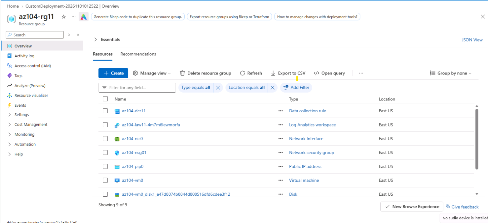

**06 – Azure Monitor Agent Status**

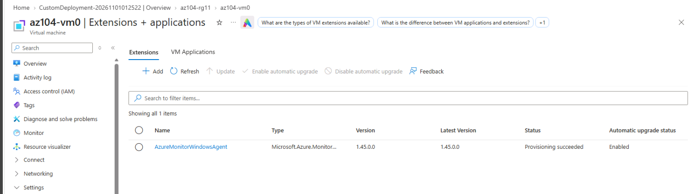

**07 – Data Collection Rule Association**

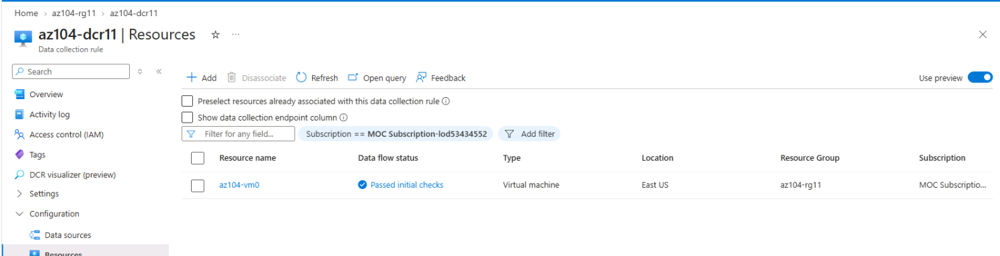

---

# 📊 Task 2 – Verify Monitoring Data with Azure Monitor Logs

## Objective

Verify that Azure Monitor Agent is sending heartbeat and VM performance data to the Log Analytics workspace.

### Open Log Analytics Workspace

1. Open `az104-rg11`.
2. Locate the workspace beginning with `az104-law11-`.
3. Open the workspace.
4. Navigate to **General → Logs**.
5. Close the welcome window or Queries hub if displayed.
6. Switch to **KQL mode** if necessary.

## Query 1 – Verify VM Heartbeat Data

Run the following KQL query:

```kusto
Heartbeat
| where TimeGenerated > ago(30m)
| where Computer =~ "az104-vm0"
| summarize HeartbeatCount = count(),
            LastHeartbeat = max(TimeGenerated)
            by Computer, Category
```

### Query Explanation

| KQL Component | Purpose                         |
| ------------- | ------------------------------- |
| `Heartbeat`   | Reads heartbeat records         |
| `where`       | Filters matching records        |
| `ago(30m)`    | Selects the last 30 minutes     |
| `count()`     | Counts heartbeat records        |
| `max()`       | Finds the latest heartbeat time |
| `summarize`   | Aggregates the results          |

Expected result should contain:

```text
az104-vm0
```

If no records appear, wait approximately five minutes and run the query again. Verify the monitoring agent and DCR association if necessary.

## Query 2 – Verify VM Performance Data

Run the following query:

```kusto
InsightsMetrics
| where TimeGenerated > ago(30m)
| where Computer =~ "az104-vm0"
| where Name == "UtilizationPercentage"
| summarize AverageUtilization = avg(Val)
    by bin(TimeGenerated, 5m), Computer
| render timechart
```

### Query Explanation

| KQL Component      | Purpose                            |
| ------------------ | ---------------------------------- |
| `InsightsMetrics`  | Reads performance records          |
| `TimeGenerated`    | Filters records by time            |
| `Computer`         | Filters the target VM              |
| `Name`             | Selects the utilization metric     |
| `avg(Val)`         | Calculates average utilization     |
| `bin()`            | Groups records into time intervals |
| `render timechart` | Displays a time chart              |

### Verification

Confirm that:

* The heartbeat query returns `az104-vm0`.
* The performance query returns monitoring data.
* The performance time chart is displayed.

> **Important:** Complete both queries before deleting the VM in Task 6. Previously collected records remain available according to the workspace retention period.

### 📸 Screenshots

**08 – Log Analytics Workspace Overview**

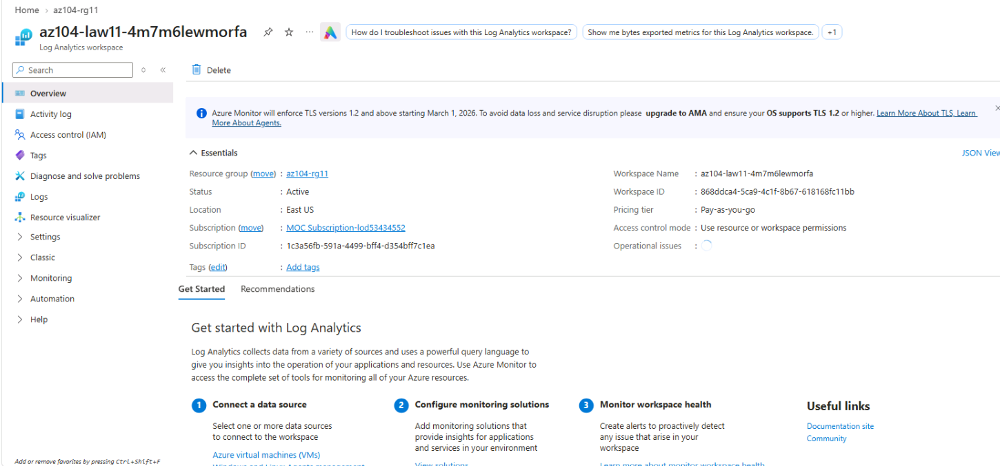

**09 – Heartbeat KQL Query**

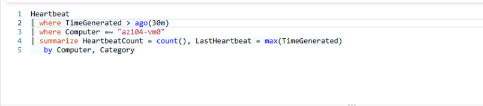

**10 – Heartbeat Query Results**

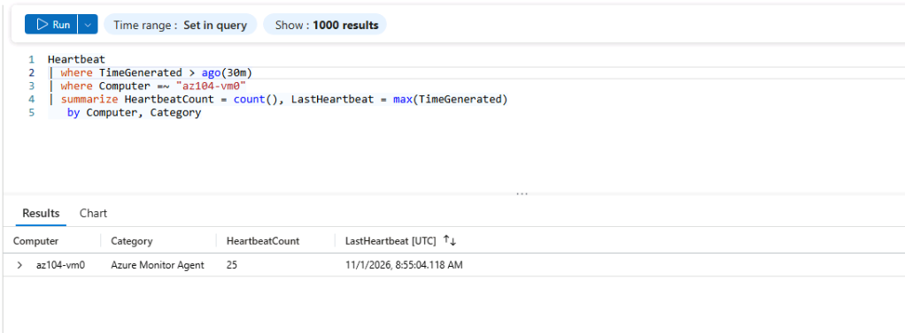

**11 – VM Performance KQL Query**

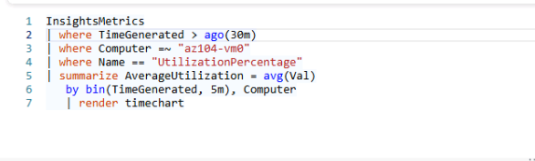

**12 – VM Performance Query Results**

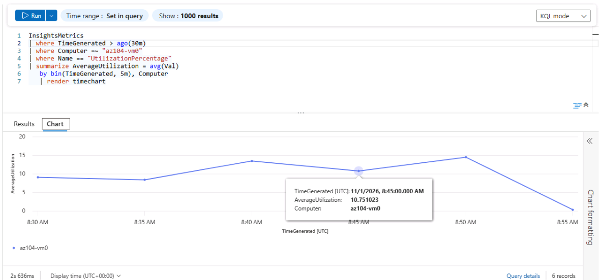

---

# 📧 Task 3 – Create an Action Group

## Objective

Create an Azure Monitor action group that sends email notifications when an alert is triggered.

### Action Group Configuration

| Setting           | Value                       |
| ----------------- | --------------------------- |
| Subscription      | Your Azure subscription     |
| Resource Group    | `az104-rg11`                |
| Region            | Global                      |
| Action Group Name | `Alert the operations team` |
| Display Name      | `AlertOpsTeam`              |

### Configure Email Notification

1. Open Azure Monitor.
2. Navigate to **Alerts → Action groups**.
3. Select **Create**.
4. Enter the action group configuration.
5. Select **Next: Notifications**.
6. Configure the notification:

| Setting           | Value                        |
| ----------------- | ---------------------------- |
| Notification Type | Email/SMS message/Push/Voice |
| Name              | `VM was deleted`             |
| Email             | Your email address           |

7. Select Email.
8. Enter your email address.
9. Select **OK**.
10. Select **Review + Create**.
11. Select **Create**.

### Verification

Confirm that the action group is created and that you receive an email indicating you were added to the action group.

### 📸 Screenshots

**13 – Action Group Basics**

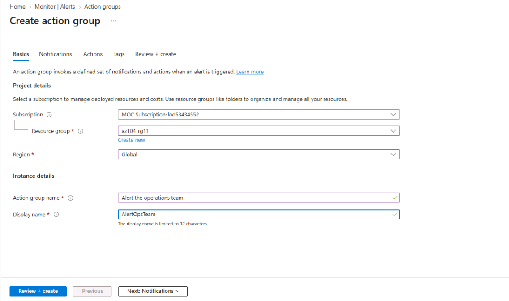

**14 – Action Group Notification Settings**

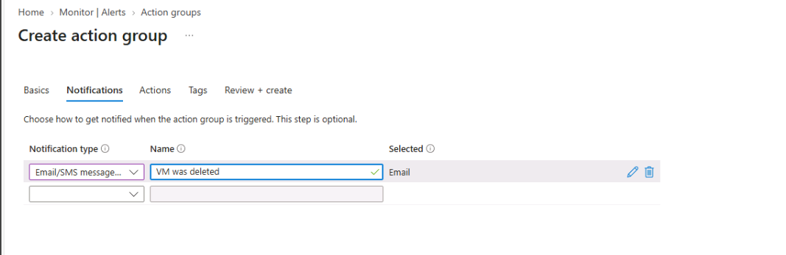

**15 – Action Group Created**

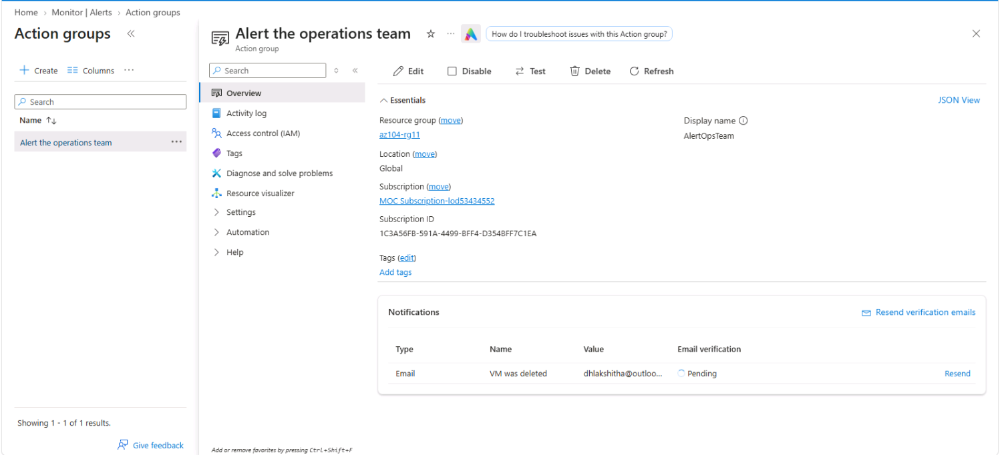

---

# 🚨 Task 4 – Create an Activity Log Alert

## Objective

Create an Activity Log alert that detects when an Azure virtual machine is deleted.

### Important Operation Name

VM deletion is an administrative Activity Log operation, not a VM performance metric.

```text
Microsoft.Compute/virtualMachines/delete
```

### Configure Alert Scope

1. Open **Azure Monitor → Alerts**.
2. Select **Create → Alert rule**.
3. Open the Scope tab.
4. Select your Azure subscription.
5. Select **Apply**.

### Configure Alert Condition

1. Open the Condition tab.
2. Select **See all signals**.
3. Locate:

```text
Delete Virtual Machine (Virtual Machines)
```

4. Select the signal.
5. Select **Apply**.
6. Leave Event level and Status as **All selected**.

### Configure Alert Actions

1. Open the Actions tab.
2. Select **Select action groups**.
3. Select `Alert the operations team`.
4. Select **Select**.

### Configure Alert Details

| Setting                         | Value                                  |
| ------------------------------- | -------------------------------------- |
| Resource Group                  | `az104-rg11`                           |
| Alert Rule Name                 | `VM was deleted`                       |
| Description                     | `A VM in the subscription was deleted` |
| Region                          | Global                                 |
| Enable Alert Rule Upon Creation | Selected                               |

1. Select **Review + Create**.
2. Select **Create**.
3. Navigate to **Azure Monitor → Alerts → Alert rules**.
4. Verify that `VM was deleted` is enabled.

### Optional – Cloud Shell Fallback

If the portal cannot load the Delete Virtual Machine signal, the lab provides an Azure CLI alternative.

```bash
subscriptionId=$(az account show --query id --output tsv)

actionGroupId=$(az monitor action-group show \
  --resource-group az104-rg11 \
  --name "Alert the operations team" \
  --query id \
  --output tsv)

az monitor activity-log alert create \
  --name "VM was deleted" \
  --resource-group az104-rg11 \
  --scope "/subscriptions/$subscriptionId" \
  --condition "category=Administrative and operationName=Microsoft.Compute/virtualMachines/delete" \
  --action-group "$actionGroupId" \
  --description "A VM in the subscription was deleted"
```

After successful execution, return to Azure Monitor and verify that the alert rule is enabled.

### 📸 Screenshots

**16 – Activity Log Alert Condition**

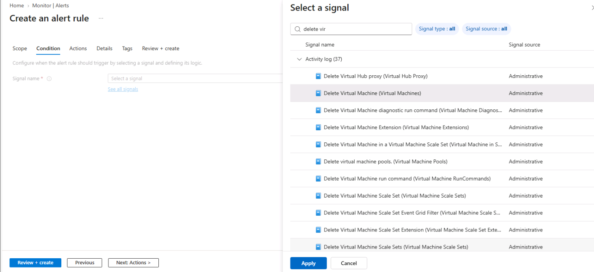

**17 – Activity Log Alert Action Group**

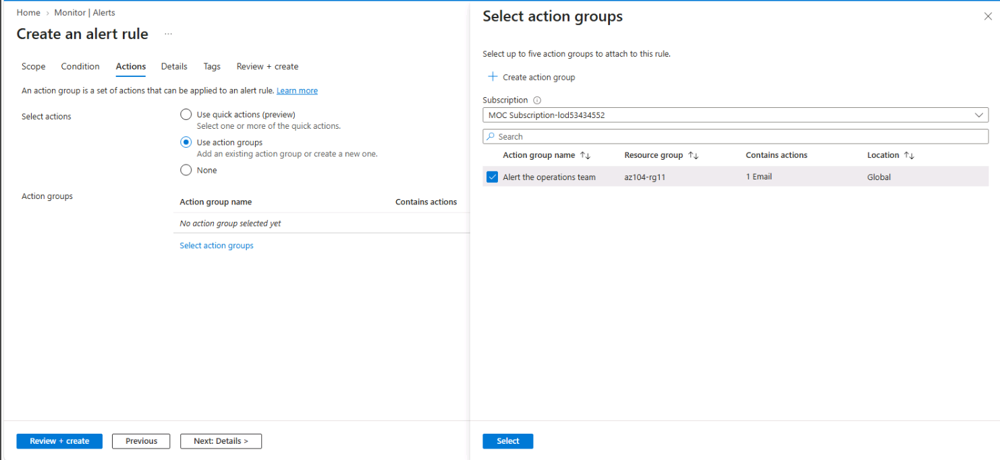

**18 – Activity Log Alert Details**

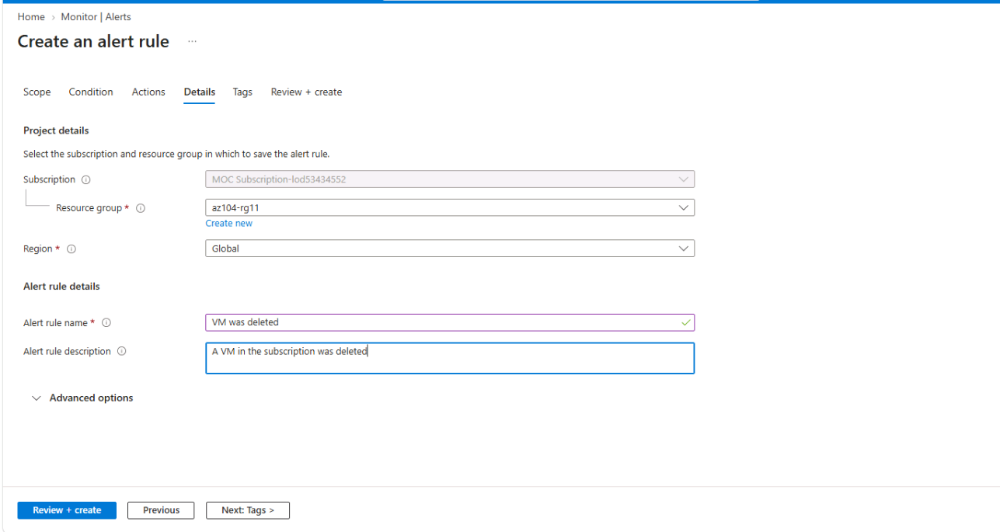

**19 – Activity Log Alert Rule Created**

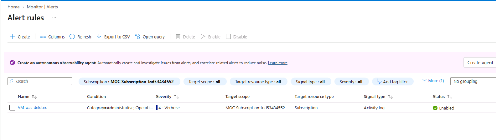

---

# 🛠️ Task 5 – Configure an Alert Processing Rule

## Objective

Configure an alert processing rule to suppress notifications during a planned maintenance period.

### Create Alert Processing Rule

1. Open **Azure Monitor**.
2. Navigate to **Alerts → Alert processing rules**.
3. Select **Create**.
4. Select your subscription under Scope.
5. Select **Apply**.
6. Select **Next: Rule settings**.
7. Choose **Suppress notifications**.

### Configure Maintenance Schedule

| Setting        | Value                      |
| -------------- | -------------------------- |
| Apply the Rule | At a specific time         |
| Start          | Today's date at 10:00 PM   |
| End            | Tomorrow's date at 7:00 AM |
| Time Zone      | Your local time zone       |

### Configure Rule Details

| Setting        | Value                                                |
| -------------- | ---------------------------------------------------- |
| Resource Group | `az104-rg11`                                         |
| Rule Name      | `Planned Maintenance`                                |
| Description    | `Suppress notifications during planned maintenance.` |

1. Select **Review + Create**.
2. Review the configuration.
3. Select **Create**.

> **Note:** Ensure that the current time is outside the suppression schedule before triggering the deletion alert. Otherwise, the notification may be suppressed.

### 📸 Screenshots

**20 – Alert Processing Rule Settings**

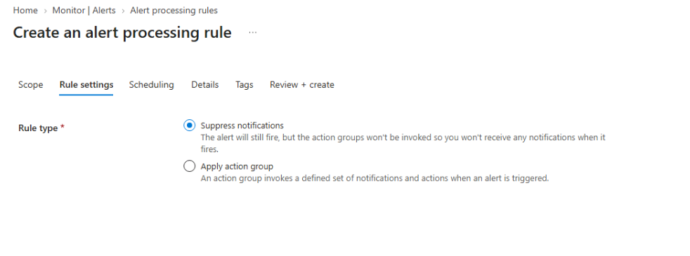

**21 – Alert Processing Rule Schedule**

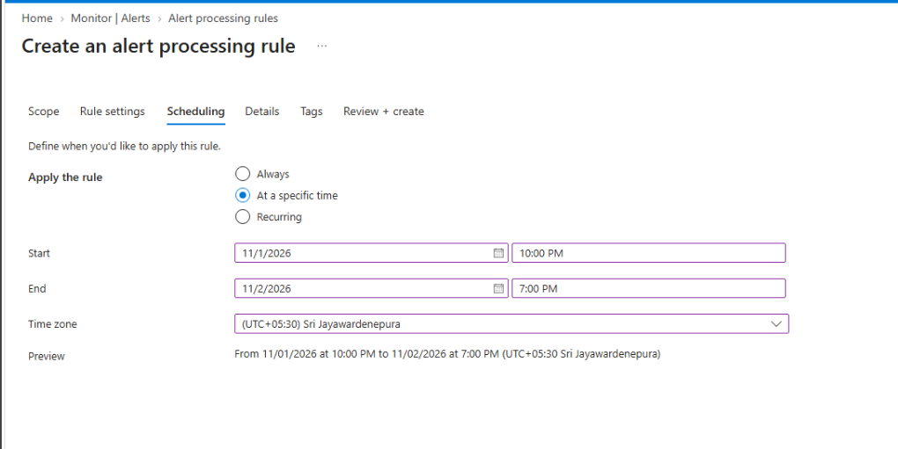

**22 – Alert Processing Rule Created**

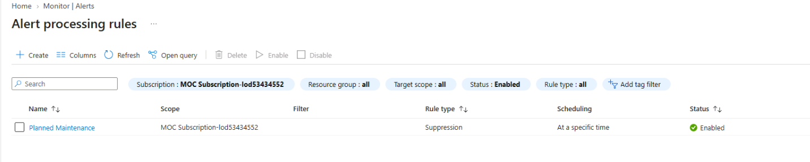

---

# 🔔 Task 6 – Trigger and Verify the Alert

## Objective

Delete the virtual machine to trigger the Activity Log alert and verify the email notification.

> **Warning:** This task permanently deletes the lab virtual machine. Complete Task 2 and verify the monitoring data before continuing.

### Verify Alert Rule

1. Open Azure Monitor.
2. Navigate to **Alerts → Alert rules**.
3. Locate `VM was deleted`.
4. Verify that the alert is enabled.

### Delete the Virtual Machine

1. Search for **Virtual machines**.
2. Locate `az104-vm0`.
3. Select the VM checkbox.
4. Select **Delete**.
5. Review the selected resources.
6. Enter the confirmation text:

```text
delete
```

7. Select **Delete**.
8. Confirm again if prompted.
9. Open the Notifications panel.
10. Wait until the VM deletion completes.

### Verify Email Notification

1. Open the email account configured in the action group.
2. Wait for the Azure Monitor notification.
3. Verify that the notification indicates the `VM was deleted` alert was activated.

### Verify Azure Monitor Alert

1. Return to Azure Monitor.
2. Select **Alerts**.
3. Locate `VM was deleted`.
4. Open the alert.
5. Review the following information:

* Scope
* Condition
* Operation Name
* Status
* History

### 📸 Screenshots

**23 – VM Deletion Operation**

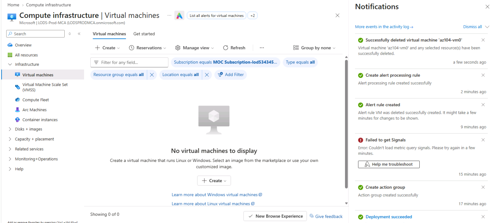

**24 – VM Deletion Completed**

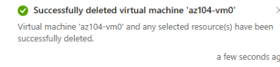

**25 – Activity Log Alert Email**


**26 – Azure Monitor Alert Details**

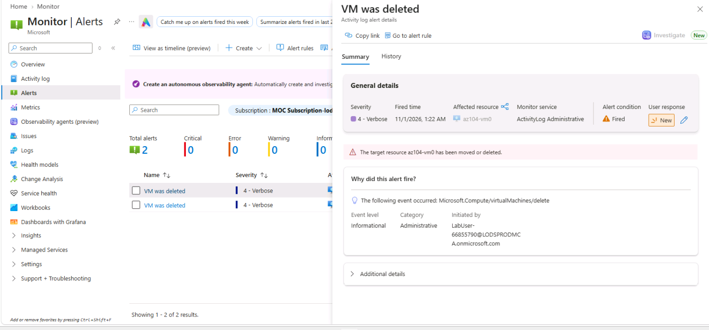

**27 – Alert History and Condition**


---

# 🧠 Key Concepts Learned

| Concept               | Description                                         |
| --------------------- | --------------------------------------------------- |
| Azure Monitor         | Centralized monitoring platform for Azure resources |
| Log Analytics         | Stores and analyzes log data                        |
| Azure Monitor Agent   | Collects monitoring data from supported machines    |
| Data Collection Rule  | Defines what data is collected and where it is sent |
| KQL                   | Query language used to analyze log data             |
| Heartbeat             | Indicates communication from a monitored machine    |
| Action Group          | Defines notification recipients and actions         |
| Activity Log Alert    | Detects supported administrative events             |
| Alert Processing Rule | Controls alert processing and notification delivery |

## Metrics vs Logs vs Activity Logs

| Feature | Metrics                  | Logs                        | Activity Logs             |
| ------- | ------------------------ | --------------------------- | ------------------------- |
| Purpose | Performance measurements | Detailed monitoring records | Administrative events     |
| Example | CPU utilization          | Heartbeat records           | VM deletion               |
| Usage   | Performance analysis     | Investigation               | Track resource operations |

## Action Groups vs Alert Processing Rules

| Action Groups                            | Alert Processing Rules                 |
| ---------------------------------------- | -------------------------------------- |
| Define notification recipients           | Control notification delivery          |
| Send emails and other configured actions | Suppress notifications when applicable |
| Associated with alert rules              | Applied to matching alerts             |

---

# 🔧 Troubleshooting

| Issue                           | Recommended Action                                   |
| ------------------------------- | ---------------------------------------------------- |
| ARM deployment fails            | Verify region, VM size and existing resources        |
| VM is stopped                   | Start the VM                                         |
| Azure Monitor Agent fails       | Review extension provisioning status                 |
| No heartbeat records            | Wait and verify DCR association                      |
| No performance records          | Check agent, DCR and data ingestion                  |
| KQL query returns no results    | Verify VM name and time filter                       |
| Action group email not received | Verify the email address and allow time for delivery |
| Delete VM signal unavailable    | Use the lab's Cloud Shell fallback                   |
| Alert not triggered             | Verify the alert rule is enabled                     |
| Notification suppressed         | Review the processing rule schedule                  |
| Alert not immediately visible   | Allow time for Activity Log processing               |

---

# 🧹 Resource Cleanup

After completing the lab, delete the lab resource group if you are using your own Azure subscription.

Resource group:

```text
az104-rg11
```

### Azure Portal

1. Open Resource Groups.
2. Select `az104-rg11`.
3. Select **Delete resource group**.
4. Enter the resource group name.
5. Confirm deletion.

### Azure PowerShell

```powershell
Remove-AzResourceGroup -Name az104-rg11
```

### Azure CLI

```bash
az group delete --name az104-rg11
```

> **Important:** Resource group deletion permanently removes the resources contained in the group.

---

# ✅ Lab Completion Checklist

* [ ] Deployed monitoring infrastructure.
* [ ] Verified Azure Monitor Agent.
* [ ] Verified Data Collection Rule association.
* [ ] Queried heartbeat data using KQL.
* [ ] Queried VM performance data using KQL.
* [ ] Created an action group.
* [ ] Configured email notifications.
* [ ] Created an Activity Log alert.
* [ ] Configured an alert processing rule.
* [ ] Triggered the alert through VM deletion.
* [ ] Verified the email notification.
* [ ] Reviewed Azure Monitor alert details and history.

**Lab Status:** In Progress / Completed

---

# 📚 Additional Learning Resources

* [Azure Monitor Documentation](https://learn.microsoft.com/azure/azure-monitor/)
* [Azure Monitor Agent](https://learn.microsoft.com/azure/azure-monitor/agents/azure-monitor-agent-overview)
* [Data Collection Rules](https://learn.microsoft.com/azure/azure-monitor/data-collection/data-collection-rule-overview)
* [Log Analytics Workspace](https://learn.microsoft.com/azure/azure-monitor/logs/log-analytics-workspace-overview)
* [Kusto Query Language](https://learn.microsoft.com/kusto/query/)
* [Azure Monitor Alerts](https://learn.microsoft.com/azure/azure-monitor/alerts/alerts-overview)
* [Action Groups](https://learn.microsoft.com/azure/azure-monitor/alerts/action-groups)
* [Alert Processing Rules](https://learn.microsoft.com/azure/azure-monitor/alerts/alerts-processing-rules)

---

<p align="center">
  <b>AZ-104 Microsoft Azure Administrator</b><br>
  Lab 14 – Implement Monitoring<br>
  <i>Monitor. Analyze. Alert. Respond.</i>
</p>
